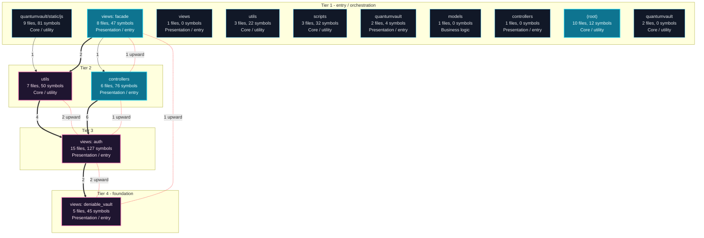
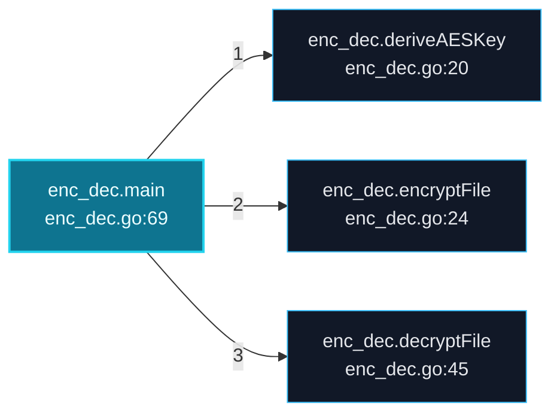
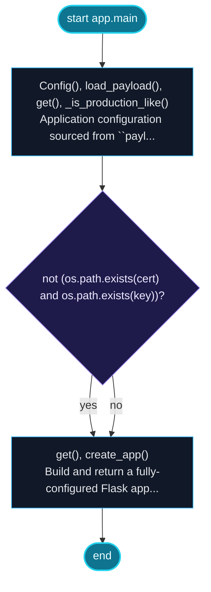
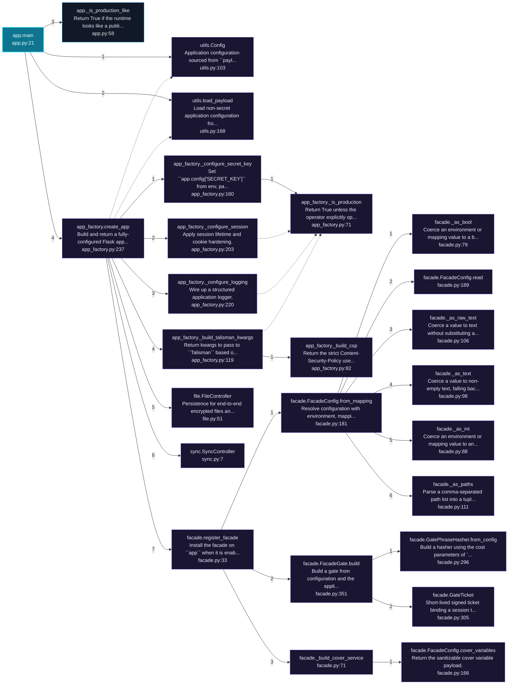
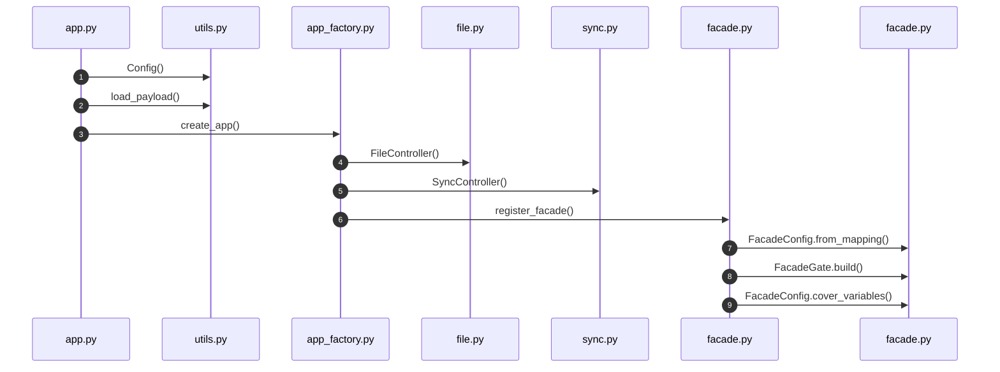

# QuantumVault Architecture and Execution Flows

[Back to index](index.md)

## Architecture Overview

14 components stacked in 4 dependency tiers (weighted Eades-Lin-Smyth ordering: arrows point from dependent to dependency, top to bottom). Labels are import counts, thick arrows the top quartile; 2 transitively implied edges are omitted. Dashed red arrows are upward dependencies: the smallest set of imports that closes every cycle and breaks the layering. Cyan components hold entry points. Interactive version: `readmenator-apidocs/index.html#/flows`.

Upward dependencies to fix first: `views: auth` -> `utils` (2 imports); `views: deniable_vault` -> `views: auth` (2 imports); `views: auth` -> `controllers` (1 imports); `controllers` -> `views: facade` (1 imports); `views: deniable_vault` -> `views: facade` (1 imports)

---

## Execution Flows

Entry points are scored from `__main__` guards, `main` functions, entry-style names and files, and call-graph sources. Each flow walks resolved calls in call-site order (depth <= 4, <= 40 steps); numbers give the call order, dashed arrows revisit an already expanded callee, red arrows are recursion. Interactive version with zoom and per-node docs: `readmenator-apidocs/index.html#/flows`.

### `server.main`

`server.go:11`, score 13: `main` in a compiled-language file; entry-style name `main`; defined in entry file `server.go`.

Call tree:

### `enc_dec.main`

`enc_dec.go:69`, score 12: `main` in a compiled-language file; entry-style name `main`; call-graph source with 3 calls.

Call tree:

### `app.main`

`app.py:21`, score 9: entry-style name `main`; defined in entry file `app.py`; called from the `__main__` guard.

Control flow:

Call tree:

Cross-file sequence:

---
