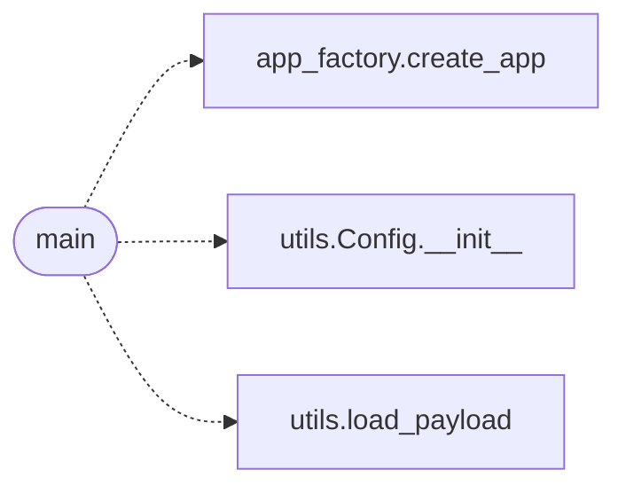

# `app`

> Source: [app.py:1](../../app.py#L1) | language `py` | coverage 50.0% | [API index](../index.md)

Local development entry point.

This script exists for the ``make run`` workflow: the Werkzeug dev
server with SSL on the loopback port. It is the only place in the
codebase where the dev server is started. Production deployments use
``wsgi.py`` and gunicorn instead.

The Werkzeug interactive debugger is intentionally NOT enabled: even
with ``FLASK_DEBUG=1`` we never want the debug PIN surface exposed on
a network-reachable port. To get a debugger for local work, run the
app under an IDE debugger against this file.

## Contents

- **Functions:** [`main`](#main)

## Call Graph

Solid arrows stay in this module, dashed arrows leave it.



## Functions

<a id="main"></a>

### `main`

`function` | [app.py:21](../../app.py#L21)

```python
def main() -> None
```

*Calls:* [`create_app`](quantumvault.app_factory.py.md#create_app), [`Config.__init__`](utils.utils.py.md#config-__init__), [`load_payload`](utils.utils.py.md#load_payload)

---
