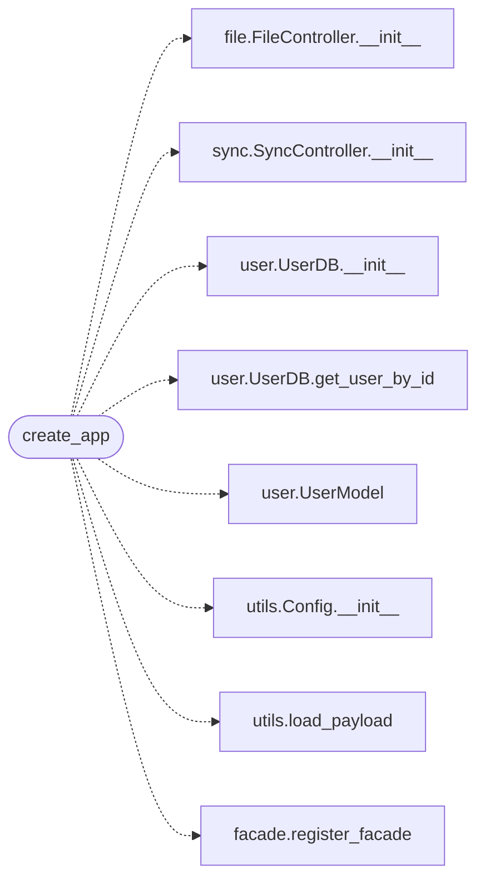

# `app_factory`

> Source: [app_factory.py:1](../../app_factory.py#L1) | language `py` | coverage 100.0% | [API index](../index.md)

Application factory for QuantumVault.

The same `[`create_app`](#create_app)` callable powers:

- ``app.py`` (dev: ``flask run`` or Werkzeug's dev server with debug)
- ``wsgi.py`` (prod: gunicorn / uWSGI behind a reverse proxy)

The factory enforces three things that the old ``app.py``-as-script
pattern could not:

1. No Werkzeug debug PIN is ever exposed. Debug mode is gated on the
   ``FLASK_DEBUG`` environment variable and the Werkzeug debugger is
   disabled regardless.
2. Security headers (CSP, HSTS, X-Frame-Options, etc.) are installed
   via Flask-Talisman in production. The strict policy is the default;
   tests can override ``security_overrides`` to relax specific headers.
3. The session cookie is hardened: HttpOnly, SameSite=Lax, Secure when
   the request is HTTPS. ``PERMANENT_SESSION_LIFETIME`` caps the
   idle/absolute lifetime so an unattended browser does not retain
   auth indefinitely.

Keeping every global side-effect (``app.config[...]``, blueprint
registration, extension init) inside the factory means importing
``quantumvault.app_factory`` is free of side effects. That property
matters because ``gunicorn`` forks workers and a top-level ``app =
create_app()`` in a module would import-time-bind the app to the
parent process and re-execute initialization in each worker.

## Contents

- **Functions:** [`create_app`](#create_app)
- **Constants:** [`DEFAULT_ALLOWED_ORIGINS`](#default_allowed_origins)

## Call Graph

Solid arrows stay in this module, dashed arrows leave it.



## Functions

<a id="create_app"></a>

### `create_app`

`function` | [app_factory.py:237](../../app_factory.py#L237)

```python
def create_app(config_overrides: Optional[dict[str, Any]] = None, security_overrides: Optional[dict[str, Any]] = None) -> Flask
```

Build and return a fully-configured Flask application.

**Parameters**

| Name | Type | Default | Description |
|---|---|---|---|
| `config_overrides` | `Optional[dict[str, Any]]` | `None` | Values to merge into ``app.config`` after defaults are applied. Useful for tests that need to swap the database path or disable the rate limiter. |
| `security_overrides` | `Optional[dict[str, Any]]` | `None` | Values to merge into the Talisman kwargs. Used by tests to disable CSP and the HTTPS redirect without forking the whole factory. |

**Returns:** `Flask` - A Flask application ready to be served by gunicorn or the
Werkzeug dev server.

*Calls:* [`FileController.__init__`](controllers.file.py.md#filecontroller-__init__), [`SyncController.__init__`](controllers.sync.py.md#synccontroller-__init__), [`UserDB.__init__`](models.user.py.md#userdb-__init__), [`UserDB.get_user_by_id`](models.user.py.md#userdb-get_user_by_id), [`UserModel`](models.user.py.md#usermodel), [`Config.__init__`](utils.utils.py.md#config-__init__), [`load_payload`](utils.utils.py.md#load_payload), [`register_facade`](views.facade.py.md#register_facade)

*Called by:* [`main`](app.py.md#main)

---

## Constants

<a id="default_allowed_origins"></a>

### `DEFAULT_ALLOWED_ORIGINS`

`constant` | [app_factory.py:61](../../app_factory.py#L61)

```python
DEFAULT_ALLOWED_ORIGINS
```

---
