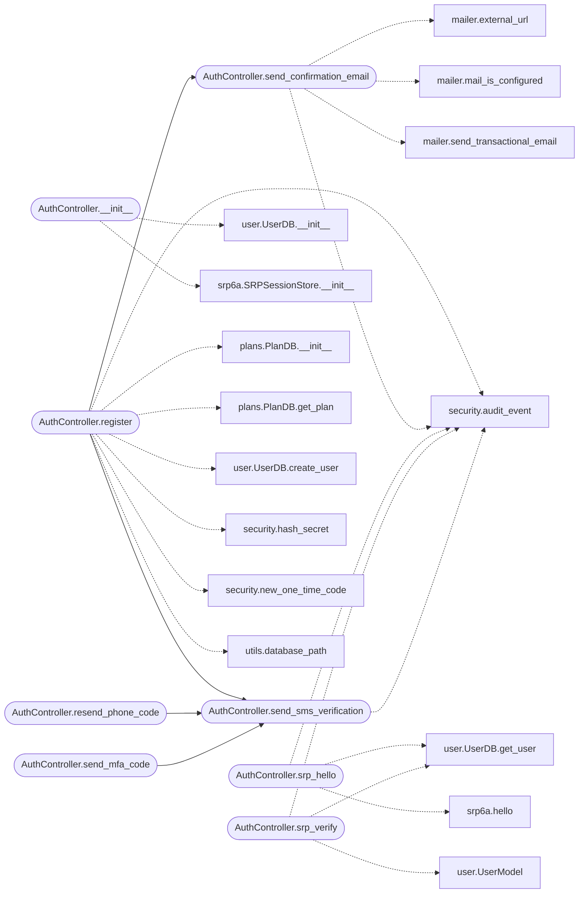

# `controllers.auth`

> Source: [controllers/auth.py:1](../../controllers/auth.py#L1) | language `py` | coverage 100.0% | [API index](../index.md)

Zero-knowledge authentication controller for QuantumVault.

Registration accepts cryptographic material that the browser generated
and stores it verbatim: the SRP salt and verifier, the user's public
key, the password-encrypted private key blob, and the KDF salt. The
server never sees the password or any private key. Login is a Secure
Remote Password (SRP-6a) challenge/response (see [`utils.srp6a`](utils.srp6a.py.md))
so the password is never transmitted.

Phone verification codes, MFA codes, and recovery codes are never
stored in plaintext. They are hashed with a server-side pepper via
[`utils.security.hash_secret`](utils.security.py.md#hash_secret) so a database leak does not hand
the attacker ready-to-use codes.

## Contents

- **Classes:** [`AuthController`](#authcontroller)
- **Constants:** [`DISALLOWED_USERNAME_CHARS`](#disallowed_username_chars)

## Call Graph

Solid arrows stay in this module, dashed arrows leave it.



## Classes

<a id="authcontroller"></a>

### `AuthController`

`class` | [controllers/auth.py:58](../../controllers/auth.py#L58)

```python
class AuthController
```

Handles zero-knowledge registration and SRP-6a authentication.

**Members**

| Member | Kind | Summary |
|---|---|---|
| [`__init__`](#authcontroller-__init__) | constructor | Initialize the controller. |
| [`register`](#authcontroller-register) | method | Register a user from client-generated zero-knowledge credentials. |
| [`send_confirmation_email`](#authcontroller-send_confirmation_email) | method | Email the account-confirmation link to a freshly registered user. |
| [`srp_hello`](#authcontroller-srp_hello) | method | Begin an SRP-6a login and return the salt and server challenge B. |
| [`srp_verify`](#authcontroller-srp_verify) | method | Complete an SRP-6a login and return the authenticated user and proof. |
| [`send_sms_verification`](#authcontroller-send_sms_verification) | method | Send a verification code via SMS. |
| [`verify_phone_code`](#authcontroller-verify_phone_code) | method | Verify a phone verification code for a user. |
| [`resend_phone_code`](#authcontroller-resend_phone_code) | method | Issue and send a fresh phone verification code. |
| [`verify_mfa_code`](#authcontroller-verify_mfa_code) | method | Verify a multi-factor authentication code for a user. |
| [`send_mfa_code`](#authcontroller-send_mfa_code) | method | Generate, store, and send an MFA code to the user's phone. |
| [`toggle_mfa`](#authcontroller-toggle_mfa) | method | Enable or disable MFA for a user. |

<a id="authcontroller-__init__"></a>

#### `AuthController.__init__`

`constructor` | [controllers/auth.py:61](../../controllers/auth.py#L61)

```python
def __init__(self, db_path: str, mail: Mail, storage_uri: str)
```

Initialize the controller.

**Parameters**

| Name | Type | Default | Description |
|---|---|---|---|
| `db_path` | `str` |  | Path to the SQLite user database. |
| `mail` | `Mail` |  | Configured Flask-Mail instance for transactional email. |
| `storage_uri` | `str` |  | Redis URI backing the ephemeral SRP session store. |

*Calls:* [`UserDB.__init__`](models.user.py.md#userdb-__init__), [`SRPSessionStore.__init__`](utils.srp6a.py.md#srpsessionstore-__init__)

*Called by:* [`get_auth_controller`](views.auth.py.md#get_auth_controller)

<a id="authcontroller-register"></a>

#### `AuthController.register`

`method` | [controllers/auth.py:76](../../controllers/auth.py#L76)

```python
def register(self, username: str, srp_salt: str, srp_verifier: str, public_key: str, encrypted_private_key: str, kdf_salt: str, email: str, phone: str, first_name: str, last_name: str, recovery_salt: Optional[str] = None, encrypted_private_key_recovery: Optional[str] = None) -> bool
```

Register a user from client-generated zero-knowledge credentials.

**Parameters**

| Name | Type | Default | Description |
|---|---|---|---|
| `username` | `str` |  | The desired unique username. |
| `srp_salt` | `str` |  | SRP salt (hex) generated on the client. |
| `srp_verifier` | `str` |  | SRP verifier (hex) generated on the client. |
| `public_key` | `str` |  | The user's hybrid public key blob (opaque). |
| `encrypted_private_key` | `str` |  | The password-encrypted private key blob (opaque). |
| `kdf_salt` | `str` |  | Salt (hex) for the client-side key derivation function. |
| `email` | `str` |  | The user's email address. |
| `phone` | `str` |  | The user's phone number. |
| `first_name` | `str` |  | The user's first name. |
| `last_name` | `str` |  | The user's last name. |
| `recovery_salt` | `Optional[str]` | `None` | Optional QV-RECOVERY-1 PBKDF2 salt (hex), generated on the client. |
| `encrypted_private_key_recovery` | `Optional[str]` | `None` | Optional QV-RECOVERY-1 AES-256-GCM wrapping of the same private key blob, keyed by a client-generated recovery code instead of the password. |

**Returns:** `bool` - True on success, False if validation fails or persistence errors.

*Calls:* [`AuthController.send_confirmation_email`](#authcontroller-send_confirmation_email), [`AuthController.send_sms_verification`](#authcontroller-send_sms_verification), [`PlanDB.__init__`](models.plans.py.md#plandb-__init__), [`PlanDB.get_plan`](models.plans.py.md#plandb-get_plan), [`UserDB.create_user`](models.user.py.md#userdb-create_user), [`audit_event`](utils.security.py.md#audit_event), [`hash_secret`](utils.security.py.md#hash_secret), [`new_one_time_code`](utils.security.py.md#new_one_time_code), [`database_path`](utils.utils.py.md#database_path)

<a id="authcontroller-send_confirmation_email"></a>

#### `AuthController.send_confirmation_email`

`method` | [controllers/auth.py:156](../../controllers/auth.py#L156)

```python
def send_confirmation_email(self, email: str, username: str, token: str) -> bool
```

Email the account-confirmation link to a freshly registered user.

The link targets [`views.auth.confirm_email`](views.auth.py.md#confirm_email). When SMTP is not
configured, or the send fails, the link is logged at WARNING so an
operator can still verify the account from the server logs; this keeps
local and bare-VPS deployments usable before mail credentials exist.

**Parameters**

| Name | Type | Default | Description |
|---|---|---|---|
| `email` | `str` |  | The recipient address. |
| `username` | `str` |  | The account username (used for the greeting). |
| `token` | `str` |  | The single-use confirmation token stored on the account. |

**Returns:** `bool` - True if the mail server accepted the message, False otherwise.

*Calls:* [`external_url`](utils.mailer.py.md#external_url), [`mail_is_configured`](utils.mailer.py.md#mail_is_configured), [`send_transactional_email`](utils.mailer.py.md#send_transactional_email), [`audit_event`](utils.security.py.md#audit_event)

*Called by:* [`AuthController.register`](#authcontroller-register)

<a id="authcontroller-srp_hello"></a>

#### `AuthController.srp_hello`

`method` | [controllers/auth.py:202](../../controllers/auth.py#L202)

```python
def srp_hello(self, username: str, client_a_hex: str) -> Optional[Tuple[str, str]]
```

Begin an SRP-6a login and return the salt and server challenge B.

**Parameters**

| Name | Type | Default | Description |
|---|---|---|---|
| `username` | `str` |  |  |
| `client_a_hex` | `str` |  |  |

**Returns:** `Optional[Tuple[str, str]]`

*Calls:* [`UserDB.get_user`](models.user.py.md#userdb-get_user), [`audit_event`](utils.security.py.md#audit_event), [`hello`](utils.srp6a.py.md#hello)

<a id="authcontroller-srp_verify"></a>

#### `AuthController.srp_verify`

`method` | [controllers/auth.py:221](../../controllers/auth.py#L221)

```python
def srp_verify(self, username: str, client_m1_hex: str) -> Optional[Tuple[UserModel, str]]
```

Complete an SRP-6a login and return the authenticated user and proof.

**Parameters**

| Name | Type | Default | Description |
|---|---|---|---|
| `username` | `str` |  |  |
| `client_m1_hex` | `str` |  |  |

**Returns:** `Optional[Tuple[UserModel, str]]`

*Calls:* [`UserDB.get_user`](models.user.py.md#userdb-get_user), [`UserModel`](models.user.py.md#usermodel), [`audit_event`](utils.security.py.md#audit_event)

<a id="authcontroller-send_sms_verification"></a>

#### `AuthController.send_sms_verification`

`method` | [controllers/auth.py:253](../../controllers/auth.py#L253)

```python
def send_sms_verification(self, phone: str, code: str, username: str = '') -> bool
```

Send a verification code via SMS.

**Parameters**

| Name | Type | Default | Description |
|---|---|---|---|
| `phone` | `str` |  |  |
| `code` | `str` |  |  |
| `username` | `str` | `''` |  |

**Returns:** `bool`

*Calls:* [`audit_event`](utils.security.py.md#audit_event)

*Called by:* [`AuthController.register`](#authcontroller-register), [`AuthController.resend_phone_code`](#authcontroller-resend_phone_code), [`AuthController.send_mfa_code`](#authcontroller-send_mfa_code)

<a id="authcontroller-verify_phone_code"></a>

#### `AuthController.verify_phone_code`

`method` | [controllers/auth.py:274](../../controllers/auth.py#L274)

```python
def verify_phone_code(self, username: str, code: str) -> bool
```

Verify a phone verification code for a user.

The stored value is the peppered hash; the supplied code is
hashed in the same way and the two digests are compared in
constant time.

**Parameters**

| Name | Type | Default | Description |
|---|---|---|---|
| `username` | `str` |  |  |
| `code` | `str` |  |  |

**Returns:** `bool`

*Calls:* [`UserDB.get_user`](models.user.py.md#userdb-get_user), [`UserDB.update_user_phone_status`](models.user.py.md#userdb-update_user_phone_status), [`audit_event`](utils.security.py.md#audit_event), [`verify_secret`](utils.security.py.md#verify_secret)

<a id="authcontroller-resend_phone_code"></a>

#### `AuthController.resend_phone_code`

`method` | [controllers/auth.py:310](../../controllers/auth.py#L310)

```python
def resend_phone_code(self, username: str) -> bool
```

Issue and send a fresh phone verification code.

Generates a new one-time code, stores its peppered hash with a
30-minute expiry (overwriting any previous pending code), and
dispatches it by SMS. Returns False when the account is unknown,
has no phone number, is already verified, or the SMS provider is
not configured, so the caller can surface an honest result.

**Parameters**

| Name | Type | Default | Description |
|---|---|---|---|
| `username` | `str` |  | The account requesting a new code. |

**Returns:** `bool` - True if a new code was generated, stored, and accepted by the
SMS provider; False otherwise.

*Calls:* [`AuthController.send_sms_verification`](#authcontroller-send_sms_verification), [`UserDB.get_user`](models.user.py.md#userdb-get_user), [`UserDB.update_user_phone_status`](models.user.py.md#userdb-update_user_phone_status), [`audit_event`](utils.security.py.md#audit_event), [`hash_secret`](utils.security.py.md#hash_secret), [`new_one_time_code`](utils.security.py.md#new_one_time_code)

<a id="authcontroller-verify_mfa_code"></a>

#### `AuthController.verify_mfa_code`

`method` | [controllers/auth.py:369](../../controllers/auth.py#L369)

```python
def verify_mfa_code(self, username: str, code: str) -> bool
```

Verify a multi-factor authentication code for a user.

**Parameters**

| Name | Type | Default | Description |
|---|---|---|---|
| `username` | `str` |  |  |
| `code` | `str` |  |  |

**Returns:** `bool`

*Calls:* [`UserDB.get_user`](models.user.py.md#userdb-get_user), [`UserDB.update_user_mfa_status`](models.user.py.md#userdb-update_user_mfa_status), [`audit_event`](utils.security.py.md#audit_event), [`verify_secret`](utils.security.py.md#verify_secret)

<a id="authcontroller-send_mfa_code"></a>

#### `AuthController.send_mfa_code`

`method` | [controllers/auth.py:393](../../controllers/auth.py#L393)

```python
def send_mfa_code(self, username: str) -> bool
```

Generate, store, and send an MFA code to the user's phone.

**Parameters**

| Name | Type | Default | Description |
|---|---|---|---|
| `username` | `str` |  |  |

**Returns:** `bool`

*Calls:* [`AuthController.send_sms_verification`](#authcontroller-send_sms_verification), [`UserDB.get_user`](models.user.py.md#userdb-get_user), [`UserDB.update_user_mfa_status`](models.user.py.md#userdb-update_user_mfa_status), [`audit_event`](utils.security.py.md#audit_event), [`hash_secret`](utils.security.py.md#hash_secret), [`new_one_time_code`](utils.security.py.md#new_one_time_code)

<a id="authcontroller-toggle_mfa"></a>

#### `AuthController.toggle_mfa`

`method` | [controllers/auth.py:416](../../controllers/auth.py#L416)

```python
def toggle_mfa(self, username: str, enable: bool) -> None
```

Enable or disable MFA for a user.

**Parameters**

| Name | Type | Default | Description |
|---|---|---|---|
| `username` | `str` |  |  |
| `enable` | `bool` |  |  |

*Calls:* [`UserDB.update_user_mfa_status`](models.user.py.md#userdb-update_user_mfa_status), [`audit_event`](utils.security.py.md#audit_event)

---

## Constants

<a id="disallowed_username_chars"></a>

### `DISALLOWED_USERNAME_CHARS`

`constant` | [controllers/auth.py:42](../../controllers/auth.py#L42)

```python
DISALLOWED_USERNAME_CHARS = [';', '|', '&', '$', '`', "'", '"', '\\', '<', '>']
```

---
