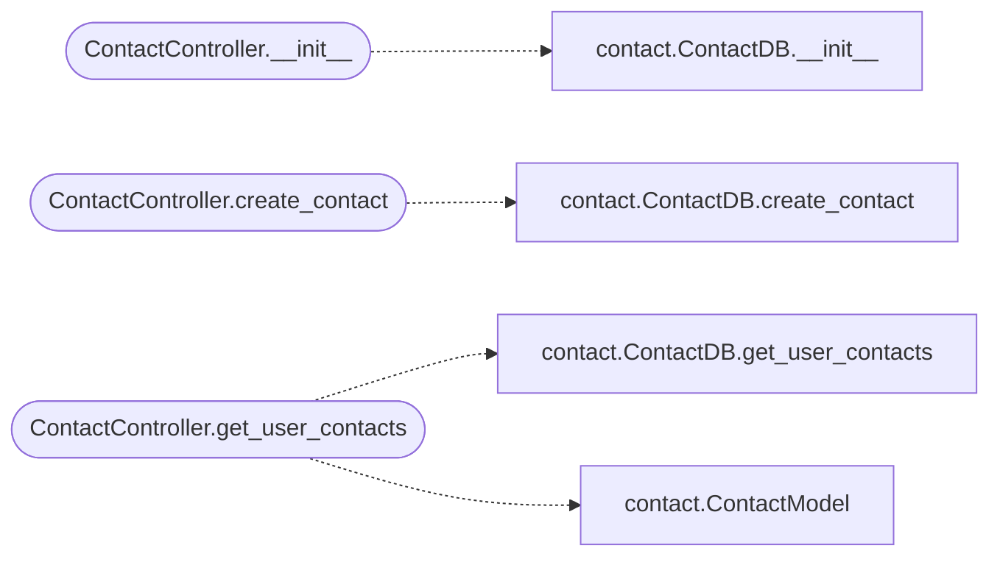

# `controllers.contact`

> Source: [controllers/contact.py:1](../../controllers/contact.py#L1) | language `py` | coverage 80.0% | [API index](../index.md)

## Contents

- **Classes:** [`ContactController`](#contactcontroller)

## Call Graph

Solid arrows stay in this module, dashed arrows leave it.



## Classes

<a id="contactcontroller"></a>

### `ContactController`

`class` | [controllers/contact.py:4](../../controllers/contact.py#L4)

```python
class ContactController
```

Handles logic related to contact messages.

**Members**

| Member | Kind | Summary |
|---|---|---|
| [`__init__`](#contactcontroller-__init__) | constructor | Initialize the ContactController with the database path. |
| [`create_contact`](#contactcontroller-create_contact) | method | Create a new contact message. |
| [`get_user_contacts`](#contactcontroller-get_user_contacts) | method | Retrieve all contact messages for a user. |

<a id="contactcontroller-__init__"></a>

#### `ContactController.__init__`

`constructor` | [controllers/contact.py:6](../../controllers/contact.py#L6)

```python
def __init__(self, db_path: str)
```

Initialize the ContactController with the database path.

**Parameters**

| Name | Type | Default | Description |
|---|---|---|---|
| `db_path` | `str` |  | Path to the SQLite database file. |

*Calls:* [`ContactDB.__init__`](models.contact.py.md#contactdb-__init__)

*Called by:* [`admin_contacts`](views.admin.py.md#admin_contacts), [`contact`](views.auth.py.md#contact)

<a id="contactcontroller-create_contact"></a>

#### `ContactController.create_contact`

`method` | [controllers/contact.py:14](../../controllers/contact.py#L14)

```python
def create_contact(self, user_id: int, subject: str, message: str) -> bool
```

Create a new contact message.

**Parameters**

| Name | Type | Default | Description |
|---|---|---|---|
| `user_id` | `int` |  | ID of the user sending the message. |
| `subject` | `str` |  | Subject of the message. |
| `message` | `str` |  | Content of the message. |

**Returns:** `bool` - True if the message was created successfully, False otherwise.

*Calls:* [`ContactDB.create_contact`](models.contact.py.md#contactdb-create_contact)

*Called by:* [`contact`](views.auth.py.md#contact)

<a id="contactcontroller-get_user_contacts"></a>

#### `ContactController.get_user_contacts`

`method` | [controllers/contact.py:36](../../controllers/contact.py#L36)

```python
def get_user_contacts(self, user_id: int) -> list[ContactModel]
```

Retrieve all contact messages for a user.

**Parameters**

| Name | Type | Default | Description |
|---|---|---|---|
| `user_id` | `int` |  | ID of the user. |

**Returns:** `list[ContactModel]` - List of contact messages.

*Calls:* [`ContactDB.get_user_contacts`](models.contact.py.md#contactdb-get_user_contacts), [`ContactModel`](models.contact.py.md#contactmodel)

---
