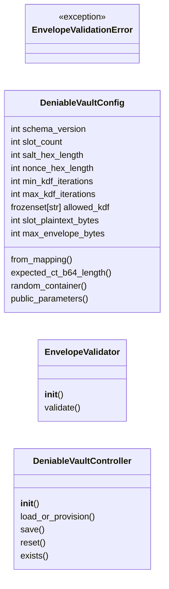
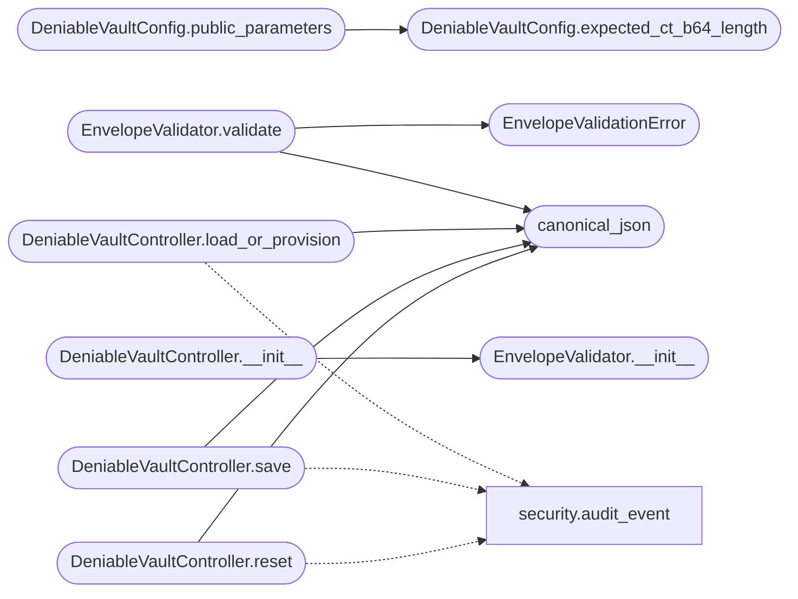

# `controllers.deniable_vault`

> Source: [controllers/deniable_vault.py:1](../../controllers/deniable_vault.py#L1) | language `py` | coverage 100.0% | [API index](../index.md)

QV-DENIABLE-1 deniable vault: configuration, validation, orchestration.

This module is the server-side core of the deniable vault feature. It is
strictly zero-knowledge: it validates the *structure* of the opaque
container the browser produces, stores it, and serves it back. It never
decrypts a slot, never sees a passphrase, and never learns which slot
holds the decoy and which holds the hidden data.

Deniability requires that activation leaves no evidence. Two mechanisms
provide that:

* Every account always has exactly one container of a fixed shape. The
  server can mint a well-formed *random* container itself, because the
  blob is opaque and AES-GCM ciphertext is indistinguishable from random.
  An unactivated account therefore looks identical to an activated one:
  "has a container" is universal and so reveals nothing. Activation only
  overwrites the random blob with one whose slots a passphrase can open.
* Every container has the same byte size. Each slot's plaintext is padded
  to a fixed length, so every slot's ciphertext is the same length and
  every container is the same size, whether or not it hides data.

Three collaborators, each with a single responsibility:

* [`DeniableVaultConfig`](#deniablevaultconfig) is the immutable set of structural limits,
  sourced from the environment with safe defaults. Nothing about the
  envelope shape is hard-coded at a call site.
* [`EnvelopeValidator`](#envelopevalidator) enforces those limits, including the fixed
  slot count and the fixed ciphertext length.
* [`DeniableVaultController`](#deniablevaultcontroller) wires the validator to
  [`models.deniable_vault.DeniableVaultDB`](models.deniable_vault.py.md#deniablevaultdb), provisions random
  containers on demand, and emits audit events that name neither the
  feature nor the contents.

## Contents

- **Classes:** [`DeniableVaultConfig`](#deniablevaultconfig), [`EnvelopeValidator`](#envelopevalidator), [`DeniableVaultController`](#deniablevaultcontroller)
- **Exceptions:** [`EnvelopeValidationError`](#envelopevalidationerror)
- **Functions:** [`canonical_json`](#canonical_json)

## Type Diagram



## Call Graph

Solid arrows stay in this module, dashed arrows leave it.



## Classes

<a id="deniablevaultconfig"></a>

### `DeniableVaultConfig`

`class` `dataclass` | [controllers/deniable_vault.py:134](../../controllers/deniable_vault.py#L134)

Decorators: `@dataclass(frozen=True)`

```python
class DeniableVaultConfig
```

Immutable structural limits for a deniable vault container.

**Attributes**

| Name | Type | Default | Description |
|---|---|---|---|
| [`schema_version`](#deniablevaultconfig-schema_version) | `int` | `_DEFAULT_SCHEMA_VERSION` |  |
| [`slot_count`](#deniablevaultconfig-slot_count) | `int` | `_DEFAULT_SLOT_COUNT` |  |
| [`salt_hex_length`](#deniablevaultconfig-salt_hex_length) | `int` | `_DEFAULT_SALT_HEX_LENGTH` |  |
| [`nonce_hex_length`](#deniablevaultconfig-nonce_hex_length) | `int` | `_DEFAULT_NONCE_HEX_LENGTH` |  |
| [`min_kdf_iterations`](#deniablevaultconfig-min_kdf_iterations) | `int` | `_DEFAULT_MIN_KDF_ITERATIONS` |  |
| [`max_kdf_iterations`](#deniablevaultconfig-max_kdf_iterations) | `int` | `_DEFAULT_MAX_KDF_ITERATIONS` |  |
| [`allowed_kdf`](#deniablevaultconfig-allowed_kdf) | `frozenset[str]` | `frozenset(_DEFAULT_ALLOWED_KDF)` |  |
| [`slot_plaintext_bytes`](#deniablevaultconfig-slot_plaintext_bytes) | `int` | `_DEFAULT_SLOT_PLAINTEXT_BYTES` |  |
| [`max_envelope_bytes`](#deniablevaultconfig-max_envelope_bytes) | `int` | `_DEFAULT_MAX_ENVELOPE_BYTES` |  |

**Members**

| Member | Kind | Summary |
|---|---|---|
| [`from_mapping`](#deniablevaultconfig-from_mapping) | classmethod | Build a config from a mapping, with environment overrides. |
| [`expected_ct_b64_length`](#deniablevaultconfig-expected_ct_b64_length) | method | Return the exact base64 length every slot ciphertext must have. |
| [`random_container`](#deniablevaultconfig-random_container) | method | Return a well-formed container filled with random, unopenable data. |
| [`public_parameters`](#deniablevaultconfig-public_parameters) | method | Return the parameters the browser needs to build a container. |

<a id="deniablevaultconfig-from_mapping"></a>

#### `DeniableVaultConfig.from_mapping`

`classmethod` | [controllers/deniable_vault.py:148](../../controllers/deniable_vault.py#L148)

Decorators: `@classmethod`

```python
def from_mapping(cls, mapping: Mapping[str, Any], env: Optional[Mapping[str, str]] = None) -> 'DeniableVaultConfig'
```

Build a config from a mapping, with environment overrides.

Resolution order for every field is: environment variable, then
``mapping`` entry (e.g. ``app.config``), then the module default.
Defaults are intentionally not written to ``payload.json`` so the
repository carries no per-deployment hint that the feature exists;
an operator overrides them per-host via the environment.

**Parameters**

| Name | Type | Default | Description |
|---|---|---|---|
| `mapping` | `Mapping[str, Any]` |  | A mapping such as ``app.config``. |
| `env` | `Optional[Mapping[str, str]]` | `None` | Environment to read overrides from. Defaults to ``os.environ``; injectable for tests. |

**Returns:** `'DeniableVaultConfig'` - The resolved, immutable configuration.

*Called by:* [`get_deniable_vault_controller`](views.account.py.md#get_deniable_vault_controller)

<a id="deniablevaultconfig-expected_ct_b64_length"></a>

#### `DeniableVaultConfig.expected_ct_b64_length`

`method` | [controllers/deniable_vault.py:213](../../controllers/deniable_vault.py#L213)

```python
def expected_ct_b64_length(self) -> int
```

Return the exact base64 length every slot ciphertext must have.

A slot's ciphertext is the fixed plaintext length plus the GCM
tag, base64-encoded. Fixing it makes every container byte-for-byte
the same shape.

**Returns:** `int`

*Called by:* [`DeniableVaultConfig.public_parameters`](#deniablevaultconfig-public_parameters)

<a id="deniablevaultconfig-random_container"></a>

#### `DeniableVaultConfig.random_container`

`method` | [controllers/deniable_vault.py:222](../../controllers/deniable_vault.py#L222)

```python
def random_container(self) -> dict[str, Any]
```

Return a well-formed container filled with random, unopenable data.

Used to provision an account that has not activated the feature and
to reset one. The result is structurally indistinguishable from an
activated container: random hex salts and nonces, and random
base64 ciphertext of exactly the expected length. No passphrase can
open it, which is the correct behavior for an unactivated vault.

**Returns:** `dict[str, Any]` - A fresh random envelope dict.

<a id="deniablevaultconfig-public_parameters"></a>

#### `DeniableVaultConfig.public_parameters`

`method` | [controllers/deniable_vault.py:250](../../controllers/deniable_vault.py#L250)

```python
def public_parameters(self) -> dict[str, Any]
```

Return the parameters the browser needs to build a container.

The browser reads these instead of hard-coding them, so a change
to the server policy propagates to clients without a code change.
The values are non-secret: they describe the container shape,
which is identical for every account.

**Returns:** `dict[str, Any]`

*Calls:* [`DeniableVaultConfig.expected_ct_b64_length`](#deniablevaultconfig-expected_ct_b64_length)

---

<a id="envelopevalidator"></a>

### `EnvelopeValidator`

`class` | [controllers/deniable_vault.py:272](../../controllers/deniable_vault.py#L272)

```python
class EnvelopeValidator
```

Validate the structure of an opaque deniable vault envelope.

The validator never decrypts. It checks only the shape: the schema
version, the KDF identifier and iteration count, the exact slot count,
each slot's hex and base64 fields, and the fixed ciphertext length
that makes every container identical in size.

**Members**

| Member | Kind | Summary |
|---|---|---|
| [`__init__`](#envelopevalidator-__init__) | constructor | Bind the validator to a configuration. |
| [`validate`](#envelopevalidator-validate) | method | Validate ``envelope``, raising on the first violation. |

<a id="envelopevalidator-__init__"></a>

#### `EnvelopeValidator.__init__`

`constructor` | [controllers/deniable_vault.py:281](../../controllers/deniable_vault.py#L281)

```python
def __init__(self, config: DeniableVaultConfig) -> None
```

Bind the validator to a configuration.

**Parameters**

| Name | Type | Default | Description |
|---|---|---|---|
| `config` | `DeniableVaultConfig` |  |  |

*Called by:* [`DeniableVaultController.__init__`](#deniablevaultcontroller-__init__)

<a id="envelopevalidator-validate"></a>

#### `EnvelopeValidator.validate`

`method` | [controllers/deniable_vault.py:285](../../controllers/deniable_vault.py#L285)

```python
def validate(self, envelope: Any) -> None
```

Validate ``envelope``, raising on the first violation.

**Parameters**

| Name | Type | Default | Description |
|---|---|---|---|
| `envelope` | `Any` |  | The decoded JSON envelope to validate. |

**Raises**

- [`EnvelopeValidationError`](#envelopevalidationerror): If any structural invariant is
violated. The message names the violated invariant and
never echoes ciphertext.

*Calls:* [`EnvelopeValidationError`](#envelopevalidationerror), [`canonical_json`](#canonical_json)

---

<a id="deniablevaultcontroller"></a>

### `DeniableVaultController`

`class` | [controllers/deniable_vault.py:393](../../controllers/deniable_vault.py#L393)

```python
class DeniableVaultController
```

Coordinate validation, provisioning, persistence, and auditing.

**Members**

| Member | Kind | Summary |
|---|---|---|
| [`__init__`](#deniablevaultcontroller-__init__) | constructor | Initialize the controller. |
| [`load_or_provision`](#deniablevaultcontroller-load_or_provision) | method | Return ``username``'s container, minting a random one if absent. |
| [`save`](#deniablevaultcontroller-save) | method | Validate and persist a container for ``username``. |
| [`reset`](#deniablevaultcontroller-reset) | method | Overwrite ``username``'s container with a fresh random one. |
| [`exists`](#deniablevaultcontroller-exists) | method | Return True if ``username`` already has a stored container. |

<a id="deniablevaultcontroller-__init__"></a>

#### `DeniableVaultController.__init__`

`constructor` | [controllers/deniable_vault.py:401](../../controllers/deniable_vault.py#L401)

```python
def __init__(self, db: DeniableVaultDB, config: DeniableVaultConfig, validator: Optional[EnvelopeValidator] = None) -> None
```

Initialize the controller.

**Parameters**

| Name | Type | Default | Description |
|---|---|---|---|
| `db` | `DeniableVaultDB` |  | The opaque container store. |
| `config` | `DeniableVaultConfig` |  | The structural limits in force. |
| `validator` | `Optional[EnvelopeValidator]` | `None` | The validator to use. Defaults to one bound to ``config``; injectable for tests. |

*Calls:* [`EnvelopeValidator.__init__`](#envelopevalidator-__init__)

*Called by:* [`get_deniable_vault_controller`](views.account.py.md#get_deniable_vault_controller)

<a id="deniablevaultcontroller-load_or_provision"></a>

#### `DeniableVaultController.load_or_provision`

`method` | [controllers/deniable_vault.py:419](../../controllers/deniable_vault.py#L419)

```python
def load_or_provision(self, username: str) -> dict[str, Any]
```

Return ``username``'s container, minting a random one if absent.

The mint-on-read behavior is what makes "has a container"
universal: any account that has ever opened its settings has an
indistinguishable container, so the mere existence of one is not
evidence of a hidden vault.

**Parameters**

| Name | Type | Default | Description |
|---|---|---|---|
| `username` | `str` |  | The owning account. |

**Returns:** `dict[str, Any]` - The decoded envelope, always present.

*Calls:* [`canonical_json`](#canonical_json), [`audit_event`](utils.security.py.md#audit_event)

<a id="deniablevaultcontroller-save"></a>

#### `DeniableVaultController.save`

`method` | [controllers/deniable_vault.py:441](../../controllers/deniable_vault.py#L441)

```python
def save(self, username: str, envelope: Mapping[str, Any]) -> None
```

Validate and persist a container for ``username``.

**Parameters**

| Name | Type | Default | Description |
|---|---|---|---|
| `username` | `str` |  | The owning account. |
| `envelope` | `Mapping[str, Any]` |  | The decoded JSON envelope from the client. |

**Raises**

- [`EnvelopeValidationError`](#envelopevalidationerror): If the envelope is structurally invalid; nothing is persisted in that case.

*Calls:* [`canonical_json`](#canonical_json), [`audit_event`](utils.security.py.md#audit_event)

<a id="deniablevaultcontroller-reset"></a>

#### `DeniableVaultController.reset`

`method` | [controllers/deniable_vault.py:456](../../controllers/deniable_vault.py#L456)

```python
def reset(self, username: str) -> dict[str, Any]
```

Overwrite ``username``'s container with a fresh random one.

Reset replaces rather than deletes: removing the row would leave a
gap that distinguishes a user who deactivated from one who never
activated. A random container keeps existence universal.

**Parameters**

| Name | Type | Default | Description |
|---|---|---|---|
| `username` | `str` |  | The owning account. |

**Returns:** `dict[str, Any]` - The new random envelope.

*Calls:* [`canonical_json`](#canonical_json), [`audit_event`](utils.security.py.md#audit_event)

<a id="deniablevaultcontroller-exists"></a>

#### `DeniableVaultController.exists`

`method` | [controllers/deniable_vault.py:474](../../controllers/deniable_vault.py#L474)

```python
def exists(self, username: str) -> bool
```

Return True if ``username`` already has a stored container.

**Parameters**

| Name | Type | Default | Description |
|---|---|---|---|
| `username` | `str` |  |  |

**Returns:** `bool`

---

## Exceptions

<a id="envelopevalidationerror"></a>

### `EnvelopeValidationError`

`exception` | [controllers/deniable_vault.py:104](../../controllers/deniable_vault.py#L104)

```python
class EnvelopeValidationError(ValueError)
```

Bases: `ValueError`

Raised when an envelope violates a structural invariant.

---

## Functions

<a id="canonical_json"></a>

### `canonical_json`

`function` | [controllers/deniable_vault.py:86](../../controllers/deniable_vault.py#L86)

```python
def canonical_json(envelope: Mapping[str, Any]) -> str
```

Serialize an envelope deterministically for storage and sizing.

Keys are sorted and separators are compact so the same logical
envelope always serializes to the same bytes. Both the size check in
[`EnvelopeValidator`](#envelopevalidator) and the persistence path in
[`DeniableVaultController`](#deniablevaultcontroller) use this single function, so the
bytes that are measured are exactly the bytes that are stored.

**Parameters**

| Name | Type | Default | Description |
|---|---|---|---|
| `envelope` | `Mapping[str, Any]` |  | The envelope mapping to serialize. |

**Returns:** `str` - The canonical JSON string.

*Called by:* [`DeniableVaultController.load_or_provision`](#deniablevaultcontroller-load_or_provision), [`DeniableVaultController.reset`](#deniablevaultcontroller-reset), [`DeniableVaultController.save`](#deniablevaultcontroller-save), [`EnvelopeValidator.validate`](#envelopevalidator-validate)

---
