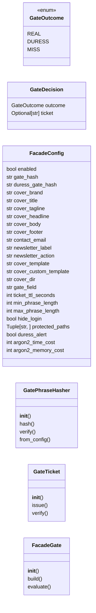
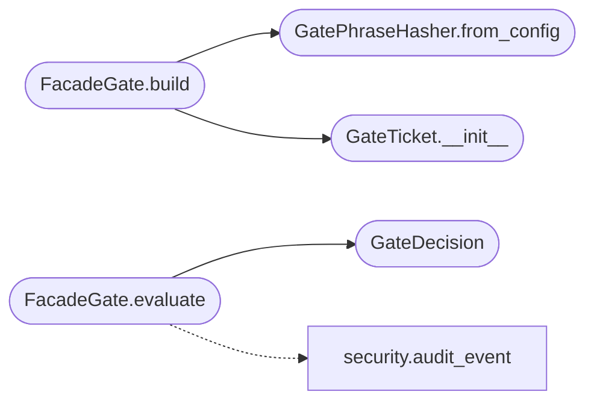

# `controllers.facade`

> Source: [controllers/facade.py:1](../../controllers/facade.py#L1) | language `py` | coverage 100.0% | [API index](../index.md)

QV-FACADE-1 cover facade: configuration, gate hashing, tickets, gate control.

The facade hides QuantumVault behind an innocuous cover application. A
secret phrase typed into the cover's search field is the first gate: a
correct phrase issues a short-lived signed ticket and marks the session
``real`` or ``duress``; either way the ordinary login page is revealed,
so an onlooker cannot tell which phrase was used.

This module is the server-side core. It never stores a phrase, never
echoes one into the audit log, and performs the same Argon2id work for a
miss, the real phrase, and the duress phrase so the response is not an
oracle. The zero-knowledge guarantees of SRP-6a and the deniable vault do
not depend on this layer.

## Contents

- **Classes:** [`GateDecision`](#gatedecision), [`FacadeConfig`](#facadeconfig), [`GatePhraseHasher`](#gatephrasehasher), [`GateTicket`](#gateticket), [`FacadeGate`](#facadegate)
- **Enums:** [`GateOutcome`](#gateoutcome)

## Type Diagram



## Call Graph

Solid arrows stay in this module, dashed arrows leave it.



## Classes

<a id="gatedecision"></a>

### `GateDecision`

`class` `dataclass` | [controllers/facade.py:72](../../controllers/facade.py#L72)

Decorators: `@dataclass(frozen=True)`

```python
class GateDecision
```

The outcome of evaluating a phrase plus any issued ticket.

**Attributes**

| Name | Type | Default | Description |
|---|---|---|---|
| [`outcome`](#gatedecision-outcome) | `GateOutcome` |  |  |
| [`ticket`](#gatedecision-ticket) | `Optional[str]` |  |  |

---

<a id="facadeconfig"></a>

### `FacadeConfig`

`class` `dataclass` | [controllers/facade.py:124](../../controllers/facade.py#L124)

Decorators: `@dataclass(frozen=True)`

```python
class FacadeConfig
```

Immutable facade configuration resolved from environment and app config.

**Attributes**

| Name | Type | Default | Description |
|---|---|---|---|
| [`enabled`](#facadeconfig-enabled) | `bool` | `_DEFAULT_ENABLED` |  |
| [`gate_hash`](#facadeconfig-gate_hash) | `str` | `_DEFAULT_GATE_HASH` |  |
| [`duress_gate_hash`](#facadeconfig-duress_gate_hash) | `str` | `_DEFAULT_DURESS_GATE_HASH` |  |
| [`cover_brand`](#facadeconfig-cover_brand) | `str` | `_DEFAULT_COVER_BRAND` |  |
| [`cover_title`](#facadeconfig-cover_title) | `str` | `_DEFAULT_COVER_TITLE` |  |
| [`cover_tagline`](#facadeconfig-cover_tagline) | `str` | `_DEFAULT_COVER_TAGLINE` |  |
| [`cover_headline`](#facadeconfig-cover_headline) | `str` | `_DEFAULT_COVER_BRAND` |  |
| [`cover_body`](#facadeconfig-cover_body) | `str` | `_DEFAULT_COVER_BODY` |  |
| [`cover_footer`](#facadeconfig-cover_footer) | `str` | `_DEFAULT_COVER_FOOTER` |  |
| [`contact_email`](#facadeconfig-contact_email) | `str` | `_DEFAULT_CONTACT_EMAIL` |  |
| [`newsletter_label`](#facadeconfig-newsletter_label) | `str` | `_DEFAULT_NEWSLETTER_LABEL` |  |
| [`newsletter_action`](#facadeconfig-newsletter_action) | `str` | `_DEFAULT_NEWSLETTER_ACTION` |  |
| [`cover_template`](#facadeconfig-cover_template) | `str` | `_DEFAULT_COVER_TEMPLATE` |  |
| [`cover_custom_template`](#facadeconfig-cover_custom_template) | `str` | `_DEFAULT_COVER_CUSTOM_TEMPLATE` |  |
| [`cover_dir`](#facadeconfig-cover_dir) | `str` | `_DEFAULT_COVER_DIR` |  |
| [`gate_field`](#facadeconfig-gate_field) | `str` | `_DEFAULT_GATE_FIELD` |  |
| [`ticket_ttl_seconds`](#facadeconfig-ticket_ttl_seconds) | `int` | `_DEFAULT_TICKET_TTL_SECONDS` |  |
| [`min_phrase_length`](#facadeconfig-min_phrase_length) | `int` | `_DEFAULT_MIN_PHRASE_LENGTH` |  |
| [`max_phrase_length`](#facadeconfig-max_phrase_length) | `int` | `_DEFAULT_MAX_PHRASE_LENGTH` |  |
| [`hide_login`](#facadeconfig-hide_login) | `bool` | `_DEFAULT_HIDE_LOGIN` |  |
| [`protected_paths`](#facadeconfig-protected_paths) | `Tuple[str, ...]` | `_DEFAULT_PROTECTED_PATHS` |  |
| [`duress_alert`](#facadeconfig-duress_alert) | `bool` | `_DEFAULT_DURESS_ALERT` |  |
| [`argon2_time_cost`](#facadeconfig-argon2_time_cost) | `int` | `_DEFAULT_ARGON2_TIME_COST` |  |
| [`argon2_memory_cost`](#facadeconfig-argon2_memory_cost) | `int` | `_DEFAULT_ARGON2_MEMORY_COST` |  |
| [`argon2_parallelism`](#facadeconfig-argon2_parallelism) | `int` | `_DEFAULT_ARGON2_PARALLELISM` |  |

**Members**

| Member | Kind | Summary |
|---|---|---|
| [`gate_configured`](#facadeconfig-gate_configured) | property | Return whether the facade is enabled and holds a real gate hash. |
| [`cover_context`](#facadeconfig-cover_context) | method | Return the cosmetic cover context, never carrying a gate hash. |
| [`cover_variables`](#facadeconfig-cover_variables) | method | Return the sanitizable cover variable payload. |
| [`from_mapping`](#facadeconfig-from_mapping) | classmethod | Resolve configuration with environment, mapping, then default order. |

<a id="facadeconfig-gate_configured"></a>

#### `FacadeConfig.gate_configured`

`property` | [controllers/facade.py:154](../../controllers/facade.py#L154)

Decorators: `@property`

```python
def gate_configured(self) -> bool
```

Return whether the facade is enabled and holds a real gate hash.

**Returns:** `bool`

<a id="facadeconfig-cover_context"></a>

#### `FacadeConfig.cover_context`

`method` | [controllers/facade.py:158](../../controllers/facade.py#L158)

```python
def cover_context(self) -> dict
```

Return the cosmetic cover context, never carrying a gate hash.

**Returns:** `dict`

<a id="facadeconfig-cover_variables"></a>

#### `FacadeConfig.cover_variables`

`method` | [controllers/facade.py:166](../../controllers/facade.py#L166)

```python
def cover_variables(self) -> dict
```

Return the sanitizable cover variable payload.

**Returns:** `dict`

<a id="facadeconfig-from_mapping"></a>

#### `FacadeConfig.from_mapping`

`classmethod` | [controllers/facade.py:181](../../controllers/facade.py#L181)

Decorators: `@classmethod`

```python
def from_mapping(cls, mapping: Mapping[str, Any], env: Optional[Mapping[str, str]] = None) -> 'FacadeConfig'
```

Resolve configuration with environment, mapping, then default order.

**Parameters**

| Name | Type | Default | Description |
|---|---|---|---|
| `mapping` | `Mapping[str, Any]` |  |  |
| `env` | `Optional[Mapping[str, str]]` | `None` |  |

**Returns:** `'FacadeConfig'`

*Called by:* [`settings`](views.account.py.md#settings), [`register_facade`](views.facade.py.md#register_facade)

---

<a id="gatephrasehasher"></a>

### `GatePhraseHasher`

`class` | [controllers/facade.py:262](../../controllers/facade.py#L262)

```python
class GatePhraseHasher
```

Argon2id hashing and verification for a human-chosen gate phrase.

**Members**

| Member | Kind | Summary |
|---|---|---|
| [`__init__`](#gatephrasehasher-__init__) | constructor | Bind the hasher to explicit Argon2id cost parameters. |
| [`hash`](#gatephrasehasher-hash) | method | Return a salted Argon2id digest of ``phrase``. |
| [`verify`](#gatephrasehasher-verify) | method | Return whether ``phrase`` matches ``encoded`` without raising. |
| [`from_config`](#gatephrasehasher-from_config) | classmethod | Build a hasher using the cost parameters of ``config``. |

<a id="gatephrasehasher-__init__"></a>

#### `GatePhraseHasher.__init__`

`constructor` | [controllers/facade.py:265](../../controllers/facade.py#L265)

```python
def __init__(self, time_cost: int = _DEFAULT_ARGON2_TIME_COST, memory_cost: int = _DEFAULT_ARGON2_MEMORY_COST, parallelism: int = _DEFAULT_ARGON2_PARALLELISM, hash_len: int = _DEFAULT_ARGON2_HASH_LEN, salt_len: int = _DEFAULT_ARGON2_SALT_LEN) -> None
```

Bind the hasher to explicit Argon2id cost parameters.

**Parameters**

| Name | Type | Default | Description |
|---|---|---|---|
| `time_cost` | `int` | `_DEFAULT_ARGON2_TIME_COST` |  |
| `memory_cost` | `int` | `_DEFAULT_ARGON2_MEMORY_COST` |  |
| `parallelism` | `int` | `_DEFAULT_ARGON2_PARALLELISM` |  |
| `hash_len` | `int` | `_DEFAULT_ARGON2_HASH_LEN` |  |
| `salt_len` | `int` | `_DEFAULT_ARGON2_SALT_LEN` |  |

<a id="gatephrasehasher-hash"></a>

#### `GatePhraseHasher.hash`

`method` | [controllers/facade.py:282](../../controllers/facade.py#L282)

```python
def hash(self, phrase: str) -> str
```

Return a salted Argon2id digest of ``phrase``.

**Parameters**

| Name | Type | Default | Description |
|---|---|---|---|
| `phrase` | `str` |  |  |

**Returns:** `str`

<a id="gatephrasehasher-verify"></a>

#### `GatePhraseHasher.verify`

`method` | [controllers/facade.py:286](../../controllers/facade.py#L286)

```python
def verify(self, phrase: str, encoded: str) -> bool
```

Return whether ``phrase`` matches ``encoded`` without raising.

**Parameters**

| Name | Type | Default | Description |
|---|---|---|---|
| `phrase` | `str` |  |  |
| `encoded` | `str` |  |  |

**Returns:** `bool`

<a id="gatephrasehasher-from_config"></a>

#### `GatePhraseHasher.from_config`

`classmethod` | [controllers/facade.py:296](../../controllers/facade.py#L296)

Decorators: `@classmethod`

```python
def from_config(cls, config: FacadeConfig) -> 'GatePhraseHasher'
```

Build a hasher using the cost parameters of ``config``.

**Parameters**

| Name | Type | Default | Description |
|---|---|---|---|
| `config` | `FacadeConfig` |  |  |

**Returns:** `'GatePhraseHasher'`

*Called by:* [`FacadeGate.build`](#facadegate-build)

---

<a id="gateticket"></a>

### `GateTicket`

`class` | [controllers/facade.py:305](../../controllers/facade.py#L305)

```python
class GateTicket
```

Short-lived signed ticket binding a session to a gate mode.

**Members**

| Member | Kind | Summary |
|---|---|---|
| [`__init__`](#gateticket-__init__) | constructor | Bind the ticket signer to the app secret and a lifetime. |
| [`issue`](#gateticket-issue) | method | Return a signed ticket for ``mode`` or raise for an unknown mode. |
| [`verify`](#gateticket-verify) | method | Return the ticket mode, or ``None`` if expired, tampered, or absent. |

<a id="gateticket-__init__"></a>

#### `GateTicket.__init__`

`constructor` | [controllers/facade.py:308](../../controllers/facade.py#L308)

```python
def __init__(self, secret_key: str, ttl_seconds: int) -> None
```

Bind the ticket signer to the app secret and a lifetime.

**Parameters**

| Name | Type | Default | Description |
|---|---|---|---|
| `secret_key` | `str` |  |  |
| `ttl_seconds` | `int` |  |  |

*Called by:* [`FacadeGate.build`](#facadegate-build)

<a id="gateticket-issue"></a>

#### `GateTicket.issue`

`method` | [controllers/facade.py:316](../../controllers/facade.py#L316)

```python
def issue(self, mode: str) -> str
```

Return a signed ticket for ``mode`` or raise for an unknown mode.

**Parameters**

| Name | Type | Default | Description |
|---|---|---|---|
| `mode` | `str` |  |  |

**Returns:** `str`

**Raises**

- `ValueError`: (raised in the body, not documented)

<a id="gateticket-verify"></a>

#### `GateTicket.verify`

`method` | [controllers/facade.py:322](../../controllers/facade.py#L322)

```python
def verify(self, token: object) -> Optional[str]
```

Return the ticket mode, or ``None`` if expired, tampered, or absent.

**Parameters**

| Name | Type | Default | Description |
|---|---|---|---|
| `token` | `object` |  |  |

**Returns:** `Optional[str]`

---

<a id="facadegate"></a>

### `FacadeGate`

`class` | [controllers/facade.py:336](../../controllers/facade.py#L336)

```python
class FacadeGate
```

Evaluate gate phrases and issue tickets with constant observable work.

**Members**

| Member | Kind | Summary |
|---|---|---|
| [`__init__`](#facadegate-__init__) | constructor | Bind the gate to its configuration and collaborators. |
| [`build`](#facadegate-build) | classmethod | Build a gate from configuration and the application secret. |
| [`evaluate`](#facadegate-evaluate) | method | Classify a phrase and emit only a generic audit event. |

<a id="facadegate-__init__"></a>

#### `FacadeGate.__init__`

`constructor` | [controllers/facade.py:339](../../controllers/facade.py#L339)

```python
def __init__(self, config: FacadeConfig, hasher: GatePhraseHasher, ticket: GateTicket) -> None
```

Bind the gate to its configuration and collaborators.

**Parameters**

| Name | Type | Default | Description |
|---|---|---|---|
| `config` | `FacadeConfig` |  |  |
| `hasher` | `GatePhraseHasher` |  |  |
| `ticket` | `GateTicket` |  |  |

<a id="facadegate-build"></a>

#### `FacadeGate.build`

`classmethod` | [controllers/facade.py:351](../../controllers/facade.py#L351)

Decorators: `@classmethod`

```python
def build(cls, config: FacadeConfig, secret_key: str) -> 'FacadeGate'
```

Build a gate from configuration and the application secret.

**Parameters**

| Name | Type | Default | Description |
|---|---|---|---|
| `config` | `FacadeConfig` |  |  |
| `secret_key` | `str` |  |  |

**Returns:** `'FacadeGate'`

*Calls:* [`GatePhraseHasher.from_config`](#gatephrasehasher-from_config), [`GateTicket.__init__`](#gateticket-__init__)

*Called by:* [`register_facade`](views.facade.py.md#register_facade)

<a id="facadegate-evaluate"></a>

#### `FacadeGate.evaluate`

`method` | [controllers/facade.py:359](../../controllers/facade.py#L359)

```python
def evaluate(self, phrase: object) -> GateDecision
```

Classify a phrase and emit only a generic audit event.

**Parameters**

| Name | Type | Default | Description |
|---|---|---|---|
| `phrase` | `object` |  |  |

**Returns:** `GateDecision`

*Calls:* [`GateDecision`](#gatedecision), [`audit_event`](utils.security.py.md#audit_event)

---

## Enums

<a id="gateoutcome"></a>

### `GateOutcome`

`enum` | [controllers/facade.py:63](../../controllers/facade.py#L63)

```python
class GateOutcome(Enum)
```

Bases: `Enum`

Classification of a submitted gate phrase.

**Attributes**

| Name | Type | Default | Description |
|---|---|---|---|
| [`REAL`](#gateoutcome-real) |  | `'real'` |  |
| [`DURESS`](#gateoutcome-duress) |  | `'duress'` |  |
| [`MISS`](#gateoutcome-miss) |  | `'miss'` |  |

---
