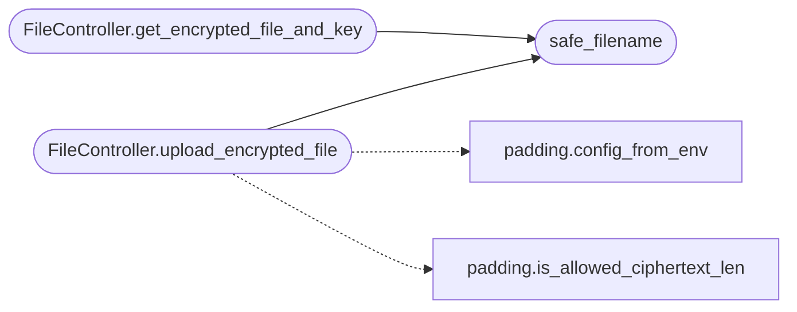

# `controllers.file`

> Source: [controllers/file.py:1](../../controllers/file.py#L1) | language `py` | coverage 87.5% | [API index](../index.md)

Encrypted file persistence layer.

The server is intentionally blind to plaintext: it only ever stores
opaque ciphertext plus an opaque "wrapped file encryption key"
(`[`wrapped_fek`](views.file.py.md#uploadform-wrapped_fek)`) produced by the browser. Every filename that flows
through this controller is normalized via [`safe_filename`](#safe_filename) so
the S3 key the user ends up with cannot contain path separators or
control characters.

## Contents

- **Classes:** [`FileController`](#filecontroller)
- **Functions:** [`safe_filename`](#safe_filename)
- **Constants:** [`S3_ERRORS`](#s3_errors)

## Call Graph

Solid arrows stay in this module, dashed arrows leave it.



## Classes

<a id="filecontroller"></a>

### `FileController`

`class` | [controllers/file.py:51](../../controllers/file.py#L51)

```python
class FileController
```

Persistence for end-to-end encrypted files and their wrapped FEKs.

**Members**

| Member | Kind | Summary |
|---|---|---|
| [`__init__`](#filecontroller-__init__) | constructor |  |
| [`get_storage_usage`](#filecontroller-get_storage_usage) | method | Sum the bytes used by ``username``'s encrypted files in S3. |
| [`upload_encrypted_file`](#filecontroller-upload_encrypted_file) | method | Persist an already-encrypted file and its wrapped FEK to S3. |
| [`get_encrypted_file_and_key`](#filecontroller-get_encrypted_file_and_key) | method | Fetch a user's encrypted file and its wrapped FEK from S3. |
| [`list_encrypted_files`](#filecontroller-list_encrypted_files) | method | List the encrypted files that belong to ``username``. |

<a id="filecontroller-__init__"></a>

#### `FileController.__init__`

`constructor` | [controllers/file.py:54](../../controllers/file.py#L54)

```python
def __init__(self, users_path: str, s3_bucket: str, s3_client) -> None
```

**Parameters**

| Name | Type | Default | Description |
|---|---|---|---|
| `users_path` | `str` |  |  |
| `s3_bucket` | `str` |  |  |
| `s3_client` |  |  |  |

*Called by:* [`create_app`](app_factory.py.md#create_app)

<a id="filecontroller-get_storage_usage"></a>

#### `FileController.get_storage_usage`

`method` | [controllers/file.py:71](../../controllers/file.py#L71)

```python
def get_storage_usage(self, username: str) -> int
```

Sum the bytes used by ``username``'s encrypted files in S3.

**Parameters**

| Name | Type | Default | Description |
|---|---|---|---|
| `username` | `str` |  |  |

**Returns:** `int`

<a id="filecontroller-upload_encrypted_file"></a>

#### `FileController.upload_encrypted_file`

`method` | [controllers/file.py:85](../../controllers/file.py#L85)

```python
def upload_encrypted_file(self, username: str, file_storage, wrapped_fek: bytes) -> bool
```

Persist an already-encrypted file and its wrapped FEK to S3.

The ciphertext must already be padded client-side to a configured
file bucket plus AES-256-GCM overhead. Unpadded uploads are
rejected so exact plaintext sizes never reach the wire or storage.

**Parameters**

| Name | Type | Default | Description |
|---|---|---|---|
| `username` | `str` |  |  |
| `file_storage` |  |  |  |
| `wrapped_fek` | `bytes` |  |  |

**Returns:** `bool`

*Calls:* [`safe_filename`](#safe_filename), [`config_from_env`](utils.padding.py.md#config_from_env), [`is_allowed_ciphertext_len`](utils.padding.py.md#is_allowed_ciphertext_len)

<a id="filecontroller-get_encrypted_file_and_key"></a>

#### `FileController.get_encrypted_file_and_key`

`method` | [controllers/file.py:118](../../controllers/file.py#L118)

```python
def get_encrypted_file_and_key(self, username: str, filename: str) -> Tuple[Optional[bytes], Optional[bytes], Optional[str]]
```

Fetch a user's encrypted file and its wrapped FEK from S3.

**Parameters**

| Name | Type | Default | Description |
|---|---|---|---|
| `username` | `str` |  |  |
| `filename` | `str` |  |  |

**Returns:** `Tuple[Optional[bytes], Optional[bytes], Optional[str]]` - A 3-tuple of ``(ciphertext, wrapped_fek, error)``. On success
``error`` is ``None``; on failure it contains a human-readable
reason and the byte values are ``None``.

*Calls:* [`safe_filename`](#safe_filename)

<a id="filecontroller-list_encrypted_files"></a>

#### `FileController.list_encrypted_files`

`method` | [controllers/file.py:148](../../controllers/file.py#L148)

```python
def list_encrypted_files(self, username: str) -> List[str]
```

List the encrypted files that belong to ``username``.

**Parameters**

| Name | Type | Default | Description |
|---|---|---|---|
| `username` | `str` |  |  |

**Returns:** `List[str]`

---

## Functions

<a id="safe_filename"></a>

### `safe_filename`

`function` | [controllers/file.py:33](../../controllers/file.py#L33)

```python
def safe_filename(name: Optional[str]) -> str
```

Return a filename safe to embed in an S3 key.

Applies `werkzeug.utils.secure_filename` to strip any path
components and control characters, then rejects any residual
shell-meta characters and NUL bytes. Returns an empty string
for empty/None input.

**Parameters**

| Name | Type | Default | Description |
|---|---|---|---|
| `name` | `Optional[str]` |  |  |

**Returns:** `str`

*Called by:* [`FileController.get_encrypted_file_and_key`](#filecontroller-get_encrypted_file_and_key), [`FileController.upload_encrypted_file`](#filecontroller-upload_encrypted_file)

---

## Constants

<a id="s3_errors"></a>

### `S3_ERRORS`

`constant` | [controllers/file.py:25](../../controllers/file.py#L25)

```python
S3_ERRORS = (BotoCoreError, ClientError)
```

---
