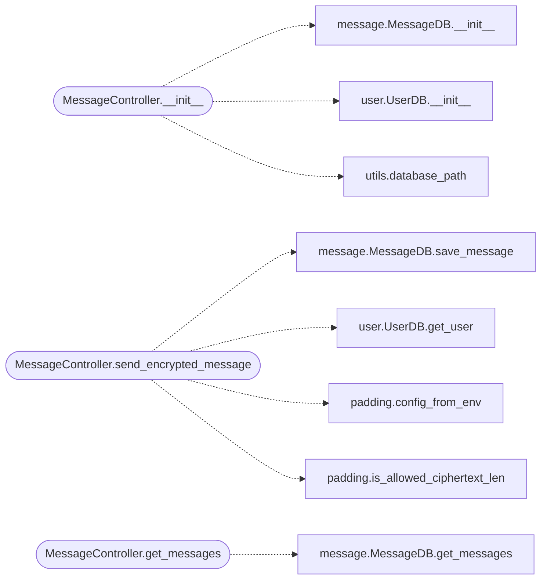

# `controllers.message`

> Source: [controllers/message.py:1](../../controllers/message.py#L1) | language `py` | coverage 100.0% | [API index](../index.md)

Server-side controller for end-to-end encrypted messages.

The browser generates the CEK, encrypts the message with AES-256-GCM, and
wraps the CEK with the recipient's and sender's hybrid public keys. The
server stores only opaque material; it cannot derive plaintext or any key.

## Contents

- **Classes:** [`MessageController`](#messagecontroller)

## Call Graph

Solid arrows stay in this module, dashed arrows leave it.



## Classes

<a id="messagecontroller"></a>

### `MessageController`

`class` | [controllers/message.py:19](../../controllers/message.py#L19)

```python
class MessageController
```

Handles message persistence in the zero-knowledge flow.

**Members**

| Member | Kind | Summary |
|---|---|---|
| [`__init__`](#messagecontroller-__init__) | constructor | Initialize the controller. |
| [`send_encrypted_message`](#messagecontroller-send_encrypted_message) | method | Persist an opaque message envelope for the recipient. |
| [`get_messages`](#messagecontroller-get_messages) | method | Return opaque message envelopes for the user. |

<a id="messagecontroller-__init__"></a>

#### `MessageController.__init__`

`constructor` | [controllers/message.py:22](../../controllers/message.py#L22)

```python
def __init__(self, users_path: str, users_db_path: Optional[str] = None)
```

Initialize the controller.

**Parameters**

| Name | Type | Default | Description |
|---|---|---|---|
| `users_path` | `str` |  | Base directory under which each user has a ``messages/`` subdirectory. |
| `users_db_path` | `Optional[str]` | `None` | Path to the SQLite user database, used to verify that a message recipient is a registered account. Defaults to the configured database path when omitted. |

*Calls:* [`MessageDB.__init__`](models.message.py.md#messagedb-__init__), [`UserDB.__init__`](models.user.py.md#userdb-__init__), [`database_path`](utils.utils.py.md#database_path)

*Called by:* [`api_secure_message`](views.message.py.md#api_secure_message), [`messages`](views.message.py.md#messages)

<a id="messagecontroller-send_encrypted_message"></a>

#### `MessageController.send_encrypted_message`

`method` | [controllers/message.py:36](../../controllers/message.py#L36)

```python
def send_encrypted_message(self, sender: str, recipient: str, encrypted_message_b64: str, cek_for_recipient: str, cek_for_sender: str) -> bool
```

Persist an opaque message envelope for the recipient.

**Parameters**

| Name | Type | Default | Description |
|---|---|---|---|
| `sender` | `str` |  | Sender's username. |
| `recipient` | `str` |  | Recipient's username. |
| `encrypted_message_b64` | `str` |  | AES-256-GCM ciphertext (base64) of the message body, with the IV prepended by the browser. |
| `cek_for_recipient` | `str` |  | Hybrid-wrapped CEK to the recipient's public key (base64 JSON from qv-crypto). |
| `cek_for_sender` | `str` |  | Hybrid-wrapped CEK to the sender's public key (so the outbox copy is readable). |

**Returns:** `bool` - True on success, False otherwise. Envelopes whose decoded
ciphertext length is not a configured message bucket plus
AES-256-GCM overhead are rejected so unpadded clients cannot
leak exact plaintext sizes on the wire.

*Calls:* [`MessageDB.save_message`](models.message.py.md#messagedb-save_message), [`UserDB.get_user`](models.user.py.md#userdb-get_user), [`config_from_env`](utils.padding.py.md#config_from_env), [`is_allowed_ciphertext_len`](utils.padding.py.md#is_allowed_ciphertext_len)

*Called by:* [`api_secure_message`](views.message.py.md#api_secure_message)

<a id="messagecontroller-get_messages"></a>

#### `MessageController.get_messages`

`method` | [controllers/message.py:90](../../controllers/message.py#L90)

```python
def get_messages(self, username: str, page: int = 1, per_page: int = 10) -> Tuple[List[MessageModel], int]
```

Return opaque message envelopes for the user.

The browser unwraps each CEK with the user's private blob; the
server only returns the opaque envelopes.

**Parameters**

| Name | Type | Default | Description |
|---|---|---|---|
| `username` | `str` |  | User whose mailbox to read. |
| `page` | `int` | `1` | 1-indexed page number. |
| `per_page` | `int` | `10` | Messages per page. |

**Returns:** `Tuple[List[MessageModel], int]` - A tuple ``(messages, total_pages)`` of opaque messages.

*Calls:* [`MessageDB.get_messages`](models.message.py.md#messagedb-get_messages)

*Called by:* [`messages`](views.message.py.md#messages)

---
