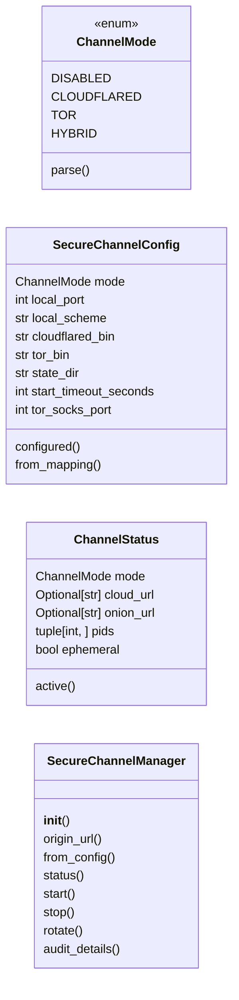
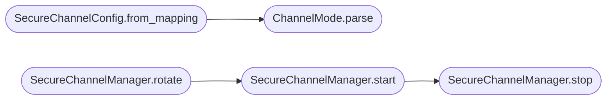

# `controllers.secure_channel`

> Source: [controllers/secure_channel.py:1](../../controllers/secure_channel.py#L1) | language `py` | coverage 100.0% | [API index](../index.md)

QV-TUNNEL disposable secure channels over Cloudflare and Tor.

Inspiration comes from LazyOwn operator practice: a disposable
``cloudflared`` quick tunnel exposing a local port through a
``*.trycloudflare.com`` URL, and a disposable Tor onion service
exposing the same port as a ``*.onion`` address. LazyOwn runs both
with interactive prompts and host-wide side effects. This module
replaces that workflow with an unprivileged deterministic
supervisor suited to QuantumVault zero-trust operation.

Contract summary:

- Channel modes are ``disabled``, ``cloudflared``, ``tor``, and
  ``hybrid``. Hybrid runs both backends so traffic can use either
  path and rotation disposes both addresses at once.
- Cloudflare uses ``cloudflared tunnel --url`` against loopback
  only. The origin scheme follows ``QV_CHANNEL_LOCAL_SCHEME``
  (``http`` or ``https``): an ``https`` origin adds
  ``--no-tls-verify`` so a self-signed dev listener stays reachable
  instead of answering Bad Gateway. The public URL is parsed from
  process output with a closed allow-list pattern. No account token
  is required for quick tunnels and none is accepted here, which
  keeps rotation fully disposable.
- Tor uses an unprivileged ``tor`` process with a generated data
  directory under the configured state directory. No system
  ``torrc`` file is modified and no sudo is required. The onion
  hostname is read from the disposable data directory.
- State persists atomically as owner-only JSON. Audit records
  carry mode plus short fingerprints, never full URLs.

## Contents

- **Classes:** [`SecureChannelConfig`](#securechannelconfig), [`ChannelStatus`](#channelstatus), [`SecureChannelManager`](#securechannelmanager)
- **Enums:** [`ChannelMode`](#channelmode)
- **Functions:** [`is_cloudflare_url`](#is_cloudflare_url), [`is_onion_url`](#is_onion_url)

## Type Diagram



## Call Graph

Solid arrows stay in this module, dashed arrows leave it.



## Classes

<a id="securechannelconfig"></a>

### `SecureChannelConfig`

`class` `dataclass` | [controllers/secure_channel.py:116](../../controllers/secure_channel.py#L116)

Decorators: `@dataclass(frozen=True)`

```python
class SecureChannelConfig
```

Immutable secure channel configuration from env and mapping.

**Attributes**

| Name | Type | Default | Description |
|---|---|---|---|
| [`mode`](#securechannelconfig-mode) | `ChannelMode` | `ChannelMode.DISABLED` |  |
| [`local_port`](#securechannelconfig-local_port) | `int` | `_DEFAULT_LOCAL_PORT` |  |
| [`local_scheme`](#securechannelconfig-local_scheme) | `str` | `_DEFAULT_LOCAL_SCHEME` |  |
| [`cloudflared_bin`](#securechannelconfig-cloudflared_bin) | `str` | `_DEFAULT_CLOUDFLARED_BIN` |  |
| [`tor_bin`](#securechannelconfig-tor_bin) | `str` | `_DEFAULT_TOR_BIN` |  |
| [`state_dir`](#securechannelconfig-state_dir) | `str` | `_DEFAULT_STATE_DIR` |  |
| [`start_timeout_seconds`](#securechannelconfig-start_timeout_seconds) | `int` | `_DEFAULT_START_TIMEOUT_SECONDS` |  |
| [`tor_socks_port`](#securechannelconfig-tor_socks_port) | `int` | `_DEFAULT_TOR_SOCKS_PORT` |  |

**Members**

| Member | Kind | Summary |
|---|---|---|
| [`configured`](#securechannelconfig-configured) | property | Return whether a disposible channel mode is selected. |
| [`from_mapping`](#securechannelconfig-from_mapping) | classmethod | Resolve configuration with environment, mapping, then default order. |

<a id="securechannelconfig-configured"></a>

#### `SecureChannelConfig.configured`

`property` | [controllers/secure_channel.py:129](../../controllers/secure_channel.py#L129)

Decorators: `@property`

```python
def configured(self) -> bool
```

Return whether a disposible channel mode is selected.

**Returns:** `bool`

<a id="securechannelconfig-from_mapping"></a>

#### `SecureChannelConfig.from_mapping`

`classmethod` | [controllers/secure_channel.py:134](../../controllers/secure_channel.py#L134)

Decorators: `@classmethod`

```python
def from_mapping(cls, mapping: Mapping[str, Any], env: Optional[Mapping[str, str]] = None) -> 'SecureChannelConfig'
```

Resolve configuration with environment, mapping, then default order.

**Parameters**

| Name | Type | Default | Description |
|---|---|---|---|
| `mapping` | `Mapping[str, Any]` |  |  |
| `env` | `Optional[Mapping[str, str]]` | `None` |  |

**Returns:** `'SecureChannelConfig'`

*Calls:* [`ChannelMode.parse`](#channelmode-parse)

---

<a id="channelstatus"></a>

### `ChannelStatus`

`class` `dataclass` | [controllers/secure_channel.py:174](../../controllers/secure_channel.py#L174)

Decorators: `@dataclass(frozen=True)`

```python
class ChannelStatus
```

Point-in-time view of disposable channel state.

**Attributes**

| Name | Type | Default | Description |
|---|---|---|---|
| [`mode`](#channelstatus-mode) | `ChannelMode` |  |  |
| [`cloud_url`](#channelstatus-cloud_url) | `Optional[str]` |  |  |
| [`onion_url`](#channelstatus-onion_url) | `Optional[str]` |  |  |
| [`pids`](#channelstatus-pids) | `tuple[int, ...]` |  |  |
| [`ephemeral`](#channelstatus-ephemeral) | `bool` | `True` |  |

**Members**

| Member | Kind | Summary |
|---|---|---|
| [`active`](#channelstatus-active) | property | Return whether any backend address is currently published. |

<a id="channelstatus-active"></a>

#### `ChannelStatus.active`

`property` | [controllers/secure_channel.py:184](../../controllers/secure_channel.py#L184)

Decorators: `@property`

```python
def active(self) -> bool
```

Return whether any backend address is currently published.

**Returns:** `bool`

---

<a id="securechannelmanager"></a>

### `SecureChannelManager`

`class` | [controllers/secure_channel.py:220](../../controllers/secure_channel.py#L220)

```python
class SecureChannelManager
```

Supervise disposable Cloudflare and Tor backends.

**Members**

| Member | Kind | Summary |
|---|---|---|
| [`__init__`](#securechannelmanager-__init__) | constructor | Bind the manager to a state directory and backend binaries. |
| [`origin_url`](#securechannelmanager-origin_url) | property | Return the loopback origin URL both backends forward to. |
| [`from_config`](#securechannelmanager-from_config) | classmethod | Build a manager sharing binary paths and ports with config. |
| [`status`](#securechannelmanager-status) | method | Return live status, pruning dead pids without side effects. |
| [`start`](#securechannelmanager-start) | method | Start backends for mode, replacing any running channel. |
| [`stop`](#securechannelmanager-stop) | method | Terminate tracked backends and remove persisted state. |
| [`rotate`](#securechannelmanager-rotate) | method | Dispose current addresses and start the same mode again. |
| [`audit_details`](#securechannelmanager-audit_details) | method | Return an audit-safe detail string without full addresses. |

<a id="securechannelmanager-__init__"></a>

#### `SecureChannelManager.__init__`

`constructor` | [controllers/secure_channel.py:223](../../controllers/secure_channel.py#L223)

```python
def __init__(self, state_dir: str = _DEFAULT_STATE_DIR, local_port: int = _DEFAULT_LOCAL_PORT, local_scheme: str = _DEFAULT_LOCAL_SCHEME, cloudflared_bin: str = _DEFAULT_CLOUDFLARED_BIN, tor_bin: str = _DEFAULT_TOR_BIN, start_timeout_seconds: int = _DEFAULT_START_TIMEOUT_SECONDS, launcher: Optional[Launcher] = None, killer: Optional[Killer] = None) -> None
```

Bind the manager to a state directory and backend binaries.

**Parameters**

| Name | Type | Default | Description |
|---|---|---|---|
| `state_dir` | `str` | `_DEFAULT_STATE_DIR` |  |
| `local_port` | `int` | `_DEFAULT_LOCAL_PORT` |  |
| `local_scheme` | `str` | `_DEFAULT_LOCAL_SCHEME` |  |
| `cloudflared_bin` | `str` | `_DEFAULT_CLOUDFLARED_BIN` |  |
| `tor_bin` | `str` | `_DEFAULT_TOR_BIN` |  |
| `start_timeout_seconds` | `int` | `_DEFAULT_START_TIMEOUT_SECONDS` |  |
| `launcher` | `Optional[Launcher]` | `None` |  |
| `killer` | `Optional[Killer]` | `None` |  |

<a id="securechannelmanager-origin_url"></a>

#### `SecureChannelManager.origin_url`

`property` | [controllers/secure_channel.py:247](../../controllers/secure_channel.py#L247)

Decorators: `@property`

```python
def origin_url(self) -> str
```

Return the loopback origin URL both backends forward to.

**Returns:** `str`

<a id="securechannelmanager-from_config"></a>

#### `SecureChannelManager.from_config`

`classmethod` | [controllers/secure_channel.py:252](../../controllers/secure_channel.py#L252)

Decorators: `@classmethod`

```python
def from_config(cls, config: SecureChannelConfig, launcher: Optional[Launcher] = None, killer: Optional[Killer] = None) -> 'SecureChannelManager'
```

Build a manager sharing binary paths and ports with config.

**Parameters**

| Name | Type | Default | Description |
|---|---|---|---|
| `config` | `SecureChannelConfig` |  |  |
| `launcher` | `Optional[Launcher]` | `None` |  |
| `killer` | `Optional[Killer]` | `None` |  |

**Returns:** `'SecureChannelManager'`

<a id="securechannelmanager-status"></a>

#### `SecureChannelManager.status`

`method` | [controllers/secure_channel.py:270](../../controllers/secure_channel.py#L270)

```python
def status(self) -> ChannelStatus
```

Return live status, pruning dead pids without side effects.

**Returns:** `ChannelStatus`

<a id="securechannelmanager-start"></a>

#### `SecureChannelManager.start`

`method` | [controllers/secure_channel.py:281](../../controllers/secure_channel.py#L281)

```python
def start(self, mode: ChannelMode) -> ChannelStatus
```

Start backends for mode, replacing any running channel.

**Parameters**

| Name | Type | Default | Description |
|---|---|---|---|
| `mode` | `ChannelMode` |  |  |

**Returns:** `ChannelStatus`

**Raises**

- `ValueError`: (raised in the body, not documented)

*Calls:* [`SecureChannelManager.stop`](#securechannelmanager-stop)

*Called by:* [`SecureChannelManager.rotate`](#securechannelmanager-rotate)

<a id="securechannelmanager-stop"></a>

#### `SecureChannelManager.stop`

`method` | [controllers/secure_channel.py:301](../../controllers/secure_channel.py#L301)

```python
def stop(self) -> ChannelStatus
```

Terminate tracked backends and remove persisted state.

**Returns:** `ChannelStatus`

*Called by:* [`SecureChannelManager.start`](#securechannelmanager-start)

<a id="securechannelmanager-rotate"></a>

#### `SecureChannelManager.rotate`

`method` | [controllers/secure_channel.py:314](../../controllers/secure_channel.py#L314)

```python
def rotate(self) -> ChannelStatus
```

Dispose current addresses and start the same mode again.

**Returns:** `ChannelStatus`

**Raises**

- `ValueError`: (raised in the body, not documented)

*Calls:* [`SecureChannelManager.start`](#securechannelmanager-start)

<a id="securechannelmanager-audit_details"></a>

#### `SecureChannelManager.audit_details`

`method` | [controllers/secure_channel.py:321](../../controllers/secure_channel.py#L321)

```python
def audit_details(self, action: str, mode: ChannelMode, cloud_url: Optional[str], onion_url: Optional[str]) -> str
```

Return an audit-safe detail string without full addresses.

**Parameters**

| Name | Type | Default | Description |
|---|---|---|---|
| `action` | `str` |  |  |
| `mode` | `ChannelMode` |  |  |
| `cloud_url` | `Optional[str]` |  |  |
| `onion_url` | `Optional[str]` |  |  |

**Returns:** `str`

---

## Enums

<a id="channelmode"></a>

### `ChannelMode`

`enum` | [controllers/secure_channel.py:65](../../controllers/secure_channel.py#L65)

```python
class ChannelMode(Enum)
```

Bases: `Enum`

Selectable disposable channel mode.

**Attributes**

| Name | Type | Default | Description |
|---|---|---|---|
| [`DISABLED`](#channelmode-disabled) |  | `'disabled'` |  |
| [`CLOUDFLARED`](#channelmode-cloudflared) |  | `'cloudflared'` |  |
| [`TOR`](#channelmode-tor) |  | `'tor'` |  |
| [`HYBRID`](#channelmode-hybrid) |  | `'hybrid'` |  |

**Members**

| Member | Kind | Summary |
|---|---|---|
| [`parse`](#channelmode-parse) | classmethod | Parse free-form input into a mode, defaulting to disabled. |

<a id="channelmode-parse"></a>

#### `ChannelMode.parse`

`classmethod` | [controllers/secure_channel.py:74](../../controllers/secure_channel.py#L74)

Decorators: `@classmethod`

```python
def parse(cls, raw: Any) -> 'ChannelMode'
```

Parse free-form input into a mode, defaulting to disabled.

**Parameters**

| Name | Type | Default | Description |
|---|---|---|---|
| `raw` | `Any` |  |  |

**Returns:** `'ChannelMode'`

*Called by:* [`SecureChannelConfig.from_mapping`](#securechannelconfig-from_mapping), [`superadmin_channel_start`](views.admin.py.md#superadmin_channel_start)

---

## Functions

<a id="is_cloudflare_url"></a>

### `is_cloudflare_url`

`function` | [controllers/secure_channel.py:82](../../controllers/secure_channel.py#L82)

```python
def is_cloudflare_url(value: object) -> bool
```

Return whether value is a quick-tunnel HTTPS URL.

**Parameters**

| Name | Type | Default | Description |
|---|---|---|---|
| `value` | `object` |  |  |

**Returns:** `bool`

---

<a id="is_onion_url"></a>

### `is_onion_url`

`function` | [controllers/secure_channel.py:89](../../controllers/secure_channel.py#L89)

```python
def is_onion_url(value: object) -> bool
```

Return whether value is a v3 onion HTTP address.

**Parameters**

| Name | Type | Default | Description |
|---|---|---|---|
| `value` | `object` |  |  |

**Returns:** `bool`

---
