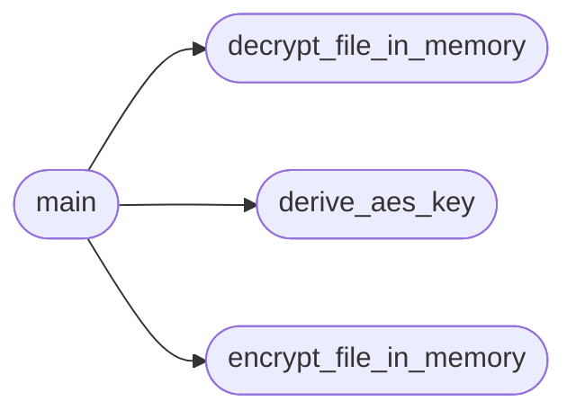

# `enc_dec`

> Source: [enc_dec.py:1](../../enc_dec.py#L1) | language `py` | coverage 100.0% | [API index](../index.md)

Offline admin tool for ML-KEM-512 key-wrap encryption (QuantumVault).

> **Warning:** This script is **not** part of the zero-knowledge user trust path. It is an
> operator-only CLI used to retroactively wrap/unwrap files that were uploaded
> before the browser-based hybrid ML-KEM-768 + X25519 KEM replaced this flow.
> Do not call it from any user-facing route. The browser does the encryption for
> regular users; the server never sees plaintext passwords or private keys.
> 
> The script reads the object-storage endpoint (Garage / S3) from the environment:
> 
>     S3_ENDPOINT_URL   - http://localhost:3900 for local Garage
>     S3_ACCESS_KEY     - scoped Garage key
>     S3_SECRET_KEY     - scoped Garage secret
>     S3_REGION         - S3 region name (default: garage)
>     S3_BUCKET         - bucket name (default: quantumvault)
> 
> When ``S3_ENDPOINT_URL`` is unset, the script falls back to plain AWS S3 using
> the ambient AWS credentials chain. The ``--aws-region`` flag overrides
> ``S3_REGION`` for a single invocation.

## Contents

- **Functions:** [`derive_aes_key`](#derive_aes_key), [`encrypt_file_in_memory`](#encrypt_file_in_memory), [`decrypt_file_in_memory`](#decrypt_file_in_memory), [`main`](#main)

## Call Graph

Solid arrows stay in this module, dashed arrows leave it.



## Functions

<a id="derive_aes_key"></a>

### `derive_aes_key`

`function` | [enc_dec.py:36](../../enc_dec.py#L36)

```python
def derive_aes_key(shared_secret)
```

Derive a 32-byte AES key from an ML-KEM shared secret.

**Parameters**

| Name | Type | Default | Description |
|---|---|---|---|
| `shared_secret` |  |  | The raw shared secret bytes from ``KeyEncapsulation``. |

**Returns:** A 32-byte AES-256 key suitable for use with `AESGCM`.

*Called by:* [`main`](#main)

---

<a id="encrypt_file_in_memory"></a>

### `encrypt_file_in_memory`

`function` | [enc_dec.py:49](../../enc_dec.py#L49)

```python
def encrypt_file_in_memory(data: bytes, aes_key: bytes) -> tuple[bytes, bytes]
```

Encrypt ``data`` in memory with AES-256-GCM and return nonce + ciphertext.

**Parameters**

| Name | Type | Default | Description |
|---|---|---|---|
| `data` | `bytes` |  | The plaintext bytes to encrypt. |
| `aes_key` | `bytes` |  | The 32-byte AES key. |

**Returns:** `tuple[bytes, bytes]` - A tuple ``(nonce, ciphertext)`` where ``nonce`` is 12 random bytes.

*Called by:* [`main`](#main)

---

<a id="decrypt_file_in_memory"></a>

### `decrypt_file_in_memory`

`function` | [enc_dec.py:65](../../enc_dec.py#L65)

```python
def decrypt_file_in_memory(nonce: bytes, ciphertext: bytes, aes_key: bytes) -> bytes
```

Decrypt ``ciphertext`` in memory with AES-256-GCM and return the plaintext.

**Parameters**

| Name | Type | Default | Description |
|---|---|---|---|
| `nonce` | `bytes` |  | The 12-byte nonce from the encrypt step. |
| `ciphertext` | `bytes` |  | The encrypted bytes. |
| `aes_key` | `bytes` |  | The 32-byte AES key. |

**Returns:** `bytes` - The original plaintext bytes.

*Called by:* [`main`](#main)

---

<a id="main"></a>

### `main`

`function` | [enc_dec.py:103](../../enc_dec.py#L103)

```python
def main()
```

Run the offline admin CLI (encrypt or decrypt a single object).

**Raises**

- `ValueError`: (raised in the body, not documented)

*Calls:* [`decrypt_file_in_memory`](#decrypt_file_in_memory), [`derive_aes_key`](#derive_aes_key), [`encrypt_file_in_memory`](#encrypt_file_in_memory)

---
