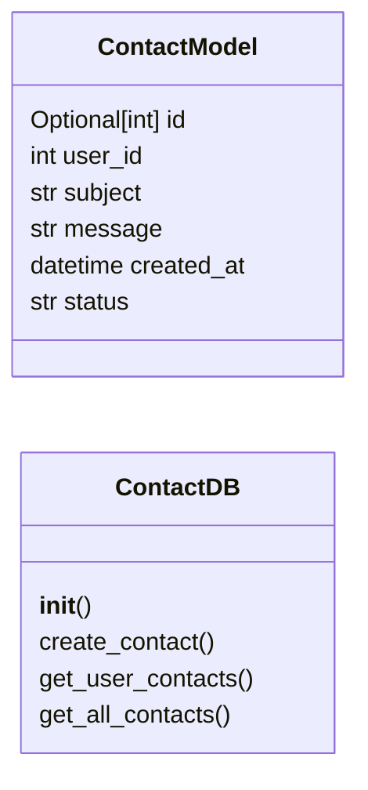

# `models.contact`

> Source: [models/contact.py:1](../../models/contact.py#L1) | language `py` | coverage 85.7% | [API index](../index.md)

## Contents

- **Classes:** [`ContactModel`](#contactmodel), [`ContactDB`](#contactdb)

## Type Diagram



## Classes

<a id="contactmodel"></a>

### `ContactModel`

`class` | [models/contact.py:8](../../models/contact.py#L8)

```python
class ContactModel(BaseModel)
```

Bases: `BaseModel`

Pydantic model for a contact message.

**Attributes**

| Name | Type | Default | Description |
|---|---|---|---|
| [`id`](#contactmodel-id) | `Optional[int]` | `None` | Unique contact ID. |
| [`user_id`](#contactmodel-user_id) | `int` |  | ID of the user who sent the message. |
| [`subject`](#contactmodel-subject) | `str` |  | Subject of the contact message. |
| [`message`](#contactmodel-message) | `str` |  | Content of the contact message. |
| [`created_at`](#contactmodel-created_at) | `datetime` |  | Timestamp when the message was created. |
| [`status`](#contactmodel-status) | `str` | `'pending'` | Status of the message (e.g. 'pending', 'resolved'). |

---

<a id="contactdb"></a>

### `ContactDB`

`class` | [models/contact.py:26](../../models/contact.py#L26)

```python
class ContactDB
```

Database operations for contact messages.

**Members**

| Member | Kind | Summary |
|---|---|---|
| [`__init__`](#contactdb-__init__) | constructor | Initialize the ContactDB with the database path. |
| [`create_contact`](#contactdb-create_contact) | method | Create a new contact message. |
| [`get_user_contacts`](#contactdb-get_user_contacts) | method | Retrieve all contact messages for a user. |
| [`get_all_contacts`](#contactdb-get_all_contacts) | method | Retrieve all contact messages with pagination. |

<a id="contactdb-__init__"></a>

#### `ContactDB.__init__`

`constructor` | [models/contact.py:29](../../models/contact.py#L29)

```python
def __init__(self, db_path: str)
```

Initialize the ContactDB with the database path.

**Parameters**

| Name | Type | Default | Description |
|---|---|---|---|
| `db_path` | `str` |  | Path to the SQLite database file. |

*Called by:* [`ContactController.__init__`](controllers.contact.py.md#contactcontroller-__init__)

<a id="contactdb-create_contact"></a>

#### `ContactDB.create_contact`

`method` | [models/contact.py:52](../../models/contact.py#L52)

```python
def create_contact(self, user_id: int, subject: str, message: str) -> bool
```

Create a new contact message.

**Parameters**

| Name | Type | Default | Description |
|---|---|---|---|
| `user_id` | `int` |  | ID of the user sending the message. |
| `subject` | `str` |  | Subject of the message. |
| `message` | `str` |  | Content of the message. |

**Returns:** `bool` - True on success, False if validation fails or the DB write fails.

*Called by:* [`ContactController.create_contact`](controllers.contact.py.md#contactcontroller-create_contact)

<a id="contactdb-get_user_contacts"></a>

#### `ContactDB.get_user_contacts`

`method` | [models/contact.py:89](../../models/contact.py#L89)

```python
def get_user_contacts(self, user_id: int) -> list[dict]
```

Retrieve all contact messages for a user.

**Parameters**

| Name | Type | Default | Description |
|---|---|---|---|
| `user_id` | `int` |  | ID of the user. |

**Returns:** `list[dict]` - List of contact message dictionaries, newest first. On DB
error, returns an empty list and logs the failure.

*Called by:* [`ContactController.get_user_contacts`](controllers.contact.py.md#contactcontroller-get_user_contacts)

<a id="contactdb-get_all_contacts"></a>

#### `ContactDB.get_all_contacts`

`method` | [models/contact.py:139](../../models/contact.py#L139)

```python
def get_all_contacts(self, page: int = 1, per_page: int = 10) -> tuple[list[dict], int]
```

Retrieve all contact messages with pagination.

**Parameters**

| Name | Type | Default | Description |
|---|---|---|---|
| `page` | `int` | `1` | 1-based page number. |
| `per_page` | `int` | `10` | Number of contacts per page. |

**Returns:** `tuple[list[dict], int]` - ``(rows, total_count)``. ``rows`` may be empty on DB error.

*Called by:* [`admin_contacts`](views.admin.py.md#admin_contacts)

---
