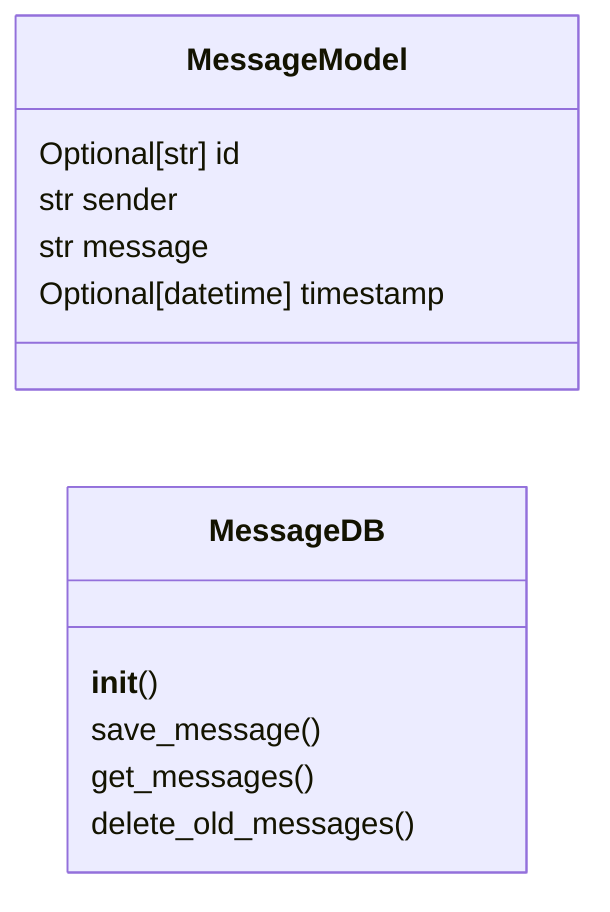
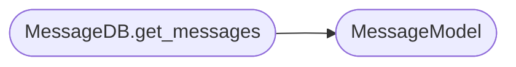

# `models.message`

> Source: [models/message.py:1](../../models/message.py#L1) | language `py` | coverage 100.0% | [API index](../index.md)

Persistence layer for end-to-end encrypted messages.

The browser performs all cryptography: it generates a random 32-byte content
encryption key (CEK), encrypts the message with AES-256-GCM, and wraps the
CEK to the recipient's hybrid public key (and to the sender for the outbox
copy). The server stores only opaque ciphertext + wrapped keys; it never
sees plaintext or can derive the message.

The on-disk format is a tiny key-value file per message::

    <sender>|<encrypted_message_b64>|<cek_for_recipient_b64>|<cek_for_sender_b64>|<iso_timestamp>

The actual decryption happens in the browser via
``static/js/qv-crypto.js`` -- the page that lists messages fetches each
opaque record and unwraps the CEK with the recipient's private blob.

## Contents

- **Classes:** [`MessageModel`](#messagemodel), [`MessageDB`](#messagedb)

## Type Diagram



## Call Graph

Solid arrows stay in this module, dashed arrows leave it.



## Classes

<a id="messagemodel"></a>

### `MessageModel`

`class` | [models/message.py:27](../../models/message.py#L27)

```python
class MessageModel(BaseModel)
```

Bases: `BaseModel`

Pydantic model for a stored message envelope.

**Attributes**

| Name | Type | Default | Description |
|---|---|---|---|
| [`id`](#messagemodel-id) | `Optional[str]` | `None` | Message ID. |
| [`sender`](#messagemodel-sender) | `str` |  | Sender username. |
| [`message`](#messagemodel-message) | `str` |  | Display text. With ZK messages this is the opaque payload returned to the client (the browser decrypts it). |
| [`timestamp`](#messagemodel-timestamp) | `Optional[datetime]` | `None` | When the message was stored. |

---

<a id="messagedb"></a>

### `MessageDB`

`class` | [models/message.py:43](../../models/message.py#L43)

```python
class MessageDB
```

File-based operations for end-to-end encrypted messages.

**Members**

| Member | Kind | Summary |
|---|---|---|
| [`__init__`](#messagedb-__init__) | constructor | Initialize the MessageDB with the base directory for per-user mailboxes. |
| [`save_message`](#messagedb-save_message) | method | Persist an opaque message envelope for the recipient. |
| [`get_messages`](#messagedb-get_messages) | method | Return opaque message envelopes for the recipient. |
| [`delete_old_messages`](#messagedb-delete_old_messages) | method | Delete messages older than ``days`` days from the recipient's mailbox. |

<a id="messagedb-__init__"></a>

#### `MessageDB.__init__`

`constructor` | [models/message.py:46](../../models/message.py#L46)

```python
def __init__(self, base_path: str)
```

Initialize the MessageDB with the base directory for per-user mailboxes.

**Parameters**

| Name | Type | Default | Description |
|---|---|---|---|
| `base_path` | `str` |  | Filesystem path under which each user has a ``messages/`` subdirectory. |

*Called by:* [`MessageController.__init__`](controllers.message.py.md#messagecontroller-__init__), [`init_scheduler`](utils.scheduler.py.md#init_scheduler)

<a id="messagedb-save_message"></a>

#### `MessageDB.save_message`

`method` | [models/message.py:55](../../models/message.py#L55)

```python
def save_message(self, recipient: str, sender: str, encrypted_message_b64: str, cek_for_recipient: str, cek_for_sender: str, message_id: str) -> None
```

Persist an opaque message envelope for the recipient.

**Parameters**

| Name | Type | Default | Description |
|---|---|---|---|
| `recipient` | `str` |  | Recipient username. |
| `sender` | `str` |  | Sender username. |
| `encrypted_message_b64` | `str` |  | AES-256-GCM(CEK, plaintext) as base64 (IV prepended by the browser). |
| `cek_for_recipient` | `str` |  | Hybrid-wrapped CEK to the recipient's public key (base64-encoded JSON from qv-crypto). |
| `cek_for_sender` | `str` |  | Hybrid-wrapped CEK to the sender's public key (so the outbox copy is readable). |
| `message_id` | `str` |  | Unique message ID. |

*Called by:* [`MessageController.send_encrypted_message`](controllers.message.py.md#messagecontroller-send_encrypted_message)

<a id="messagedb-get_messages"></a>

#### `MessageDB.get_messages`

`method` | [models/message.py:87](../../models/message.py#L87)

```python
def get_messages(self, recipient: str, page: int = 1, per_page: int = 10) -> tuple[list[MessageModel], int]
```

Return opaque message envelopes for the recipient.

The browser unwraps the CEK with the user's private blob. This
method never derives any key material.

**Parameters**

| Name | Type | Default | Description |
|---|---|---|---|
| `recipient` | `str` |  | Username whose mailbox to read. |
| `page` | `int` | `1` | 1-indexed page number. |
| `per_page` | `int` | `10` | Messages per page. |

**Returns:** `tuple[list[MessageModel], int]` - A tuple ``(messages, total_pages)`` where each message is
opaque; the `[`message`](#messagemodel-message)` field carries the JSON envelope
``{encrypted_message_b64, cek_for_recipient, cek_for_sender}``
so the browser can decrypt it.

*Calls:* [`MessageModel`](#messagemodel)

*Called by:* [`MessageController.get_messages`](controllers.message.py.md#messagecontroller-get_messages)

<a id="messagedb-delete_old_messages"></a>

#### `MessageDB.delete_old_messages`

`method` | [models/message.py:172](../../models/message.py#L172)

```python
def delete_old_messages(self, recipient: str, days: int = 7) -> None
```

Delete messages older than ``days`` days from the recipient's mailbox.

**Parameters**

| Name | Type | Default | Description |
|---|---|---|---|
| `recipient` | `str` |  | Username whose mailbox to prune. |
| `days` | `int` | `7` | Age threshold in days; older messages are removed. |

---
