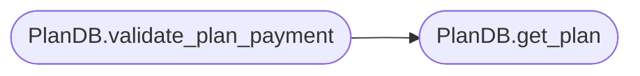

# `models.plans`

> Source: [models/plans.py:1](../../models/plans.py#L1) | language `py` | coverage 88.9% | [API index](../index.md)

## Contents

- **Classes:** [`PlanDB`](#plandb)

## Call Graph

Solid arrows stay in this module, dashed arrows leave it.



## Classes

<a id="plandb"></a>

### `PlanDB`

`class` | [models/plans.py:4](../../models/plans.py#L4)

```python
class PlanDB
```

Database operations for subscription plans.

**Members**

| Member | Kind | Summary |
|---|---|---|
| [`__init__`](#plandb-__init__) | constructor | Initialize the PlanDB with the database path. |
| [`get_plan`](#plandb-get_plan) | method | Retrieve a plan by name. |
| [`get_all_plans`](#plandb-get_all_plans) | method | Retrieve all plans. |
| [`create_plan`](#plandb-create_plan) | method | Create a new plan. |
| [`update_plan`](#plandb-update_plan) | method | Update an existing plan. |
| [`delete_plan`](#plandb-delete_plan) | method | Delete a plan by name. |
| [`validate_plan_payment`](#plandb-validate_plan_payment) | method | Validate that the paid amount matches the plan price. |

<a id="plandb-__init__"></a>

#### `PlanDB.__init__`

`constructor` | [models/plans.py:6](../../models/plans.py#L6)

```python
def __init__(self, db_path: str)
```

Initialize the PlanDB with the database path.

**Parameters**

| Name | Type | Default | Description |
|---|---|---|---|
| `db_path` | `str` |  | Path to the SQLite database file. |

*Called by:* [`AuthController.register`](controllers.auth.py.md#authcontroller-register), [`admin`](views.admin.py.md#admin), [`edit_plan`](views.admin.py.md#edit_plan), [`manage_plans`](views.admin.py.md#manage_plans), [`landing`](views.faq.py.md#landing), [`SubscriptionForm.__init__`](views.subscription.py.md#subscriptionform-__init__), [`payment_success`](views.subscription.py.md#payment_success), [`subscribe`](views.subscription.py.md#subscribe)

<a id="plandb-get_plan"></a>

#### `PlanDB.get_plan`

`method` | [models/plans.py:37](../../models/plans.py#L37)

```python
def get_plan(self, plan_name: str) -> Optional[Dict]
```

Retrieve a plan by name.

**Parameters**

| Name | Type | Default | Description |
|---|---|---|---|
| `plan_name` | `str` |  | Name of the plan to search for. |

**Returns:** `Optional[Dict]` - Plan data as a dictionary or None if not found.

*Called by:* [`AuthController.register`](controllers.auth.py.md#authcontroller-register), [`PlanDB.validate_plan_payment`](#plandb-validate_plan_payment), [`edit_plan`](views.admin.py.md#edit_plan), [`payment_success`](views.subscription.py.md#payment_success), [`subscribe`](views.subscription.py.md#subscribe)

<a id="plandb-get_all_plans"></a>

#### `PlanDB.get_all_plans`

`method` | [models/plans.py:50](../../models/plans.py#L50)

```python
def get_all_plans(self) -> List[Dict]
```

Retrieve all plans.

**Returns:** `List[Dict]` - List of dictionaries containing plan data.

*Called by:* [`admin`](views.admin.py.md#admin), [`manage_plans`](views.admin.py.md#manage_plans), [`landing`](views.faq.py.md#landing), [`SubscriptionForm.__init__`](views.subscription.py.md#subscriptionform-__init__)

<a id="plandb-create_plan"></a>

#### `PlanDB.create_plan`

`method` | [models/plans.py:60](../../models/plans.py#L60)

```python
def create_plan(self, name: str, storage_quota: int, trial_days: int, price: float) -> None
```

Create a new plan.

**Parameters**

| Name | Type | Default | Description |
|---|---|---|---|
| `name` | `str` |  | Name of the plan. |
| `storage_quota` | `int` |  | Storage quota in bytes. |
| `trial_days` | `int` |  | Number of trial days. |
| `price` | `float` |  | Price of the plan. |

**Raises**

- `Exception`: (raised in the body, not documented)

*Called by:* [`manage_plans`](views.admin.py.md#manage_plans)

<a id="plandb-update_plan"></a>

#### `PlanDB.update_plan`

`method` | [models/plans.py:78](../../models/plans.py#L78)

```python
def update_plan(self, name: str, storage_quota: Optional[int] = None, trial_days: Optional[int] = None, price: Optional[float] = None) -> None
```

Update an existing plan.

**Parameters**

| Name | Type | Default | Description |
|---|---|---|---|
| `name` | `str` |  | Name of the plan to update. |
| `storage_quota` | `Optional[int]` | `None` | New storage quota in bytes. |
| `trial_days` | `Optional[int]` | `None` | New number of trial days. |
| `price` | `Optional[float]` | `None` | New price of the plan. |

**Raises**

- `Exception`: (raised in the body, not documented)

*Called by:* [`edit_plan`](views.admin.py.md#edit_plan)

<a id="plandb-delete_plan"></a>

#### `PlanDB.delete_plan`

`method` | [models/plans.py:113](../../models/plans.py#L113)

```python
def delete_plan(self, name: str) -> None
```

Delete a plan by name.

**Parameters**

| Name | Type | Default | Description |
|---|---|---|---|
| `name` | `str` |  | Name of the plan to delete. |

**Raises**

- `Exception`: (raised in the body, not documented)

<a id="plandb-validate_plan_payment"></a>

#### `PlanDB.validate_plan_payment`

`method` | [models/plans.py:139](../../models/plans.py#L139)

```python
def validate_plan_payment(self, plan_name: str, amount_paid: float) -> bool
```

Validate that the paid amount matches the plan price.

**Parameters**

| Name | Type | Default | Description |
|---|---|---|---|
| `plan_name` | `str` |  | Name of the plan. |
| `amount_paid` | `float` |  | Amount paid. |

**Returns:** `bool` - True if the amount matches the plan price within tolerance.

*Calls:* [`PlanDB.get_plan`](#plandb-get_plan)

*Called by:* [`payment_success`](views.subscription.py.md#payment_success)

---
