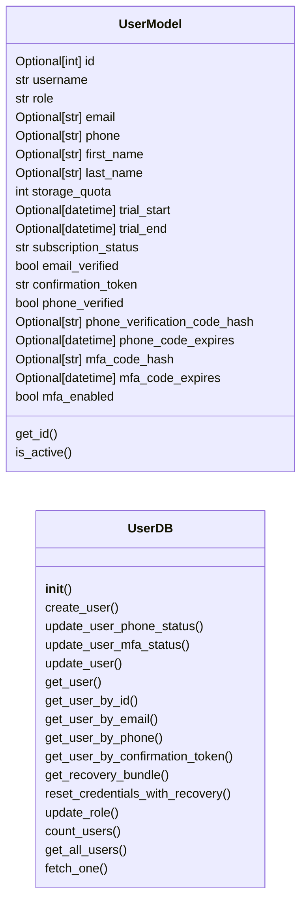
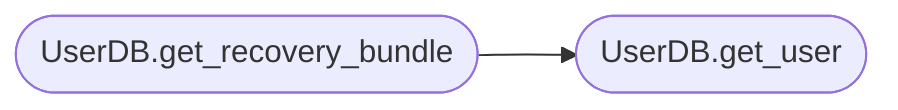

# `models.user`

> Source: [models/user.py:1](../../models/user.py#L1) | language `py` | coverage 95.2% | [API index](../index.md)

## Contents

- **Classes:** [`UserModel`](#usermodel), [`UserDB`](#userdb)

## Type Diagram



## Call Graph

Solid arrows stay in this module, dashed arrows leave it.



## Classes

<a id="usermodel"></a>

### `UserModel`

`class` | [models/user.py:8](../../models/user.py#L8)

```python
class UserModel(BaseModel, UserMixin)
```

Bases: `BaseModel`, `UserMixin`

Pydantic model for a user with Flask-Login support.

**Attributes**

| Name | Type | Default | Description |
|---|---|---|---|
| [`id`](#usermodel-id) | `Optional[int]` | `None` | Unique user ID. |
| [`username`](#usermodel-username) | `str` |  | Unique username. |
| [`role`](#usermodel-role) | `str` | `'free'` | User role (free, bronze, silver, gold, admin, superadmin). |
| [`email`](#usermodel-email) | `Optional[str]` | `None` | User's email address. |
| [`phone`](#usermodel-phone) | `Optional[str]` | `None` | User's phone number. |
| [`first_name`](#usermodel-first_name) | `Optional[str]` | `None` | User's first name. |
| [`last_name`](#usermodel-last_name) | `Optional[str]` | `None` | User's last name. |
| [`storage_quota`](#usermodel-storage_quota) | `int` | `10 * 1024 * 1024` | Storage quota in bytes. |
| [`trial_start`](#usermodel-trial_start) | `Optional[datetime]` | `None` | Trial period start date. |
| [`trial_end`](#usermodel-trial_end) | `Optional[datetime]` | `None` | Trial period end date. |
| [`subscription_status`](#usermodel-subscription_status) | `str` | `'active'` | Subscription status (active, inactive). |
| [`email_verified`](#usermodel-email_verified) | `bool` | `False` | Whether the email is verified. |
| [`confirmation_token`](#usermodel-confirmation_token) | `str` | `''` | Email confirmation token. |
| [`phone_verified`](#usermodel-phone_verified) | `bool` | `False` | Whether the phone number is verified. |
| [`phone_verification_code_hash`](#usermodel-phone_verification_code_hash) | `Optional[str]` | `None` | Peppered hash of the phone verification code. |
| [`phone_code_expires`](#usermodel-phone_code_expires) | `Optional[datetime]` | `None` | Phone verification code expiration. |
| [`mfa_code_hash`](#usermodel-mfa_code_hash) | `Optional[str]` | `None` | Peppered hash of the current MFA code. |
| [`mfa_code_expires`](#usermodel-mfa_code_expires) | `Optional[datetime]` | `None` | MFA code expiration. |
| [`mfa_enabled`](#usermodel-mfa_enabled) | `bool` | `False` | Whether MFA is enabled for the user. |

**Members**

| Member | Kind | Summary |
|---|---|---|
| [`get_id`](#usermodel-get_id) | method | Return the user ID as a string (required by Flask-Login). |
| [`is_active`](#usermodel-is_active) | property | Return True while the user can use the application. |

<a id="usermodel-get_id"></a>

#### `UserModel.get_id`

`method` | [models/user.py:52](../../models/user.py#L52)

```python
def get_id(self) -> str
```

Return the user ID as a string (required by Flask-Login).

**Returns:** `str` - The user ID as a string, or an empty string when the
user is anonymous.

<a id="usermodel-is_active"></a>

#### `UserModel.is_active`

`property` | [models/user.py:70](../../models/user.py#L70)

Decorators: `@property`

```python
def is_active(self) -> bool
```

Return True while the user can use the application.

Inactive (lapsed-subscription) users can still sign in to renew
or download their data, so we do NOT tie this to
`[`subscription_status`](#usermodel-subscription_status)`. The previous implementation returned
False for inactive users, which logged them out of every
@login_required route. Subscription-gated features should
check `[`subscription_status`](#usermodel-subscription_status)` directly in the view that needs
the gate, not via Flask-Login's activation hook.

**Returns:** `bool`

---

<a id="userdb"></a>

### `UserDB`

`class` | [models/user.py:83](../../models/user.py#L83)

```python
class UserDB
```

Database operations for users.

**Members**

| Member | Kind | Summary |
|---|---|---|
| [`__init__`](#userdb-__init__) | constructor | Initialize the UserDB with the database path. |
| [`create_user`](#userdb-create_user) | method | Persist a new user from client-provided zero-knowledge credentials. |
| [`update_user_phone_status`](#userdb-update_user_phone_status) | method | Update phone verification status and related fields. |
| [`update_user_mfa_status`](#userdb-update_user_mfa_status) | method | Update MFA code, expiration, and enabled status. |
| [`update_user`](#userdb-update_user) | method | Update specific user fields. |
| [`get_user`](#userdb-get_user) | method | Retrieve a user by username. |
| [`get_user_by_id`](#userdb-get_user_by_id) | method | Retrieve a user by ID. |
| [`get_user_by_email`](#userdb-get_user_by_email) | method | Retrieve a user by email address. |
| [`get_user_by_phone`](#userdb-get_user_by_phone) | method | Retrieve a user by phone number. |
| [`get_user_by_confirmation_token`](#userdb-get_user_by_confirmation_token) | method | Retrieve a user by confirmation token. |
| [`get_recovery_bundle`](#userdb-get_recovery_bundle) | method | Return the QV-RECOVERY-1 bundle for a username, if one exists. |
| [`reset_credentials_with_recovery`](#userdb-reset_credentials_with_recovery) | method | Replace a user's password-derived credentials after a verified recovery. |
| [`update_role`](#userdb-update_role) | method | Update a user's role, storage quota, and subscription status. |
| [`count_users`](#userdb-count_users) | method | Return the total number of users. |
| [`get_all_users`](#userdb-get_all_users) | method | Retrieve all users. |
| [`fetch_one`](#userdb-fetch_one) | method | Execute a query and return the first result as a dictionary. |

<a id="userdb-__init__"></a>

#### `UserDB.__init__`

`constructor` | [models/user.py:85](../../models/user.py#L85)

```python
def __init__(self, db_path: str)
```

Initialize the UserDB with the database path.

**Parameters**

| Name | Type | Default | Description |
|---|---|---|---|
| `db_path` | `str` |  | Path to the SQLite database file. |

*Called by:* [`create_app`](app_factory.py.md#create_app), [`AuthController.__init__`](controllers.auth.py.md#authcontroller-__init__), [`MessageController.__init__`](controllers.message.py.md#messagecontroller-__init__), [`cmd_confirm`](scripts.email_tool.py.md#cmd_confirm), [`cmd_link`](scripts.email_tool.py.md#cmd_link), [`cmd_promote`](scripts.makeadmin.py.md#cmd_promote), [`init_scheduler`](utils.scheduler.py.md#init_scheduler), [`superadmin`](views.admin.py.md#superadmin), [`superadmin_edit_user`](views.admin.py.md#superadmin_edit_user), [`superadmin_resend_confirmation`](views.admin.py.md#superadmin_resend_confirmation), [`superadmin_reset_mfa`](views.admin.py.md#superadmin_reset_mfa), [`superadmin_toggle_suspend`](views.admin.py.md#superadmin_toggle_suspend) and 2 more

<a id="userdb-create_user"></a>

#### `UserDB.create_user`

`method` | [models/user.py:325](../../models/user.py#L325)

```python
def create_user(self, username: str, srp_salt: str, srp_verifier: str, public_key: str, encrypted_private_key: str, kdf_salt: str, email: str, phone: str, first_name: str, last_name: str, role: str, storage_quota: int, trial_start: Optional[datetime], trial_end: Optional[datetime], subscription_status: str, email_verified: bool, confirmation_token: Optional[str], phone_verified: bool, phone_verification_code_hash: Optional[str], phone_code_expires: Optional[datetime], mfa_enabled: bool, recovery_salt: Optional[str] = None, encrypted_private_key_recovery: Optional[str] = None) -> None
```

Persist a new user from client-provided zero-knowledge credentials.

All cryptographic material (salt, verifier, public key, encrypted
private key, KDF salt) is generated on the client; this method only
stores opaque values and never derives or sees the password.
Phone and MFA codes are stored as the peppered hash supplied by
the controller; the plaintext only ever lives in the SMS that
leaves the building.

``recovery_salt`` and ``encrypted_private_key_recovery`` are the
QV-RECOVERY-1 fields: an independent PBKDF2 salt and AES-256-GCM
wrapping of the same ``privateBlob``, keyed by a client-generated
high-entropy recovery code instead of the account password. Both
are optional so older clients that do not yet generate a recovery
code can still register.

**Parameters**

| Name | Type | Default | Description |
|---|---|---|---|
| `username` | `str` |  |  |
| `srp_salt` | `str` |  |  |
| `srp_verifier` | `str` |  |  |
| `public_key` | `str` |  |  |
| `encrypted_private_key` | `str` |  |  |
| `kdf_salt` | `str` |  |  |
| `email` | `str` |  |  |
| `phone` | `str` |  |  |
| `first_name` | `str` |  |  |
| `last_name` | `str` |  |  |
| `role` | `str` |  |  |
| `storage_quota` | `int` |  |  |
| `trial_start` | `Optional[datetime]` |  |  |
| `trial_end` | `Optional[datetime]` |  |  |
| `subscription_status` | `str` |  |  |
| `email_verified` | `bool` |  |  |
| `confirmation_token` | `Optional[str]` |  |  |
| `phone_verified` | `bool` |  |  |
| `phone_verification_code_hash` | `Optional[str]` |  |  |
| `phone_code_expires` | `Optional[datetime]` |  |  |
| `mfa_enabled` | `bool` |  |  |
| `recovery_salt` | `Optional[str]` | `None` |  |
| `encrypted_private_key_recovery` | `Optional[str]` | `None` |  |

*Called by:* [`AuthController.register`](controllers.auth.py.md#authcontroller-register)

<a id="userdb-update_user_phone_status"></a>

#### `UserDB.update_user_phone_status`

`method` | [models/user.py:362](../../models/user.py#L362)

```python
def update_user_phone_status(self, username: str, phone_verified: bool = None, phone_verification_code_hash: Optional[str] = None, phone_code_expires: Optional[datetime] = None)
```

Update phone verification status and related fields.

The `[`phone_verification_code_hash`](#usermodel-phone_verification_code_hash)` parameter accepts the
peppered SHA-256 digest. Passing ``None`` clears the stored
hash (e.g. after the user verifies successfully).

**Parameters**

| Name | Type | Default | Description |
|---|---|---|---|
| `username` | `str` |  |  |
| `phone_verified` | `bool` | `None` |  |
| `phone_verification_code_hash` | `Optional[str]` | `None` |  |
| `phone_code_expires` | `Optional[datetime]` | `None` |  |

*Called by:* [`AuthController.resend_phone_code`](controllers.auth.py.md#authcontroller-resend_phone_code), [`AuthController.verify_phone_code`](controllers.auth.py.md#authcontroller-verify_phone_code), [`superadmin_edit_user`](views.admin.py.md#superadmin_edit_user)

<a id="userdb-update_user_mfa_status"></a>

#### `UserDB.update_user_mfa_status`

`method` | [models/user.py:396](../../models/user.py#L396)

```python
def update_user_mfa_status(self, username: str, mfa_code_hash: Optional[str] = None, mfa_code_expires: Optional[datetime] = None, mfa_enabled: Optional[bool] = None)
```

Update MFA code, expiration, and enabled status.

The `[`mfa_code_hash`](#usermodel-mfa_code_hash)` parameter accepts the peppered SHA-256
digest of the freshly-generated 6-digit code. `[`mfa_enabled`](#usermodel-mfa_enabled)` is
a tri-state: ``None`` leaves the value alone.

**Parameters**

| Name | Type | Default | Description |
|---|---|---|---|
| `username` | `str` |  |  |
| `mfa_code_hash` | `Optional[str]` | `None` |  |
| `mfa_code_expires` | `Optional[datetime]` | `None` |  |
| `mfa_enabled` | `Optional[bool]` | `None` |  |

*Called by:* [`AuthController.send_mfa_code`](controllers.auth.py.md#authcontroller-send_mfa_code), [`AuthController.toggle_mfa`](controllers.auth.py.md#authcontroller-toggle_mfa), [`AuthController.verify_mfa_code`](controllers.auth.py.md#authcontroller-verify_mfa_code), [`superadmin_reset_mfa`](views.admin.py.md#superadmin_reset_mfa)

<a id="userdb-update_user"></a>

#### `UserDB.update_user`

`method` | [models/user.py:430](../../models/user.py#L430)

```python
def update_user(self, username: str, email_verified: Optional[bool] = None, confirmation_token: Optional[str] = None)
```

Update specific user fields.

**Parameters**

| Name | Type | Default | Description |
|---|---|---|---|
| `username` | `str` |  |  |
| `email_verified` | `Optional[bool]` | `None` |  |
| `confirmation_token` | `Optional[str]` | `None` |  |

*Called by:* [`cmd_confirm`](scripts.email_tool.py.md#cmd_confirm), [`superadmin_edit_user`](views.admin.py.md#superadmin_edit_user), [`superadmin_resend_confirmation`](views.admin.py.md#superadmin_resend_confirmation)

<a id="userdb-get_user"></a>

#### `UserDB.get_user`

`method` | [models/user.py:454](../../models/user.py#L454)

```python
def get_user(self, username: str) -> Optional[dict]
```

Retrieve a user by username.

**Parameters**

| Name | Type | Default | Description |
|---|---|---|---|
| `username` | `str` |  | Username to search for. |

**Returns:** `Optional[dict]` - User data as a dictionary or None if not found.

*Called by:* [`AuthController.resend_phone_code`](controllers.auth.py.md#authcontroller-resend_phone_code), [`AuthController.send_mfa_code`](controllers.auth.py.md#authcontroller-send_mfa_code), [`AuthController.srp_hello`](controllers.auth.py.md#authcontroller-srp_hello), [`AuthController.srp_verify`](controllers.auth.py.md#authcontroller-srp_verify), [`AuthController.verify_mfa_code`](controllers.auth.py.md#authcontroller-verify_mfa_code), [`AuthController.verify_phone_code`](controllers.auth.py.md#authcontroller-verify_phone_code), [`MessageController.send_encrypted_message`](controllers.message.py.md#messagecontroller-send_encrypted_message), [`UserDB.get_recovery_bundle`](#userdb-get_recovery_bundle), [`cmd_confirm`](scripts.email_tool.py.md#cmd_confirm), [`cmd_link`](scripts.email_tool.py.md#cmd_link), [`cmd_promote`](scripts.makeadmin.py.md#cmd_promote), [`superadmin_edit_user`](views.admin.py.md#superadmin_edit_user) and 3 more

<a id="userdb-get_user_by_id"></a>

#### `UserDB.get_user_by_id`

`method` | [models/user.py:468](../../models/user.py#L468)

```python
def get_user_by_id(self, user_id: int) -> Optional[dict]
```

Retrieve a user by ID.

**Parameters**

| Name | Type | Default | Description |
|---|---|---|---|
| `user_id` | `int` |  | ID of the user to search for. |

**Returns:** `Optional[dict]` - User data as a dictionary or None if not found.

*Called by:* [`create_app`](app_factory.py.md#create_app)

<a id="userdb-get_user_by_email"></a>

#### `UserDB.get_user_by_email`

`method` | [models/user.py:482](../../models/user.py#L482)

```python
def get_user_by_email(self, email: str) -> Optional[dict]
```

Retrieve a user by email address.

**Parameters**

| Name | Type | Default | Description |
|---|---|---|---|
| `email` | `str` |  | Email address to search for. |

**Returns:** `Optional[dict]` - User data as a dictionary or None if not found.

<a id="userdb-get_user_by_phone"></a>

#### `UserDB.get_user_by_phone`

`method` | [models/user.py:496](../../models/user.py#L496)

```python
def get_user_by_phone(self, phone: str) -> Optional[dict]
```

Retrieve a user by phone number.

**Parameters**

| Name | Type | Default | Description |
|---|---|---|---|
| `phone` | `str` |  | Phone number to search for. |

**Returns:** `Optional[dict]` - User data as a dictionary or None if not found.

<a id="userdb-get_user_by_confirmation_token"></a>

#### `UserDB.get_user_by_confirmation_token`

`method` | [models/user.py:510](../../models/user.py#L510)

```python
def get_user_by_confirmation_token(self, token: str) -> Optional[dict]
```

Retrieve a user by confirmation token.

**Parameters**

| Name | Type | Default | Description |
|---|---|---|---|
| `token` | `str` |  | Confirmation token to search for. |

**Returns:** `Optional[dict]` - User data as a dictionary or None if not found.

<a id="userdb-get_recovery_bundle"></a>

#### `UserDB.get_recovery_bundle`

`method` | [models/user.py:524](../../models/user.py#L524)

```python
def get_recovery_bundle(self, username: str) -> Optional[dict]
```

Return the QV-RECOVERY-1 bundle for a username, if one exists.

**Parameters**

| Name | Type | Default | Description |
|---|---|---|---|
| `username` | `str` |  | Username to look up. |

**Returns:** `Optional[dict]` - A dict with ``recovery_salt``, ``encrypted_private_key_recovery``,
and ``public_key`` if the account has a recovery bundle
configured, or ``None`` if the account does not exist or has
not generated a recovery code (e.g. accounts created before
QV-RECOVERY-1 was added).

*Calls:* [`UserDB.get_user`](#userdb-get_user)

<a id="userdb-reset_credentials_with_recovery"></a>

#### `UserDB.reset_credentials_with_recovery`

`method` | [models/user.py:548](../../models/user.py#L548)

```python
def reset_credentials_with_recovery(self, username: str, srp_salt: str, srp_verifier: str, kdf_salt: str, encrypted_private_key: str) -> None
```

Replace a user's password-derived credentials after a verified recovery.

Called only after the caller has verified ``public_key_proof``
against the stored ``public_key`` (proof that the requester
possesses the recovery code, since it is the only way to recover
the matching ``privateBlob`` and re-derive the public key). The
``public_key`` and the underlying keypair are unchanged; only the
SRP verifier and the password-wrapping of the existing private key
blob are replaced.

**Parameters**

| Name | Type | Default | Description |
|---|---|---|---|
| `username` | `str` |  | Username whose credentials are being reset. |
| `srp_salt` | `str` |  | New SRP salt, hex-encoded. |
| `srp_verifier` | `str` |  | New SRP verifier, hex-encoded. |
| `kdf_salt` | `str` |  | New PBKDF2 salt for the password-wrapped private key, hex-encoded. |
| `encrypted_private_key` | `str` |  | The same private key blob, re-wrapped under the new password. |

<a id="userdb-update_role"></a>

#### `UserDB.update_role`

`method` | [models/user.py:579](../../models/user.py#L579)

```python
def update_role(self, username: str, role: str, storage_quota: int = 10 * 1024 * 1024, subscription_status: str = 'active') -> None
```

Update a user's role, storage quota, and subscription status.

**Parameters**

| Name | Type | Default | Description |
|---|---|---|---|
| `username` | `str` |  | Username of the user to update. |
| `role` | `str` |  | New role for the user. |
| `storage_quota` | `int` | `10 * 1024 * 1024` | New storage quota in bytes (default: 10MB). |
| `subscription_status` | `str` | `'active'` | New subscription status (default: 'active'). |

*Called by:* [`cmd_promote`](scripts.makeadmin.py.md#cmd_promote), [`superadmin_edit_user`](views.admin.py.md#superadmin_edit_user), [`superadmin_toggle_suspend`](views.admin.py.md#superadmin_toggle_suspend), [`payment_success`](views.subscription.py.md#payment_success)

<a id="userdb-count_users"></a>

#### `UserDB.count_users`

`method` | [models/user.py:592](../../models/user.py#L592)

```python
def count_users(self) -> int
```

Return the total number of users.

Implemented as ``SELECT COUNT(*)`` rather than ``len(get_all_users())``
so the home page does not materialise the entire table on every
request.

**Returns:** `int`

*Called by:* [`home`](views.views.py.md#home)

<a id="userdb-get_all_users"></a>

#### `UserDB.get_all_users`

`method` | [models/user.py:603](../../models/user.py#L603)

```python
def get_all_users(self) -> list[dict]
```

Retrieve all users.

**Returns:** `list[dict]` - List of dictionaries containing user data.

*Called by:* [`superadmin`](views.admin.py.md#superadmin)

<a id="userdb-fetch_one"></a>

#### `UserDB.fetch_one`

`method` | [models/user.py:694](../../models/user.py#L694)

```python
def fetch_one(self, query: str, params: tuple = ()) -> Optional[dict]
```

Execute a query and return the first result as a dictionary.

**Parameters**

| Name | Type | Default | Description |
|---|---|---|---|
| `query` | `str` |  | SQL query to execute. |
| `params` | `tuple` | `()` | Parameters for the query (default: empty tuple). |

**Returns:** `Optional[dict]` - First row as a dictionary or None if no results or an error occurs.

---
