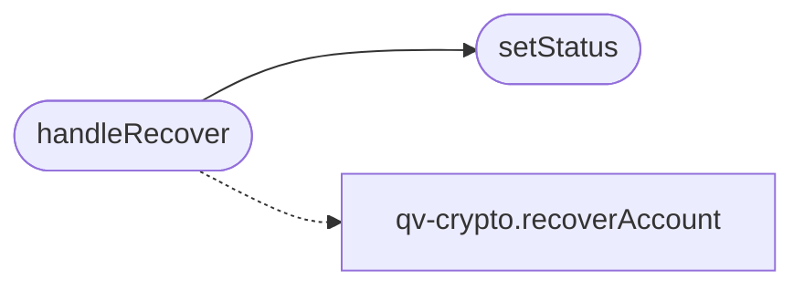

# `quantumvault/static/js/recover.js`

> Source: [quantumvault/static/js/recover.js:1](../../quantumvault/static/js/recover.js#L1) | language `js` | coverage 25.0% | [API index](../index.md)

Account recovery page controller (QV-RECOVERY-1 flow).

Loaded as an external ES module so it complies with the strict Content-Security-Policy (script-src 'self'), which forbids inline scripts and inline event handlers. recoverAccount() in qv-crypto.js fetches the account's recovery bundle, decrypts the private key blob entirely in the browser using a key derived from the recovery code, and re-wraps it under the new password. The recovery code and the new password never leave the browser.

## Contents

- **Functions:** [`setStatus`](#setstatus), [`handleRecover`](#handlerecover), [`init`](#init)

## Call Graph

Solid arrows stay in this module, dashed arrows leave it.



## Functions

<a id="setstatus"></a>

### `setStatus`

`function` | [quantumvault/static/js/recover.js:15](../../quantumvault/static/js/recover.js#L15)

```javascript
function setStatus(el, message, isError)
```

**Parameters**

| Name | Type | Default | Description |
|---|---|---|---|
| `el` |  |  |  |
| `message` |  |  |  |
| `isError` |  |  |  |

*Called by:* [`handleRecover`](#handlerecover)

---

<a id="handlerecover"></a>

### `handleRecover`

`function` `async` | [quantumvault/static/js/recover.js:22](../../quantumvault/static/js/recover.js#L22)

```javascript
async function handleRecover(event)
```

**Parameters**

| Name | Type | Default | Description |
|---|---|---|---|
| `event` |  |  |  |

*Calls:* [`recoverAccount`](quantumvault.static.js.qv-crypto.js.md#recoveraccount), [`setStatus`](#setstatus)

---

<a id="init"></a>

### `init`

`function` | [quantumvault/static/js/recover.js:80](../../quantumvault/static/js/recover.js#L80)

```javascript
function init()
```

---
