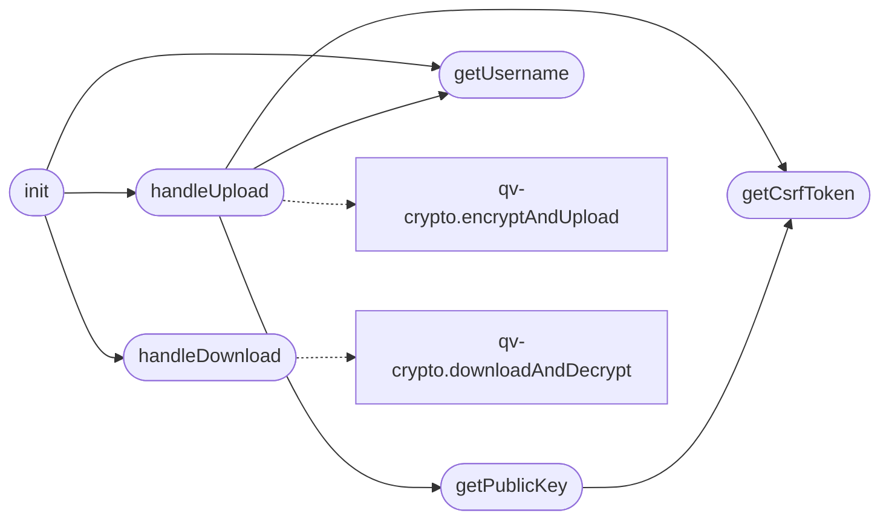

# `quantumvault/static/js/upload.js`

> Source: [quantumvault/static/js/upload.js:1](../../quantumvault/static/js/upload.js#L1) | language `js` | coverage 14.3% | [API index](../index.md)

Upload page controller (zero-knowledge file storage).

Loaded as an external ES module so it complies with the strict Content-Security-Policy (script-src 'self'). The browser derives a fresh file key, encrypts the file with AES-256-GCM, and wraps the key to the user's hybrid public key. Downloads are decrypted locally after prompting for the password. The server never sees plaintext, the file key, or the password.

## Contents

- **Functions:** [`getCsrfToken`](#getcsrftoken), [`getUsername`](#getusername), [`getPublicKey`](#getpublickey), [`handleUpload`](#handleupload), [`handleDownload`](#handledownload), [`init`](#init)

## Call Graph

Solid arrows stay in this module, dashed arrows leave it.



## Functions

<a id="getcsrftoken"></a>

### `getCsrfToken`

`function` | [quantumvault/static/js/upload.js:12](../../quantumvault/static/js/upload.js#L12)

```javascript
function getCsrfToken()
```

*Called by:* [`getPublicKey`](#getpublickey), [`handleUpload`](#handleupload)

---

<a id="getusername"></a>

### `getUsername`

`function` | [quantumvault/static/js/upload.js:17](../../quantumvault/static/js/upload.js#L17)

```javascript
function getUsername(uploadForm)
```

**Parameters**

| Name | Type | Default | Description |
|---|---|---|---|
| `uploadForm` |  |  |  |

*Called by:* [`handleUpload`](#handleupload), [`init`](#init)

---

<a id="getpublickey"></a>

### `getPublicKey`

`function` `async` | [quantumvault/static/js/upload.js:23](../../quantumvault/static/js/upload.js#L23)

```javascript
async function getPublicKey(username)
```

**Parameters**

| Name | Type | Default | Description |
|---|---|---|---|
| `username` |  |  |  |

*Calls:* [`getCsrfToken`](#getcsrftoken)

*Called by:* [`handleUpload`](#handleupload)

---

<a id="handleupload"></a>

### `handleUpload`

`function` `async` | [quantumvault/static/js/upload.js:40](../../quantumvault/static/js/upload.js#L40)

```javascript
async function handleUpload(event, uploadForm, fileInput, submitButton)
```

**Parameters**

| Name | Type | Default | Description |
|---|---|---|---|
| `event` |  |  |  |
| `uploadForm` |  |  |  |
| `fileInput` |  |  |  |
| `submitButton` |  |  |  |

*Calls:* [`encryptAndUpload`](quantumvault.static.js.qv-crypto.js.md#encryptandupload), [`getCsrfToken`](#getcsrftoken), [`getPublicKey`](#getpublickey), [`getUsername`](#getusername)

*Called by:* [`init`](#init)

---

<a id="handledownload"></a>

### `handleDownload`

`function` `async` | [quantumvault/static/js/upload.js:74](../../quantumvault/static/js/upload.js#L74)

```javascript
async function handleDownload(event, username)
```

**Parameters**

| Name | Type | Default | Description |
|---|---|---|---|
| `event` |  |  |  |
| `username` |  |  |  |

*Calls:* [`downloadAndDecrypt`](quantumvault.static.js.qv-crypto.js.md#downloadanddecrypt)

*Called by:* [`init`](#init)

---

<a id="init"></a>

### `init`

`function` | [quantumvault/static/js/upload.js:97](../../quantumvault/static/js/upload.js#L97)

```javascript
function init()
```

*Calls:* [`getUsername`](#getusername), [`handleDownload`](#handledownload), [`handleUpload`](#handleupload)

---
