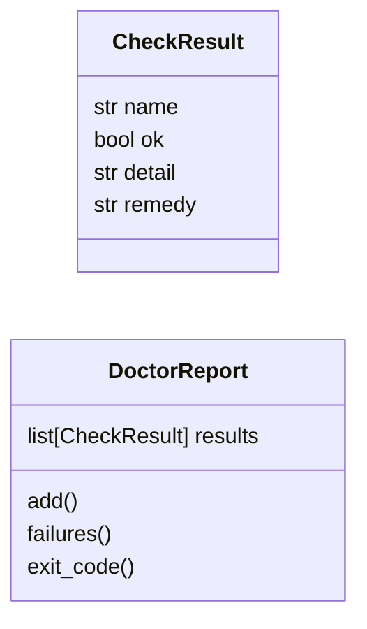
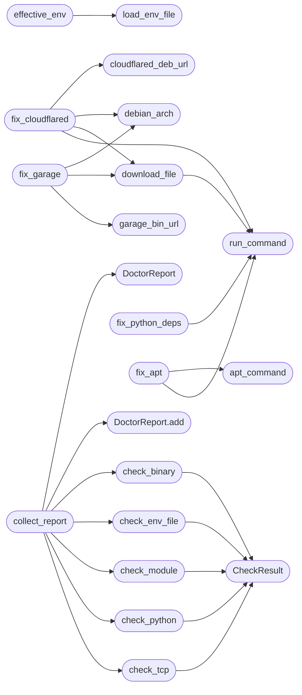

# `scripts.doctor`

> Source: [scripts/doctor.py:1](../../scripts/doctor.py#L1) | language `py` | coverage 100.0% | [API index](../index.md)

Doctor: verify and repair the QuantumVault operator environment.

Used by ``make doctor`` (check only) and ``make doctor-fix`` (check
plus install every missing piece that has an unattended installer).

Stdlib only, so it runs even when no project dependency is installed.
Every knob is overridable through the environment; module-level
constants are the single source of truth for defaults.

Checks cover Python modules, system binaries (openssl, redis-server,
tor, cloudflared, docker, node), the ``.env`` file, and TCP
reachability of Redis and the Garage S3 endpoint. ``--fix`` installs
Python dependencies from ``requirements.txt``, Debian packages via
apt, the cloudflared binary from the official Cloudflare release,
and the garage binary from the official release server. Anything
that cannot be installed unattended is reported in plain English
with the exact command to run or the instruction to contact the
server administrator.

## Contents

- **Classes:** [`CheckResult`](#checkresult), [`DoctorReport`](#doctorreport)
- **Functions:** [`load_env_file`](#load_env_file), [`effective_env`](#effective_env), [`check_python`](#check_python), [`check_module`](#check_module), [`check_binary`](#check_binary), [`check_env_file`](#check_env_file), [`parse_host_port`](#parse_host_port), [`check_tcp`](#check_tcp), [`debian_arch`](#debian_arch), [`cloudflared_deb_url`](#cloudflared_deb_url), [`garage_bin_url`](#garage_bin_url), [`apt_command`](#apt_command), [`run_command`](#run_command), [`download_file`](#download_file), [`upsert_env`](#upsert_env), [`fix_python_deps`](#fix_python_deps), [`fix_apt`](#fix_apt), [`fix_cloudflared`](#fix_cloudflared), [`fix_garage`](#fix_garage), [`collect_report`](#collect_report), [`print_report`](#print_report), [`apply_fixes`](#apply_fixes), [`main`](#main)
- **Constants:** [`MODULES`](#modules)

## Type Diagram



## Call Graph

Solid arrows stay in this module, dashed arrows leave it.



## Classes

<a id="checkresult"></a>

### `CheckResult`

`class` `dataclass` | [scripts/doctor.py:98](../../scripts/doctor.py#L98)

Decorators: `@dataclass(frozen=True)`

```python
class CheckResult
```

Outcome of one environment check with a repair hint.

**Attributes**

| Name | Type | Default | Description |
|---|---|---|---|
| [`name`](#checkresult-name) | `str` |  |  |
| [`ok`](#checkresult-ok) | `bool` |  |  |
| [`detail`](#checkresult-detail) | `str` |  |  |
| [`remedy`](#checkresult-remedy) | `str` | `''` |  |

---

<a id="doctorreport"></a>

### `DoctorReport`

`class` `dataclass` | [scripts/doctor.py:108](../../scripts/doctor.py#L108)

Decorators: `@dataclass`

```python
class DoctorReport
```

Accumulated check results with derived exit status.

**Attributes**

| Name | Type | Default | Description |
|---|---|---|---|
| [`results`](#doctorreport-results) | `list[CheckResult]` | `field(default_factory=list)` |  |

**Members**

| Member | Kind | Summary |
|---|---|---|
| [`add`](#doctorreport-add) | method | Append one check result. |
| [`failures`](#doctorreport-failures) | property | Return every failing check. |
| [`exit_code`](#doctorreport-exit_code) | property | Return 0 when every check passes, 1 otherwise. |

<a id="doctorreport-add"></a>

#### `DoctorReport.add`

`method` | [scripts/doctor.py:113](../../scripts/doctor.py#L113)

```python
def add(self, result: CheckResult) -> None
```

Append one check result.

**Parameters**

| Name | Type | Default | Description |
|---|---|---|---|
| `result` | `CheckResult` |  |  |

*Called by:* [`collect_report`](#collect_report)

<a id="doctorreport-failures"></a>

#### `DoctorReport.failures`

`property` | [scripts/doctor.py:118](../../scripts/doctor.py#L118)

Decorators: `@property`

```python
def failures(self) -> list[CheckResult]
```

Return every failing check.

**Returns:** `list[CheckResult]`

<a id="doctorreport-exit_code"></a>

#### `DoctorReport.exit_code`

`property` | [scripts/doctor.py:123](../../scripts/doctor.py#L123)

Decorators: `@property`

```python
def exit_code(self) -> int
```

Return 0 when every check passes, 1 otherwise.

**Returns:** `int`

---

## Functions

<a id="load_env_file"></a>

### `load_env_file`

`function` | [scripts/doctor.py:128](../../scripts/doctor.py#L128)

```python
def load_env_file(path: Path) -> dict[str, str]
```

Parse a dotenv file into a dict without third-party imports.

**Parameters**

| Name | Type | Default | Description |
|---|---|---|---|
| `path` | `Path` |  |  |

**Returns:** `dict[str, str]`

*Called by:* [`effective_env`](#effective_env)

---

<a id="effective_env"></a>

### `effective_env`

`function` | [scripts/doctor.py:147](../../scripts/doctor.py#L147)

```python
def effective_env() -> dict[str, str]
```

Return process env overlaid with ``.env`` file values.

**Returns:** `dict[str, str]`

*Calls:* [`load_env_file`](#load_env_file)

*Called by:* [`collect_report`](#collect_report)

---

<a id="check_python"></a>

### `check_python`

`function` | [scripts/doctor.py:154](../../scripts/doctor.py#L154)

```python
def check_python(minimum: tuple[int, int] = _MIN_PYTHON) -> CheckResult
```

Verify the interpreter meets the minimum supported version.

**Parameters**

| Name | Type | Default | Description |
|---|---|---|---|
| `minimum` | `tuple[int, int]` | `_MIN_PYTHON` |  |

**Returns:** `CheckResult`

*Calls:* [`CheckResult`](#checkresult)

*Called by:* [`collect_report`](#collect_report)

---

<a id="check_module"></a>

### `check_module`

`function` | [scripts/doctor.py:170](../../scripts/doctor.py#L170)

```python
def check_module(name: str) -> CheckResult
```

Verify one Python module imports cleanly.

**Parameters**

| Name | Type | Default | Description |
|---|---|---|---|
| `name` | `str` |  |  |

**Returns:** `CheckResult`

*Calls:* [`CheckResult`](#checkresult)

*Called by:* [`collect_report`](#collect_report)

---

<a id="check_binary"></a>

### `check_binary`

`function` | [scripts/doctor.py:186](../../scripts/doctor.py#L186)

```python
def check_binary(name: str, env_override: str = '') -> CheckResult
```

Verify one system binary resolves via PATH or an override path.

**Parameters**

| Name | Type | Default | Description |
|---|---|---|---|
| `name` | `str` |  |  |
| `env_override` | `str` | `''` |  |

**Returns:** `CheckResult`

*Calls:* [`CheckResult`](#checkresult)

*Called by:* [`collect_report`](#collect_report)

---

<a id="check_env_file"></a>

### `check_env_file`

`function` | [scripts/doctor.py:210](../../scripts/doctor.py#L210)

```python
def check_env_file() -> CheckResult
```

Verify the operator ``.env`` file exists.

**Returns:** `CheckResult`

*Calls:* [`CheckResult`](#checkresult)

*Called by:* [`collect_report`](#collect_report)

---

<a id="parse_host_port"></a>

### `parse_host_port`

`function` | [scripts/doctor.py:223](../../scripts/doctor.py#L223)

```python
def parse_host_port(uri: str, default_port: int) -> tuple[str, int]
```

Extract a TCP host and port from a Redis or HTTP(S) URL.

**Parameters**

| Name | Type | Default | Description |
|---|---|---|---|
| `uri` | `str` |  |  |
| `default_port` | `int` |  |  |

**Returns:** `tuple[str, int]`

*Called by:* [`collect_report`](#collect_report)

---

<a id="check_tcp"></a>

### `check_tcp`

`function` | [scripts/doctor.py:242](../../scripts/doctor.py#L242)

```python
def check_tcp(name: str, host: str, port: int, timeout: float = 3.0) -> CheckResult
```

Verify a TCP endpoint accepts connections.

**Parameters**

| Name | Type | Default | Description |
|---|---|---|---|
| `name` | `str` |  |  |
| `host` | `str` |  |  |
| `port` | `int` |  |  |
| `timeout` | `float` | `3.0` |  |

**Returns:** `CheckResult`

*Calls:* [`CheckResult`](#checkresult)

*Called by:* [`collect_report`](#collect_report)

---

<a id="debian_arch"></a>

### `debian_arch`

`function` | [scripts/doctor.py:261](../../scripts/doctor.py#L261)

```python
def debian_arch(deb: bool = True) -> str
```

Map the host CPU to a Cloudflare or Garage release architecture.

**Parameters**

| Name | Type | Default | Description |
|---|---|---|---|
| `deb` | `bool` | `True` |  |

**Returns:** `str`

**Raises**

- `ValueError`: (raised in the body, not documented)

*Called by:* [`fix_cloudflared`](#fix_cloudflared), [`fix_garage`](#fix_garage)

---

<a id="cloudflared_deb_url"></a>

### `cloudflared_deb_url`

`function` | [scripts/doctor.py:270](../../scripts/doctor.py#L270)

```python
def cloudflared_deb_url(version: str, arch: str) -> str
```

Build the official cloudflared .deb URL for a version and arch.

**Parameters**

| Name | Type | Default | Description |
|---|---|---|---|
| `version` | `str` |  |  |
| `arch` | `str` |  |  |

**Returns:** `str`

*Called by:* [`fix_cloudflared`](#fix_cloudflared)

---

<a id="garage_bin_url"></a>

### `garage_bin_url`

`function` | [scripts/doctor.py:283](../../scripts/doctor.py#L283)

```python
def garage_bin_url(version: str, target: str) -> str
```

Build the official garage binary URL for a version and target.

**Parameters**

| Name | Type | Default | Description |
|---|---|---|---|
| `version` | `str` |  |  |
| `target` | `str` |  |  |

**Returns:** `str`

*Called by:* [`fix_garage`](#fix_garage)

---

<a id="apt_command"></a>

### `apt_command`

`function` | [scripts/doctor.py:288](../../scripts/doctor.py#L288)

```python
def apt_command(packages: tuple[str, ...]) -> list[str]
```

Build an apt install command, prefixed with sudo outside root.

**Parameters**

| Name | Type | Default | Description |
|---|---|---|---|
| `packages` | `tuple[str, ...]` |  |  |

**Returns:** `list[str]`

*Called by:* [`fix_apt`](#fix_apt)

---

<a id="run_command"></a>

### `run_command`

`function` | [scripts/doctor.py:298](../../scripts/doctor.py#L298)

```python
def run_command(cmd: list[str]) -> tuple[bool, str]
```

Run one shell command and capture its outcome.

**Parameters**

| Name | Type | Default | Description |
|---|---|---|---|
| `cmd` | `list[str]` |  |  |

**Returns:** `tuple[bool, str]`

*Called by:* [`download_file`](#download_file), [`fix_apt`](#fix_apt), [`fix_cloudflared`](#fix_cloudflared), [`fix_python_deps`](#fix_python_deps)

---

<a id="download_file"></a>

### `download_file`

`function` | [scripts/doctor.py:319](../../scripts/doctor.py#L319)

```python
def download_file(url: str, destination: Path) -> tuple[bool, str]
```

Fetch a URL with curl when present, else urllib.

**Parameters**

| Name | Type | Default | Description |
|---|---|---|---|
| `url` | `str` |  |  |
| `destination` | `Path` |  |  |

**Returns:** `tuple[bool, str]`

*Calls:* [`run_command`](#run_command)

*Called by:* [`fix_cloudflared`](#fix_cloudflared), [`fix_garage`](#fix_garage)

---

<a id="upsert_env"></a>

### `upsert_env`

`function` | [scripts/doctor.py:334](../../scripts/doctor.py#L334)

```python
def upsert_env(key: str, value: str, path: Path | None = None) -> None
```

Set one KEY=value pair in ``.env``, preserving other lines.

**Parameters**

| Name | Type | Default | Description |
|---|---|---|---|
| `key` | `str` |  |  |
| `value` | `str` |  |  |
| `path` | `Path \| None` | `None` |  |

*Called by:* [`apply_fixes`](#apply_fixes)

---

<a id="fix_python_deps"></a>

### `fix_python_deps`

`function` | [scripts/doctor.py:352](../../scripts/doctor.py#L352)

```python
def fix_python_deps() -> tuple[bool, str]
```

Install project requirements with the running interpreter.

**Returns:** `tuple[bool, str]`

*Calls:* [`run_command`](#run_command)

*Called by:* [`apply_fixes`](#apply_fixes)

---

<a id="fix_apt"></a>

### `fix_apt`

`function` | [scripts/doctor.py:360](../../scripts/doctor.py#L360)

```python
def fix_apt(packages: tuple[str, ...] = _APT_PACKAGES) -> tuple[bool, str]
```

Install Debian system packages, using sudo outside root.

**Parameters**

| Name | Type | Default | Description |
|---|---|---|---|
| `packages` | `tuple[str, ...]` | `_APT_PACKAGES` |  |

**Returns:** `tuple[bool, str]`

*Calls:* [`apt_command`](#apt_command), [`run_command`](#run_command)

*Called by:* [`apply_fixes`](#apply_fixes)

---

<a id="fix_cloudflared"></a>

### `fix_cloudflared`

`function` | [scripts/doctor.py:373](../../scripts/doctor.py#L373)

```python
def fix_cloudflared(version: str = _DEFAULT_CLOUDFLARED_VERSION, bin_dir: str = _DEFAULT_BIN_DIR) -> tuple[bool, str]
```

Install the cloudflared binary into a user-writable bin directory.

**Parameters**

| Name | Type | Default | Description |
|---|---|---|---|
| `version` | `str` | `_DEFAULT_CLOUDFLARED_VERSION` |  |
| `bin_dir` | `str` | `_DEFAULT_BIN_DIR` |  |

**Returns:** `tuple[bool, str]`

*Calls:* [`cloudflared_deb_url`](#cloudflared_deb_url), [`debian_arch`](#debian_arch), [`download_file`](#download_file), [`run_command`](#run_command)

*Called by:* [`apply_fixes`](#apply_fixes)

---

<a id="fix_garage"></a>

### `fix_garage`

`function` | [scripts/doctor.py:417](../../scripts/doctor.py#L417)

```python
def fix_garage(version: str = _DEFAULT_GARAGE_VERSION, destination: str = _DEFAULT_GARAGE_BIN) -> tuple[bool, str]
```

Download the garage binary and verify it against its checksum.

**Parameters**

| Name | Type | Default | Description |
|---|---|---|---|
| `version` | `str` | `_DEFAULT_GARAGE_VERSION` |  |
| `destination` | `str` | `_DEFAULT_GARAGE_BIN` |  |

**Returns:** `tuple[bool, str]`

*Calls:* [`debian_arch`](#debian_arch), [`download_file`](#download_file), [`garage_bin_url`](#garage_bin_url)

*Called by:* [`apply_fixes`](#apply_fixes)

---

<a id="collect_report"></a>

### `collect_report`

`function` | [scripts/doctor.py:449](../../scripts/doctor.py#L449)

```python
def collect_report() -> DoctorReport
```

Run every check and return the aggregated report.

**Returns:** `DoctorReport`

*Calls:* [`DoctorReport`](#doctorreport), [`DoctorReport.add`](#doctorreport-add), [`check_binary`](#check_binary), [`check_env_file`](#check_env_file), [`check_module`](#check_module), [`check_python`](#check_python), [`check_tcp`](#check_tcp), [`effective_env`](#effective_env), [`parse_host_port`](#parse_host_port)

*Called by:* [`apply_fixes`](#apply_fixes), [`main`](#main)

---

<a id="print_report"></a>

### `print_report`

`function` | [scripts/doctor.py:476](../../scripts/doctor.py#L476)

```python
def print_report(report: DoctorReport) -> None
```

Render the report in plain English for operators.

**Parameters**

| Name | Type | Default | Description |
|---|---|---|---|
| `report` | `DoctorReport` |  |  |

*Called by:* [`main`](#main)

---

<a id="apply_fixes"></a>

### `apply_fixes`

`function` | [scripts/doctor.py:493](../../scripts/doctor.py#L493)

```python
def apply_fixes(report: DoctorReport) -> DoctorReport
```

Install every missing piece that has an unattended installer.

**Parameters**

| Name | Type | Default | Description |
|---|---|---|---|
| `report` | `DoctorReport` |  |  |

**Returns:** `DoctorReport`

*Calls:* [`collect_report`](#collect_report), [`fix_apt`](#fix_apt), [`fix_cloudflared`](#fix_cloudflared), [`fix_garage`](#fix_garage), [`fix_python_deps`](#fix_python_deps), [`upsert_env`](#upsert_env)

*Called by:* [`main`](#main)

---

<a id="main"></a>

### `main`

`function` | [scripts/doctor.py:530](../../scripts/doctor.py#L530)

```python
def main(argv: list[str] | None = None) -> int
```

Entry point for ``make doctor`` and ``make doctor-fix``.

**Parameters**

| Name | Type | Default | Description |
|---|---|---|---|
| `argv` | `list[str] \| None` | `None` |  |

**Returns:** `int`

*Calls:* [`apply_fixes`](#apply_fixes), [`collect_report`](#collect_report), [`print_report`](#print_report)

---

## Constants

<a id="modules"></a>

### `MODULES`

`constant` | [scripts/doctor.py:59](../../scripts/doctor.py#L59)

```python
MODULES
```

---
