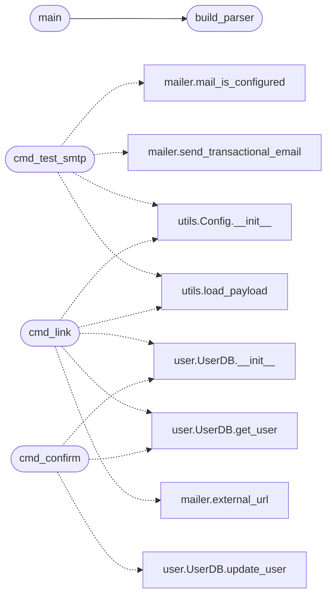

# `scripts.email_tool`

> Source: [scripts/email_tool.py:1](../../scripts/email_tool.py#L1) | language `py` | coverage 100.0% | [API index](../index.md)

Operator email tooling for QuantumVault.

Three subcommands, all runnable from any Linux host or AWS VPS that has the
project checked out and its configuration available (payload.json plus an
optional .env):

    python scripts/email_tool.py test-smtp you@example.com
        Send a real test message through the configured SMTP server to prove
        the transport works from this machine.

    python scripts/email_tool.py link <username>
        Print the account-confirmation URL for a user without sending mail,
        so an operator can verify an account when SMTP is not yet set up.

    python scripts/email_tool.py confirm <username>
        Mark a user's email as verified directly in the database.

Exit code is 0 on success and 1 on failure so the commands compose in scripts.

## Contents

- **Functions:** [`cmd_test_smtp`](#cmd_test_smtp), [`cmd_link`](#cmd_link), [`cmd_confirm`](#cmd_confirm), [`build_parser`](#build_parser), [`main`](#main)
- **Constants:** [`USERS_DB_PATH`](#users_db_path)

## Call Graph

Solid arrows stay in this module, dashed arrows leave it.



## Functions

<a id="cmd_test_smtp"></a>

### `cmd_test_smtp`

`function` | [scripts/email_tool.py:63](../../scripts/email_tool.py#L63)

```python
def cmd_test_smtp(args: argparse.Namespace) -> int
```

Send a test email through the configured SMTP server.

**Parameters**

| Name | Type | Default | Description |
|---|---|---|---|
| `args` | `argparse.Namespace` |  |  |

**Returns:** `int`

*Calls:* [`mail_is_configured`](utils.mailer.py.md#mail_is_configured), [`send_transactional_email`](utils.mailer.py.md#send_transactional_email), [`Config.__init__`](utils.utils.py.md#config-__init__), [`load_payload`](utils.utils.py.md#load_payload)

---

<a id="cmd_link"></a>

### `cmd_link`

`function` | [scripts/email_tool.py:91](../../scripts/email_tool.py#L91)

```python
def cmd_link(args: argparse.Namespace) -> int
```

Print the confirmation URL for a user without sending email.

**Parameters**

| Name | Type | Default | Description |
|---|---|---|---|
| `args` | `argparse.Namespace` |  |  |

**Returns:** `int`

*Calls:* [`UserDB.__init__`](models.user.py.md#userdb-__init__), [`UserDB.get_user`](models.user.py.md#userdb-get_user), [`external_url`](utils.mailer.py.md#external_url), [`Config.__init__`](utils.utils.py.md#config-__init__), [`load_payload`](utils.utils.py.md#load_payload)

---

<a id="cmd_confirm"></a>

### `cmd_confirm`

`function` | [scripts/email_tool.py:114](../../scripts/email_tool.py#L114)

```python
def cmd_confirm(args: argparse.Namespace) -> int
```

Mark a user's email as verified directly in the database.

**Parameters**

| Name | Type | Default | Description |
|---|---|---|---|
| `args` | `argparse.Namespace` |  |  |

**Returns:** `int`

*Calls:* [`UserDB.__init__`](models.user.py.md#userdb-__init__), [`UserDB.get_user`](models.user.py.md#userdb-get_user), [`UserDB.update_user`](models.user.py.md#userdb-update_user)

---

<a id="build_parser"></a>

### `build_parser`

`function` | [scripts/email_tool.py:133](../../scripts/email_tool.py#L133)

```python
def build_parser() -> argparse.ArgumentParser
```

Construct the argument parser for the three subcommands.

**Returns:** `argparse.ArgumentParser`

*Called by:* [`main`](#main)

---

<a id="main"></a>

### `main`

`function` | [scripts/email_tool.py:153](../../scripts/email_tool.py#L153)

```python
def main() -> int
```

Parse arguments and dispatch to the selected subcommand.

**Returns:** `int`

*Calls:* [`build_parser`](#build_parser)

---

## Constants

<a id="users_db_path"></a>

### `USERS_DB_PATH`

`constant` | [scripts/email_tool.py:37](../../scripts/email_tool.py#L37)

```python
USERS_DB_PATH = 'instance/users.db'
```

---
