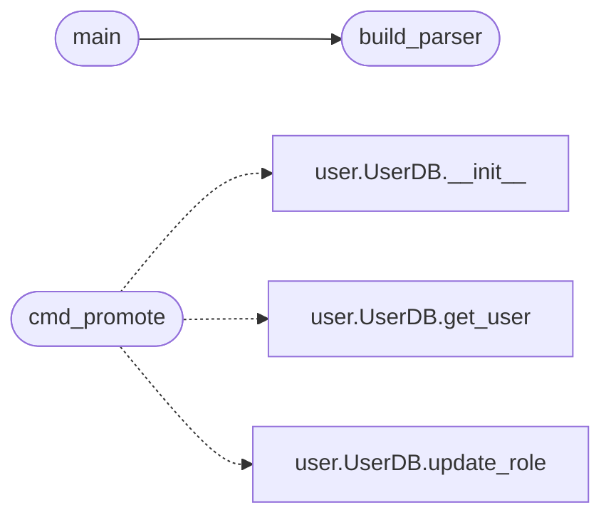

# `scripts.makeadmin`

> Source: [scripts/makeadmin.py:1](../../scripts/makeadmin.py#L1) | language `py` | coverage 100.0% | [API index](../index.md)

Operator tooling to promote QuantumVault users to a privileged role.

Two subcommands, runnable from any Linux host that has the project checked
out (no Flask app context required — talks to the SQLite DB directly):

    python scripts/makeadmin.py <username>
        Promote <username> to 'superadmin'. Idempotent: re-running on an
        already-superadmin user is a no-op that still returns exit code 0.

    python scripts/makeadmin.py <username> <role>
        Set <username>'s role to an arbitrary value from the allowed set
        (free, bronze, silver, gold, admin, superadmin). Use this for
        demotions, role audits, or seeding non-superadmin operators.

Exit code is 0 on success and 1 on failure so the commands compose in
scripts. The DB path defaults to ``instance/users.db``; override with the
``QV_USERS_DB`` environment variable when running against a non-default
deployment (e.g. a staging copy).

The script writes through `[`UserDB.update_role`](models.user.py.md#userdb-update_role)` (models/user.py) so the
storage_quota and subscription_status side-effects match what the rest of
the application does. It does NOT touch the KEM / SRP credentials — a
promotion never invalidates a user's existing login.

## Contents

- **Functions:** [`cmd_promote`](#cmd_promote), [`build_parser`](#build_parser), [`main`](#main)
- **Constants:** [`USERS_DB_PATH`](#users_db_path), [`ALLOWED_ROLES`](#allowed_roles)

## Call Graph

Solid arrows stay in this module, dashed arrows leave it.



## Functions

<a id="cmd_promote"></a>

### `cmd_promote`

`function` | [scripts/makeadmin.py:75](../../scripts/makeadmin.py#L75)

```python
def cmd_promote(args: argparse.Namespace) -> int
```

Promote ``args.username`` to the requested role (default: superadmin).

**Parameters**

| Name | Type | Default | Description |
|---|---|---|---|
| `args` | `argparse.Namespace` |  |  |

**Returns:** `int`

*Calls:* [`UserDB.__init__`](models.user.py.md#userdb-__init__), [`UserDB.get_user`](models.user.py.md#userdb-get_user), [`UserDB.update_role`](models.user.py.md#userdb-update_role)

---

<a id="build_parser"></a>

### `build_parser`

`function` | [scripts/makeadmin.py:126](../../scripts/makeadmin.py#L126)

```python
def build_parser() -> argparse.ArgumentParser
```

Construct the argument parser for the makeadmin subcommands.

**Returns:** `argparse.ArgumentParser`

*Called by:* [`main`](#main)

---

<a id="main"></a>

### `main`

`function` | [scripts/makeadmin.py:152](../../scripts/makeadmin.py#L152)

```python
def main() -> int
```

Parse arguments and dispatch to the selected subcommand.

**Returns:** `int`

*Calls:* [`build_parser`](#build_parser)

---

## Constants

<a id="users_db_path"></a>

### `USERS_DB_PATH`

`constant` | [scripts/makeadmin.py:37](../../scripts/makeadmin.py#L37)

```python
USERS_DB_PATH = os.environ.get('QV_USERS_DB', 'instance/users.db')
```

---

<a id="allowed_roles"></a>

### `ALLOWED_ROLES`

`constant` | [scripts/makeadmin.py:42](../../scripts/makeadmin.py#L42)

```python
ALLOWED_ROLES = ('free', 'bronze', 'silver', 'gold', 'admin', 'superadmin')
```

---
