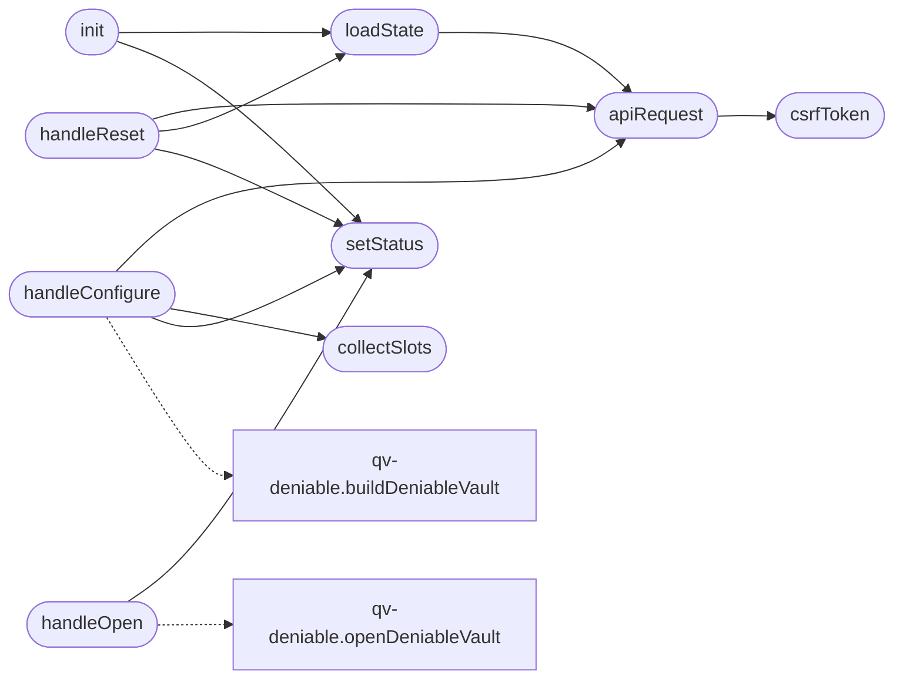

# `static/js/account.js`

> Source: [static/js/account.js:1](../../static/js/account.js#L1) | language `js` | coverage 10.0% | [API index](../index.md)

Account settings controller: secure notes (QV-DENIABLE-1).

Loaded as an external ES module to comply with the strict Content-Security-Policy (script-src 'self'), which forbids inline scripts. All container building and opening happens in qv-deniable.js, in the browser. The server returns and accepts an opaque container plus the non-secret structural parameters; it never sees a passphrase or any note text, and it never reports whether a second set of notes exists.

## Contents

- **Functions:** [`setStatus`](#setstatus), [`csrfToken`](#csrftoken), [`apiRequest`](#apirequest), [`loadState`](#loadstate), [`collectSlots`](#collectslots), [`handleConfigure`](#handleconfigure), [`handleOpen`](#handleopen), [`handleReset`](#handlereset), [`init`](#init)

## Call Graph

Solid arrows stay in this module, dashed arrows leave it.



## Functions

<a id="setstatus"></a>

### `setStatus`

`function` | [static/js/account.js:20](../../static/js/account.js#L20)

```javascript
function setStatus(message, kind)
```

**Parameters**

| Name | Type | Default | Description |
|---|---|---|---|
| `message` |  |  |  |
| `kind` |  |  |  |

*Called by:* [`handleConfigure`](#handleconfigure), [`handleOpen`](#handleopen), [`handleReset`](#handlereset), [`init`](#init)

---

<a id="csrftoken"></a>

### `csrfToken`

`function` | [static/js/account.js:31](../../static/js/account.js#L31)

```javascript
function csrfToken()
```

*Called by:* [`apiRequest`](#apirequest)

---

<a id="apirequest"></a>

### `apiRequest`

`function` `async` | [static/js/account.js:36](../../static/js/account.js#L36)

```javascript
async function apiRequest(method, body)
```

**Parameters**

| Name | Type | Default | Description |
|---|---|---|---|
| `method` |  |  |  |
| `body` |  |  |  |

*Calls:* [`csrfToken`](#csrftoken)

*Called by:* [`handleConfigure`](#handleconfigure), [`handleReset`](#handlereset), [`loadState`](#loadstate)

---

<a id="loadstate"></a>

### `loadState`

`function` `async` | [static/js/account.js:54](../../static/js/account.js#L54)

```javascript
async function loadState()
```

*Calls:* [`apiRequest`](#apirequest)

*Called by:* [`handleReset`](#handlereset), [`init`](#init)

---

<a id="collectslots"></a>

### `collectSlots`

`function` | [static/js/account.js:60](../../static/js/account.js#L60)

```javascript
function collectSlots()
```

*Called by:* [`handleConfigure`](#handleconfigure)

---

<a id="handleconfigure"></a>

### `handleConfigure`

`function` `async` | [static/js/account.js:73](../../static/js/account.js#L73)

```javascript
async function handleConfigure(event)
```

**Parameters**

| Name | Type | Default | Description |
|---|---|---|---|
| `event` |  |  |  |

*Calls:* [`apiRequest`](#apirequest), [`collectSlots`](#collectslots), [`setStatus`](#setstatus), [`buildDeniableVault`](static.js.qv-deniable.js.md#builddeniablevault)

---

<a id="handleopen"></a>

### `handleOpen`

`function` `async` | [static/js/account.js:103](../../static/js/account.js#L103)

```javascript
async function handleOpen(event)
```

**Parameters**

| Name | Type | Default | Description |
|---|---|---|---|
| `event` |  |  |  |

*Calls:* [`setStatus`](#setstatus), [`openDeniableVault`](static.js.qv-deniable.js.md#opendeniablevault)

---

<a id="handlereset"></a>

### `handleReset`

`function` `async` | [static/js/account.js:125](../../static/js/account.js#L125)

```javascript
async function handleReset()
```

*Calls:* [`apiRequest`](#apirequest), [`loadState`](#loadstate), [`setStatus`](#setstatus)

---

<a id="init"></a>

### `init`

`function` `async` | [static/js/account.js:138](../../static/js/account.js#L138)

```javascript
async function init()
```

*Calls:* [`loadState`](#loadstate), [`setStatus`](#setstatus)

---
