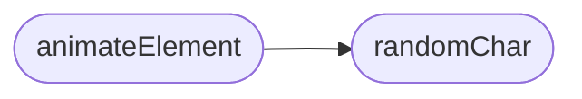

# `static/js/coded-text.js`

> Source: [static/js/coded-text.js:1](../../static/js/coded-text.js#L1) | language `js` | coverage 25.0% | [API index](../index.md)

Decipher animation for elements tagged with the "codedText" class.

Extracted from an inline <script> so it complies with the strict Content-Security-Policy (script-src 'self'), which forbids inline scripts. The effect is purely cosmetic: if the GSAP animation library is not available it degrades gracefully and leaves the text untouched.

## Contents

- **Functions:** [`randomChar`](#randomchar), [`animateElement`](#animateelement), [`init`](#init)

## Call Graph

Solid arrows stay in this module, dashed arrows leave it.



## Functions

<a id="randomchar"></a>

### `randomChar`

`function` | [static/js/coded-text.js:13](../../static/js/coded-text.js#L13)

```javascript
function randomChar()
```

*Called by:* [`animateElement`](#animateelement)

---

<a id="animateelement"></a>

### `animateElement`

`function` | [static/js/coded-text.js:19](../../static/js/coded-text.js#L19)

```javascript
function animateElement(element)
```

**Parameters**

| Name | Type | Default | Description |
|---|---|---|---|
| `element` |  |  |  |

*Calls:* [`randomChar`](#randomchar)

---

<a id="init"></a>

### `init`

`function` | [static/js/coded-text.js:50](../../static/js/coded-text.js#L50)

```javascript
function init()
```

---
