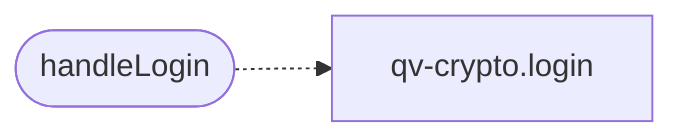

# `static/js/login.js`

> Source: [static/js/login.js:1](../../static/js/login.js#L1) | language `js` | coverage 33.3% | [API index](../index.md)

Login page controller (zero-knowledge SRP-6a flow).

Loaded as an external ES module so it complies with the strict Content-Security-Policy (script-src 'self'), which forbids inline scripts and inline event handlers. The password never leaves the browser: the SRP handshake exchanges only A (client public) and M1 (proof) and verifies the server proof M2.

## Contents

- **Functions:** [`handleLogin`](#handlelogin), [`init`](#init)

## Call Graph

Solid arrows stay in this module, dashed arrows leave it.



## Functions

<a id="handlelogin"></a>

### `handleLogin`

`function` `async` | [static/js/login.js:11](../../static/js/login.js#L11)

```javascript
async function handleLogin(event)
```

**Parameters**

| Name | Type | Default | Description |
|---|---|---|---|
| `event` |  |  |  |

*Calls:* [`login`](static.js.qv-crypto.js.md#login)

---

<a id="init"></a>

### `init`

`function` | [static/js/login.js:44](../../static/js/login.js#L44)

```javascript
function init()
```

---
