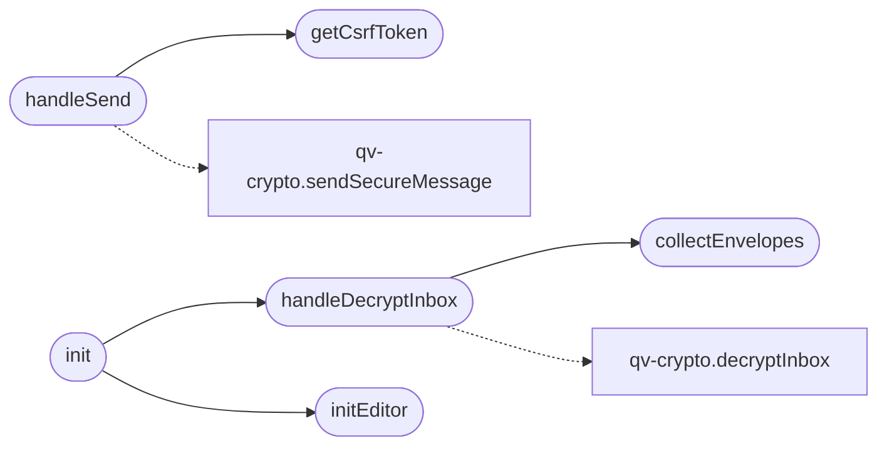

# `static/js/messages.js`

> Source: [static/js/messages.js:1](../../static/js/messages.js#L1) | language `js` | coverage 14.3% | [API index](../index.md)

Messages page controller (zero-knowledge end-to-end messaging).

Loaded as an external ES module so it complies with the strict Content-Security-Policy (script-src 'self'). Sending encrypts the message to the recipient's hybrid public key in the browser; receiving decrypts the opaque envelopes locally after prompting for the password. Decrypted text is rendered with textContent (never innerHTML) so a malicious sender cannot inject HTML/script into the recipient's page.

## Contents

- **Functions:** [`getCsrfToken`](#getcsrftoken), [`handleSend`](#handlesend), [`collectEnvelopes`](#collectenvelopes), [`handleDecryptInbox`](#handledecryptinbox), [`initEditor`](#initeditor), [`init`](#init)

## Call Graph

Solid arrows stay in this module, dashed arrows leave it.



## Functions

<a id="getcsrftoken"></a>

### `getCsrfToken`

`function` | [static/js/messages.js:12](../../static/js/messages.js#L12)

```javascript
function getCsrfToken()
```

*Called by:* [`handleSend`](#handlesend)

---

<a id="handlesend"></a>

### `handleSend`

`function` `async` | [static/js/messages.js:17](../../static/js/messages.js#L17)

```javascript
async function handleSend(event)
```

**Parameters**

| Name | Type | Default | Description |
|---|---|---|---|
| `event` |  |  |  |

*Calls:* [`getCsrfToken`](#getcsrftoken), [`sendSecureMessage`](static.js.qv-crypto.js.md#sendsecuremessage)

---

<a id="collectenvelopes"></a>

### `collectEnvelopes`

`function` | [static/js/messages.js:44](../../static/js/messages.js#L44)

```javascript
function collectEnvelopes()
```

*Called by:* [`handleDecryptInbox`](#handledecryptinbox)

---

<a id="handledecryptinbox"></a>

### `handleDecryptInbox`

`function` `async` | [static/js/messages.js:60](../../static/js/messages.js#L60)

```javascript
async function handleDecryptInbox(form)
```

**Parameters**

| Name | Type | Default | Description |
|---|---|---|---|
| `form` |  |  |  |

*Calls:* [`collectEnvelopes`](#collectenvelopes), [`decryptInbox`](static.js.qv-crypto.js.md#decryptinbox)

*Called by:* [`init`](#init)

---

<a id="initeditor"></a>

### `initEditor`

`function` | [static/js/messages.js:88](../../static/js/messages.js#L88)

```javascript
function initEditor()
```

*Called by:* [`init`](#init)

---

<a id="init"></a>

### `init`

`function` | [static/js/messages.js:109](../../static/js/messages.js#L109)

```javascript
function init()
```

*Calls:* [`handleDecryptInbox`](#handledecryptinbox), [`initEditor`](#initeditor)

---
