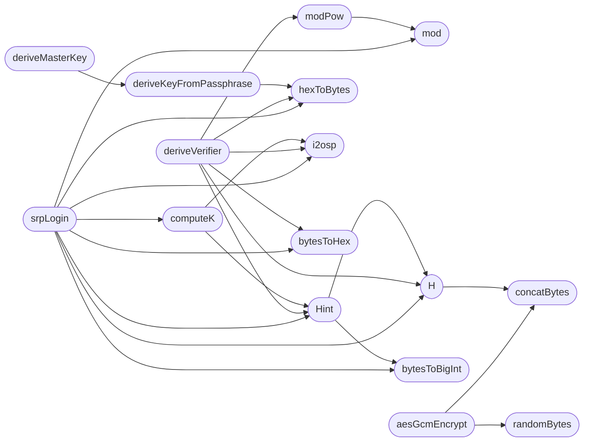

# `static/js/qv-crypto.js`

> Source: [static/js/qv-crypto.js:1](../../static/js/qv-crypto.js#L1) | language `js` | coverage 46.3% | [API index](../index.md)

QuantumVault zero-knowledge browser crypto.

Single source of truth for all client-side cryptography. The password and every private key are generated, used, and stored encrypted in the browser; only opaque ciphertext, the SRP salt/verifier, the public key, and the password-encrypted private key blob ever reach the server.  Primitives: - Authentication: SRP-6a (RFC 5054 2048-bit group, SHA-256), scheme "QV-SRP-1" mirroring utils/srp6a.py byte-for-byte. - Key wrapping: hybrid KEM = ML-KEM-768 (post-quantum) + X25519 (classical), combined via HKDF-SHA256, sealing keys with AES-256-GCM. - Size concealment: every message/file plaintext is padded to a fixed bucket (qv-padding.js, QV-PAD-1) before AES-GCM, so ciphertext lengths reveal only the bucket. Pad bytes are fresh crypto.getRandomValues per envelope and are never cached or reused. - Private-key protection: PBKDF2-SHA256 (600k iterations) derives the master key that encrypts the user's private key blob.  All cryptographic primitives are loaded from the local `vendor/` directory instead of a CDN. The vendored bundles are pinned to specific upstream versions, served as first-party static assets, and benefit from the same SRI / CSP protections as the rest of the application. The version comment on each import is the upstream package version that was vendored.  noble/hashes 1.8.0 — SHA-2, HKDF, utils, browser crypto provider

## Contents

- **Functions:** [`concatBytes`](#concatbytes), [`hexToBytes`](#hextobytes), [`bytesToHex`](#bytestohex), [`bytesToBase64`](#bytestobase64), [`bytesToBase32`](#bytestobase32), [`base64ToBytes`](#base64tobytes), [`bytesToBigInt`](#bytestobigint), [`i2osp`](#i2osp), [`mod`](#mod), [`modPow`](#modpow), [`randomBytes`](#randombytes), [`H`](#h), [`Hint`](#hint), [`deriveKeyFromPassphrase`](#derivekeyfrompassphrase), [`deriveMasterKey`](#derivemasterkey), [`aesGcmEncrypt`](#aesgcmencrypt), [`aesGcmDecrypt`](#aesgcmdecrypt), [`computeK`](#computek), [`deriveVerifier`](#deriveverifier), [`srpLogin`](#srplogin), [`generateIdentity`](#generateidentity), [`parsePublicKey`](#parsepublickey), [`parsePrivateBlob`](#parseprivateblob), [`deriveWrapKey`](#derivewrapkey), [`wrapKey`](#wrapkey), [`unwrapKey`](#unwrapkey), [`generateRecoveryCode`](#generaterecoverycode), [`normalizeRecoveryCode`](#normalizerecoverycode), [`wrapPrivateKeyForRecovery`](#wrapprivatekeyforrecovery), [`derivePublicKeyFromPrivateBlob`](#derivepublickeyfromprivateblob), [`postJson`](#postjson), [`buildRegistration`](#buildregistration), [`register`](#register), [`recoverAccount`](#recoveraccount), [`login`](#login), [`encryptAndUpload`](#encryptandupload), [`downloadAndDecrypt`](#downloadanddecrypt), [`fetchPublicKey`](#fetchpublickey), [`sendSecureMessage`](#sendsecuremessage), [`decryptInbox`](#decryptinbox)

## Call Graph

Solid arrows stay in this module, dashed arrows leave it.



## Functions

<a id="concatbytes"></a>

### `concatBytes`

`function` | [static/js/qv-crypto.js:59](../../static/js/qv-crypto.js#L59)

```javascript
function concatBytes(...arrays)
```

**Parameters**

| Name | Type | Default | Description |
|---|---|---|---|
| `arrays` |  |  |  |

*Called by:* [`H`](#h), [`aesGcmEncrypt`](#aesgcmencrypt), [`deriveWrapKey`](#derivewrapkey)

---

<a id="hextobytes"></a>

### `hexToBytes`

`function` | [static/js/qv-crypto.js:70](../../static/js/qv-crypto.js#L70)

```javascript
function hexToBytes(hex)
```

**Parameters**

| Name | Type | Default | Description |
|---|---|---|---|
| `hex` |  |  |  |

*Called by:* [`deriveKeyFromPassphrase`](#derivekeyfrompassphrase), [`deriveVerifier`](#deriveverifier), [`srpLogin`](#srplogin), [`openSlot`](static.js.qv-deniable.js.md#openslot)

---

<a id="bytestohex"></a>

### `bytesToHex`

`function` | [static/js/qv-crypto.js:79](../../static/js/qv-crypto.js#L79)

```javascript
function bytesToHex(bytes)
```

**Parameters**

| Name | Type | Default | Description |
|---|---|---|---|
| `bytes` |  |  |  |

*Called by:* [`buildRegistration`](#buildregistration), [`deriveVerifier`](#deriveverifier), [`recoverAccount`](#recoveraccount), [`srpLogin`](#srplogin), [`wrapPrivateKeyForRecovery`](#wrapprivatekeyforrecovery), [`buildDeniableVault`](static.js.qv-deniable.js.md#builddeniablevault), [`sealSlot`](static.js.qv-deniable.js.md#sealslot)

---

<a id="bytestobase64"></a>

### `bytesToBase64`

`function` | [static/js/qv-crypto.js:85](../../static/js/qv-crypto.js#L85)

```javascript
function bytesToBase64(bytes)
```

**Parameters**

| Name | Type | Default | Description |
|---|---|---|---|
| `bytes` |  |  |  |

*Called by:* [`buildRegistration`](#buildregistration), [`derivePublicKeyFromPrivateBlob`](#derivepublickeyfromprivateblob), [`generateIdentity`](#generateidentity), [`recoverAccount`](#recoveraccount), [`sendSecureMessage`](#sendsecuremessage), [`wrapKey`](#wrapkey), [`wrapPrivateKeyForRecovery`](#wrapprivatekeyforrecovery), [`sealSlot`](static.js.qv-deniable.js.md#sealslot)

---

<a id="bytestobase32"></a>

### `bytesToBase32`

`function` | [static/js/qv-crypto.js:96](../../static/js/qv-crypto.js#L96)

```javascript
function bytesToBase32(bytes)
```

**Parameters**

| Name | Type | Default | Description |
|---|---|---|---|
| `bytes` |  |  |  |

*Called by:* [`generateRecoveryCode`](#generaterecoverycode)

---

<a id="base64tobytes"></a>

### `base64ToBytes`

`function` | [static/js/qv-crypto.js:114](../../static/js/qv-crypto.js#L114)

```javascript
function base64ToBytes(b64)
```

**Parameters**

| Name | Type | Default | Description |
|---|---|---|---|
| `b64` |  |  |  |

*Called by:* [`decryptInbox`](#decryptinbox), [`downloadAndDecrypt`](#downloadanddecrypt), [`parsePrivateBlob`](#parseprivateblob), [`parsePublicKey`](#parsepublickey), [`recoverAccount`](#recoveraccount), [`unwrapKey`](#unwrapkey), [`openSlot`](static.js.qv-deniable.js.md#openslot)

---

<a id="bytestobigint"></a>

### `bytesToBigInt`

`function` | [static/js/qv-crypto.js:121](../../static/js/qv-crypto.js#L121)

```javascript
function bytesToBigInt(bytes)
```

**Parameters**

| Name | Type | Default | Description |
|---|---|---|---|
| `bytes` |  |  |  |

*Called by:* [`Hint`](#hint), [`srpLogin`](#srplogin)

---

<a id="i2osp"></a>

### `i2osp`

`function` | [static/js/qv-crypto.js:128](../../static/js/qv-crypto.js#L128)

```javascript
function i2osp(value)
```

Encode an integer as a big-endian byte string padded to the length of N.

**Parameters**

| Name | Type | Default | Description |
|---|---|---|---|
| `value` |  |  |  |

*Called by:* [`computeK`](#computek), [`deriveVerifier`](#deriveverifier), [`srpLogin`](#srplogin)

---

<a id="mod"></a>

### `mod`

`function` | [static/js/qv-crypto.js:138](../../static/js/qv-crypto.js#L138)

```javascript
function mod(a, m)
```

**Parameters**

| Name | Type | Default | Description |
|---|---|---|---|
| `a` |  |  |  |
| `m` |  |  |  |

*Called by:* [`modPow`](#modpow), [`srpLogin`](#srplogin)

---

<a id="modpow"></a>

### `modPow`

`function` | [static/js/qv-crypto.js:142](../../static/js/qv-crypto.js#L142)

```javascript
function modPow(base, exponent, modulus)
```

**Parameters**

| Name | Type | Default | Description |
|---|---|---|---|
| `base` |  |  |  |
| `exponent` |  |  |  |
| `modulus` |  |  |  |

*Calls:* [`mod`](#mod)

*Called by:* [`deriveVerifier`](#deriveverifier), [`srpLogin`](#srplogin)

---

<a id="randombytes"></a>

### `randomBytes`

`function` | [static/js/qv-crypto.js:160](../../static/js/qv-crypto.js#L160)

```javascript
function randomBytes(length)
```

**Parameters**

| Name | Type | Default | Description |
|---|---|---|---|
| `length` |  |  |  |

*Called by:* [`aesGcmEncrypt`](#aesgcmencrypt), [`buildRegistration`](#buildregistration), [`encryptAndUpload`](#encryptandupload), [`generateRecoveryCode`](#generaterecoverycode), [`recoverAccount`](#recoveraccount), [`sendSecureMessage`](#sendsecuremessage), [`srpLogin`](#srplogin), [`wrapPrivateKeyForRecovery`](#wrapprivatekeyforrecovery), [`buildDeniableVault`](static.js.qv-deniable.js.md#builddeniablevault), [`frame`](static.js.qv-deniable.js.md#frame), [`sealSlot`](static.js.qv-deniable.js.md#sealslot)

---

<a id="h"></a>

### `H`

`function` | [static/js/qv-crypto.js:169](../../static/js/qv-crypto.js#L169)

```javascript
function H(...arrays)
```

**Parameters**

| Name | Type | Default | Description |
|---|---|---|---|
| `arrays` |  |  |  |

*Calls:* [`concatBytes`](#concatbytes)

*Called by:* [`Hint`](#hint), [`deriveVerifier`](#deriveverifier), [`srpLogin`](#srplogin)

---

<a id="hint"></a>

### `Hint`

`function` | [static/js/qv-crypto.js:173](../../static/js/qv-crypto.js#L173)

```javascript
function Hint(...arrays)
```

**Parameters**

| Name | Type | Default | Description |
|---|---|---|---|
| `arrays` |  |  |  |

*Calls:* [`H`](#h), [`bytesToBigInt`](#bytestobigint)

*Called by:* [`computeK`](#computek), [`deriveVerifier`](#deriveverifier), [`srpLogin`](#srplogin)

---

<a id="derivekeyfrompassphrase"></a>

### `deriveKeyFromPassphrase`

`function` `async` | [static/js/qv-crypto.js:184](../../static/js/qv-crypto.js#L184)

```javascript
export async function deriveKeyFromPassphrase(passphrase, saltHex, iterations)
```

Derive a 256-bit key from a passphrase with a caller-chosen PBKDF2 iteration count.

This is the single PBKDF2 implementation in the client; deriveMasterKey pins it to the account-password iteration count, while the deniable vault (qv-deniable.js) drives it with the server-advertised count so a policy change needs no client edit.

**Parameters**

| Name | Type | Default | Description |
|---|---|---|---|
| `passphrase` |  |  |  |
| `saltHex` |  |  |  |
| `iterations` |  |  |  |

*Calls:* [`hexToBytes`](#hextobytes)

*Called by:* [`deriveMasterKey`](#derivemasterkey), [`openSlot`](static.js.qv-deniable.js.md#openslot), [`sealSlot`](static.js.qv-deniable.js.md#sealslot)

---

<a id="derivemasterkey"></a>

### `deriveMasterKey`

`function` `async` | [static/js/qv-crypto.js:205](../../static/js/qv-crypto.js#L205)

```javascript
async function deriveMasterKey(password, kdfSaltHex)
```

**Parameters**

| Name | Type | Default | Description |
|---|---|---|---|
| `password` |  |  |  |
| `kdfSaltHex` |  |  |  |

*Calls:* [`deriveKeyFromPassphrase`](#derivekeyfrompassphrase)

*Called by:* [`buildRegistration`](#buildregistration), [`decryptInbox`](#decryptinbox), [`downloadAndDecrypt`](#downloadanddecrypt), [`recoverAccount`](#recoveraccount), [`wrapPrivateKeyForRecovery`](#wrapprivatekeyforrecovery)

---

<a id="aesgcmencrypt"></a>

### `aesGcmEncrypt`

`function` `async` | [static/js/qv-crypto.js:209](../../static/js/qv-crypto.js#L209)

```javascript
async function aesGcmEncrypt(keyBytes, plaintext)
```

**Parameters**

| Name | Type | Default | Description |
|---|---|---|---|
| `keyBytes` |  |  |  |
| `plaintext` |  |  |  |

*Calls:* [`concatBytes`](#concatbytes), [`randomBytes`](#randombytes)

*Called by:* [`buildRegistration`](#buildregistration), [`encryptAndUpload`](#encryptandupload), [`recoverAccount`](#recoveraccount), [`sendSecureMessage`](#sendsecuremessage), [`wrapKey`](#wrapkey), [`wrapPrivateKeyForRecovery`](#wrapprivatekeyforrecovery), [`sealSlot`](static.js.qv-deniable.js.md#sealslot)

---

<a id="aesgcmdecrypt"></a>

### `aesGcmDecrypt`

`function` `async` | [static/js/qv-crypto.js:220](../../static/js/qv-crypto.js#L220)

```javascript
async function aesGcmDecrypt(keyBytes, ivAndCiphertext)
```

**Parameters**

| Name | Type | Default | Description |
|---|---|---|---|
| `keyBytes` |  |  |  |
| `ivAndCiphertext` |  |  |  |

*Called by:* [`decryptInbox`](#decryptinbox), [`downloadAndDecrypt`](#downloadanddecrypt), [`recoverAccount`](#recoveraccount), [`unwrapKey`](#unwrapkey), [`openSlot`](static.js.qv-deniable.js.md#openslot)

---

<a id="computek"></a>

### `computeK`

`function` | [static/js/qv-crypto.js:251](../../static/js/qv-crypto.js#L251)

```javascript
function computeK()
```

*Calls:* [`Hint`](#hint), [`i2osp`](#i2osp)

*Called by:* [`srpLogin`](#srplogin)

---

<a id="deriveverifier"></a>

### `deriveVerifier`

`function` | [static/js/qv-crypto.js:256](../../static/js/qv-crypto.js#L256)

```javascript
function deriveVerifier(username, password, saltHex)
```

Derive x = H(salt | H(I | ":" | P)) and the verifier v = g^x mod N.

**Parameters**

| Name | Type | Default | Description |
|---|---|---|---|
| `username` |  |  |  |
| `password` |  |  |  |
| `saltHex` |  |  |  |

*Calls:* [`H`](#h), [`Hint`](#hint), [`bytesToHex`](#bytestohex), [`hexToBytes`](#hextobytes), [`i2osp`](#i2osp), [`modPow`](#modpow)

*Called by:* [`buildRegistration`](#buildregistration), [`recoverAccount`](#recoveraccount)

---

<a id="srplogin"></a>

### `srpLogin`

`function` `async` | [static/js/qv-crypto.js:263](../../static/js/qv-crypto.js#L263)

```javascript
async function srpLogin(username, password, csrfToken)
```

Run a full SRP-6a login against the server, verifying the server proof M2.

**Parameters**

| Name | Type | Default | Description |
|---|---|---|---|
| `username` |  |  |  |
| `password` |  |  |  |
| `csrfToken` |  |  |  |

*Calls:* [`H`](#h), [`Hint`](#hint), [`bytesToBigInt`](#bytestobigint), [`bytesToHex`](#bytestohex), [`computeK`](#computek), [`hexToBytes`](#hextobytes), [`i2osp`](#i2osp), [`mod`](#mod), [`modPow`](#modpow), [`postJson`](#postjson), [`randomBytes`](#randombytes)

*Called by:* [`login`](#login)

---

<a id="generateidentity"></a>

### `generateIdentity`

`function` | [static/js/qv-crypto.js:316](../../static/js/qv-crypto.js#L316)

```javascript
function generateIdentity()
```

Generate the user's hybrid (ML-KEM-768 + X25519) key pair.

*Calls:* [`bytesToBase64`](#bytestobase64)

*Called by:* [`buildRegistration`](#buildregistration)

---

<a id="parsepublickey"></a>

### `parsePublicKey`

`function` | [static/js/qv-crypto.js:344](../../static/js/qv-crypto.js#L344)

```javascript
function parsePublicKey(publicKeyB64)
```

**Parameters**

| Name | Type | Default | Description |
|---|---|---|---|
| `publicKeyB64` |  |  |  |

*Calls:* [`base64ToBytes`](#base64tobytes)

*Called by:* [`wrapKey`](#wrapkey)

---

<a id="parseprivateblob"></a>

### `parsePrivateBlob`

`function` | [static/js/qv-crypto.js:352](../../static/js/qv-crypto.js#L352)

```javascript
function parsePrivateBlob(privateBlob)
```

**Parameters**

| Name | Type | Default | Description |
|---|---|---|---|
| `privateBlob` |  |  |  |

*Calls:* [`base64ToBytes`](#base64tobytes)

*Called by:* [`derivePublicKeyFromPrivateBlob`](#derivepublickeyfromprivateblob), [`unwrapKey`](#unwrapkey)

---

<a id="derivewrapkey"></a>

### `deriveWrapKey`

`function` | [static/js/qv-crypto.js:360](../../static/js/qv-crypto.js#L360)

```javascript
function deriveWrapKey(sharedSecretPq, sharedSecretClassic)
```

**Parameters**

| Name | Type | Default | Description |
|---|---|---|---|
| `sharedSecretPq` |  |  |  |
| `sharedSecretClassic` |  |  |  |

*Calls:* [`concatBytes`](#concatbytes)

*Called by:* [`unwrapKey`](#unwrapkey), [`wrapKey`](#wrapkey)

---

<a id="wrapkey"></a>

### `wrapKey`

`function` `async` | [static/js/qv-crypto.js:371](../../static/js/qv-crypto.js#L371)

```javascript
async function wrapKey(publicKeyB64, fekBytes)
```

Seal a file encryption key to a recipient's hybrid public key.

**Parameters**

| Name | Type | Default | Description |
|---|---|---|---|
| `publicKeyB64` |  |  |  |
| `fekBytes` |  |  |  |

*Calls:* [`aesGcmEncrypt`](#aesgcmencrypt), [`bytesToBase64`](#bytestobase64), [`deriveWrapKey`](#derivewrapkey), [`parsePublicKey`](#parsepublickey)

*Called by:* [`encryptAndUpload`](#encryptandupload), [`sendSecureMessage`](#sendsecuremessage)

---

<a id="unwrapkey"></a>

### `unwrapKey`

`function` `async` | [static/js/qv-crypto.js:395](../../static/js/qv-crypto.js#L395)

```javascript
async function unwrapKey(privateBlob, wrappedFekB64)
```

Recover a file encryption key using the recipient's hybrid private blob.

**Parameters**

| Name | Type | Default | Description |
|---|---|---|---|
| `privateBlob` |  |  |  |
| `wrappedFekB64` |  |  |  |

*Calls:* [`aesGcmDecrypt`](#aesgcmdecrypt), [`base64ToBytes`](#base64tobytes), [`deriveWrapKey`](#derivewrapkey), [`parsePrivateBlob`](#parseprivateblob)

*Called by:* [`decryptInbox`](#decryptinbox), [`downloadAndDecrypt`](#downloadanddecrypt)

---

<a id="generaterecoverycode"></a>

### `generateRecoveryCode`

`function` | [static/js/qv-crypto.js:417](../../static/js/qv-crypto.js#L417)

```javascript
export function generateRecoveryCode()
```

Generate a QV-RECOVERY-1 code: 20 random bytes (160 bits) Base32-encoded (RFC 4648, no padding) and grouped as XXXX-XXXX-... for readability.

*Calls:* [`bytesToBase32`](#bytestobase32), [`randomBytes`](#randombytes)

*Called by:* [`buildRegistration`](#buildregistration)

---

<a id="normalizerecoverycode"></a>

### `normalizeRecoveryCode`

`function` | [static/js/qv-crypto.js:429](../../static/js/qv-crypto.js#L429)

```javascript
function normalizeRecoveryCode(recoveryCode)
```

Normalize a user-entered recovery code: strip surrounding whitespace, remove group separators, and uppercase, so "abcd-efgh" and "ABCDEFGH" derive the same key.

**Parameters**

| Name | Type | Default | Description |
|---|---|---|---|
| `recoveryCode` |  |  |  |

*Called by:* [`recoverAccount`](#recoveraccount), [`wrapPrivateKeyForRecovery`](#wrapprivatekeyforrecovery)

---

<a id="wrapprivatekeyforrecovery"></a>

### `wrapPrivateKeyForRecovery`

`function` `async` | [static/js/qv-crypto.js:436](../../static/js/qv-crypto.js#L436)

```javascript
export async function wrapPrivateKeyForRecovery(privateBlob, recoveryCode)
```

Re-wrap an existing privateBlob under a key derived from a recovery code, using the same PBKDF2-SHA256 + AES-256-GCM scheme as the password path, with its own independent salt.

**Parameters**

| Name | Type | Default | Description |
|---|---|---|---|
| `privateBlob` |  |  |  |
| `recoveryCode` |  |  |  |

*Calls:* [`aesGcmEncrypt`](#aesgcmencrypt), [`bytesToBase64`](#bytestobase64), [`bytesToHex`](#bytestohex), [`deriveMasterKey`](#derivemasterkey), [`normalizeRecoveryCode`](#normalizerecoverycode), [`randomBytes`](#randombytes)

*Called by:* [`buildRegistration`](#buildregistration)

---

<a id="derivepublickeyfromprivateblob"></a>

### `derivePublicKeyFromPrivateBlob`

`function` | [static/js/qv-crypto.js:455](../../static/js/qv-crypto.js#L455)

```javascript
export function derivePublicKeyFromPrivateBlob(privateBlob)
```

Reconstruct the public key (the same {v, mlkem, x} structure produced by generateIdentity) from a decrypted privateBlob.

The noble ML-KEM-768 secretKey is encoded as [innerSK(1152) | publicKey(1184) | H(pk)(32) | z(32)], so the public key is recoverable directly; the X25519 public key is derived from its secret via x25519.getPublicKey. Used as a proof-of-possession when resetting credentials with a recovery code: the server accepts the reset only if this matches the stored public_key.

**Parameters**

| Name | Type | Default | Description |
|---|---|---|---|
| `privateBlob` |  |  |  |

*Calls:* [`bytesToBase64`](#bytestobase64), [`parsePrivateBlob`](#parseprivateblob)

*Called by:* [`recoverAccount`](#recoveraccount)

---

<a id="postjson"></a>

### `postJson`

`function` `async` | [static/js/qv-crypto.js:473](../../static/js/qv-crypto.js#L473)

```javascript
async function postJson(url, body, csrfToken)
```

**Parameters**

| Name | Type | Default | Description |
|---|---|---|---|
| `url` |  |  |  |
| `body` |  |  |  |
| `csrfToken` |  |  |  |

*Called by:* [`recoverAccount`](#recoveraccount), [`register`](#register), [`sendSecureMessage`](#sendsecuremessage), [`srpLogin`](#srplogin)

---

<a id="buildregistration"></a>

### `buildRegistration`

`function` `async` | [static/js/qv-crypto.js:496](../../static/js/qv-crypto.js#L496)

```javascript
export async function buildRegistration(username, password, profile)
```

Build the zero-knowledge registration payload entirely in the browser.

Returns `{ payload, recoveryCode }`: `payload` is the JSON body to POST to
the registration endpoint (it includes the recovery-code-wrapped private
key, but never the recovery code itself), and `recoveryCode` is the
plaintext QV-RECOVERY-1 code to show the user exactly once. The server
never sees `recoveryCode`.

**Parameters**

| Name | Type | Default | Description |
|---|---|---|---|
| `username` |  |  |  |
| `password` |  |  |  |
| `profile` |  |  |  |

*Calls:* [`aesGcmEncrypt`](#aesgcmencrypt), [`bytesToBase64`](#bytestobase64), [`bytesToHex`](#bytestohex), [`deriveMasterKey`](#derivemasterkey), [`deriveVerifier`](#deriveverifier), [`generateIdentity`](#generateidentity), [`generateRecoveryCode`](#generaterecoverycode), [`randomBytes`](#randombytes), [`wrapPrivateKeyForRecovery`](#wrapprivatekeyforrecovery)

*Called by:* [`register`](#register), [`handleRegister`](static.js.register.js.md#handleregister)

---

<a id="register"></a>

### `register`

`function` `async` | [static/js/qv-crypto.js:530](../../static/js/qv-crypto.js#L530)

```javascript
export async function register(formAction, csrfToken, username, password, profile)
```

**Parameters**

| Name | Type | Default | Description |
|---|---|---|---|
| `formAction` |  |  |  |
| `csrfToken` |  |  |  |
| `username` |  |  |  |
| `password` |  |  |  |
| `profile` |  |  |  |

*Calls:* [`buildRegistration`](#buildregistration), [`postJson`](#postjson)

---

<a id="recoveraccount"></a>

### `recoverAccount`

`function` `async` | [static/js/qv-crypto.js:541](../../static/js/qv-crypto.js#L541)

```javascript
export async function recoverAccount(csrfToken, username, recoveryCode, newPassword)
```

Reset SRP credentials and the password-encrypted private key using a QV-RECOVERY-1 recovery code, without ever exposing the user's keypair to the server.

Fetches the recovery-wrapped privateBlob, decrypts it locally with a key derived from the recovery code, proves possession of the resulting keypair by reconstructing its public key, and re-wraps the same privateBlob under the new password.

**Parameters**

| Name | Type | Default | Description |
|---|---|---|---|
| `csrfToken` |  |  |  |
| `username` |  |  |  |
| `recoveryCode` |  |  |  |
| `newPassword` |  |  |  |

*Calls:* [`aesGcmDecrypt`](#aesgcmdecrypt), [`aesGcmEncrypt`](#aesgcmencrypt), [`base64ToBytes`](#base64tobytes), [`bytesToBase64`](#bytestobase64), [`bytesToHex`](#bytestohex), [`deriveMasterKey`](#derivemasterkey), [`derivePublicKeyFromPrivateBlob`](#derivepublickeyfromprivateblob), [`deriveVerifier`](#deriveverifier), [`normalizeRecoveryCode`](#normalizerecoverycode), [`postJson`](#postjson), [`randomBytes`](#randombytes)

*Called by:* [`handleRecover`](static.js.recover.js.md#handlerecover)

---

<a id="login"></a>

### `login`

`function` `async` | [static/js/qv-crypto.js:592](../../static/js/qv-crypto.js#L592)

```javascript
export async function login(csrfToken, username, password)
```

**Parameters**

| Name | Type | Default | Description |
|---|---|---|---|
| `csrfToken` |  |  |  |
| `username` |  |  |  |
| `password` |  |  |  |

*Calls:* [`srpLogin`](#srplogin)

*Called by:* [`handleLogin`](static.js.login.js.md#handlelogin)

---

<a id="encryptandupload"></a>

### `encryptAndUpload`

`function` `async` | [static/js/qv-crypto.js:599](../../static/js/qv-crypto.js#L599)

```javascript
export async function encryptAndUpload(uploadUrl, csrfToken, file, publicKeyB64)
```

Generate a fresh file key, encrypt the padded file, wrap the key, and upload.

The file plaintext is padded to a fixed file bucket before AES-GCM so the ciphertext length reveals only the bucket, not the exact file size.

**Parameters**

| Name | Type | Default | Description |
|---|---|---|---|
| `uploadUrl` |  |  |  |
| `csrfToken` |  |  |  |
| `file` |  |  |  |
| `publicKeyB64` |  |  |  |

*Calls:* [`aesGcmEncrypt`](#aesgcmencrypt), [`randomBytes`](#randombytes), [`wrapKey`](#wrapkey), [`padFramed`](static.js.qv-padding.js.md#padframed)

*Called by:* [`handleUpload`](static.js.upload.js.md#handleupload)

---

<a id="downloadanddecrypt"></a>

### `downloadAndDecrypt`

`function` `async` | [static/js/qv-crypto.js:629](../../static/js/qv-crypto.js#L629)

```javascript
export async function downloadAndDecrypt(downloadUrl, username, password)
```

Download an encrypted file and its key, then decrypt it in the browser.

**Parameters**

| Name | Type | Default | Description |
|---|---|---|---|
| `downloadUrl` |  |  |  |
| `username` |  |  |  |
| `password` |  |  |  |

*Calls:* [`aesGcmDecrypt`](#aesgcmdecrypt), [`base64ToBytes`](#base64tobytes), [`deriveMasterKey`](#derivemasterkey), [`unwrapKey`](#unwrapkey), [`unframeFramed`](static.js.qv-padding.js.md#unframeframed)

*Called by:* [`handleDownload`](static.js.upload.js.md#handledownload)

---

<a id="fetchpublickey"></a>

### `fetchPublicKey`

`function` `async` | [static/js/qv-crypto.js:668](../../static/js/qv-crypto.js#L668)

```javascript
async function fetchPublicKey(username, csrfToken)
```

Fetch a user's hybrid public key so the browser can wrap content to them.

**Parameters**

| Name | Type | Default | Description |
|---|---|---|---|
| `username` |  |  |  |
| `csrfToken` |  |  |  |

*Called by:* [`sendSecureMessage`](#sendsecuremessage)

---

<a id="sendsecuremessage"></a>

### `sendSecureMessage`

`function` `async` | [static/js/qv-crypto.js:683](../../static/js/qv-crypto.js#L683)

```javascript
export async function sendSecureMessage( csrfToken, recipient, senderUsername, message, )
```

Encrypt a message to a recipient (keeping a sender-readable outbox copy) and POST the opaque envelope.

The plaintext and the CEK never leave the browser; the server stores only ciphertext and wrapped keys.

**Parameters**

| Name | Type | Default | Description |
|---|---|---|---|
| `csrfToken` |  |  |  |
| `recipient` |  |  |  |
| `senderUsername` |  |  |  |
| `message` |  |  |  |

*Calls:* [`aesGcmEncrypt`](#aesgcmencrypt), [`bytesToBase64`](#bytestobase64), [`fetchPublicKey`](#fetchpublickey), [`postJson`](#postjson), [`randomBytes`](#randombytes), [`wrapKey`](#wrapkey), [`padFramed`](static.js.qv-padding.js.md#padframed)

*Called by:* [`handleSend`](static.js.messages.js.md#handlesend)

---

<a id="decryptinbox"></a>

### `decryptInbox`

`function` `async` | [static/js/qv-crypto.js:714](../../static/js/qv-crypto.js#L714)

```javascript
export async function decryptInbox(username, password, envelopes)
```

Decrypt a batch of inbox envelopes with the user's password.

The master key and private blob are derived once and reused, so this stays cheap even for a full mailbox. Returns one result per envelope; a record that cannot be decrypted is reported with ``ok: false`` rather than aborting the batch.

**Parameters**

| Name | Type | Default | Description |
|---|---|---|---|
| `username` |  |  |  |
| `password` |  |  |  |
| `envelopes` |  |  |  |

*Calls:* [`aesGcmDecrypt`](#aesgcmdecrypt), [`base64ToBytes`](#base64tobytes), [`deriveMasterKey`](#derivemasterkey), [`unwrapKey`](#unwrapkey), [`unframeFramed`](static.js.qv-padding.js.md#unframeframed)

*Called by:* [`handleDecryptInbox`](static.js.messages.js.md#handledecryptinbox)

---
