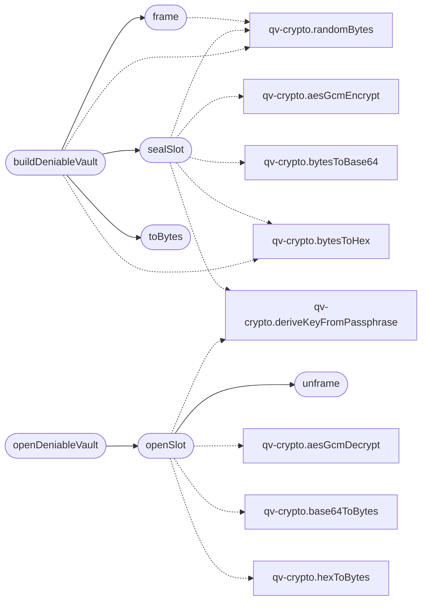

# `static/js/qv-deniable.js`

> Source: [static/js/qv-deniable.js:1](../../static/js/qv-deniable.js#L1) | language `js` | coverage 87.5% | [API index](../index.md)

QuantumVault deniable vault (QV-DENIABLE-1) browser crypto.

A deniable vault is an opaque container with a fixed number of slots. Each slot is independently encrypted under a key derived from its own passphrase; only the slot whose passphrase the user enters will authenticate and decrypt. The container is built and opened entirely in the browser. The server stores only the opaque envelope and never sees a passphrase or a plaintext.  Deniability rests on two invariants enforced here and re-checked on the server (controllers/deniable_vault.py):  1. Every container has exactly [`slot_count`](controllers.deniable_vault.py.md#deniablevaultconfig-slot_count) slots. A container that hides data is structurally identical to one that does not. 2. Every slot's plaintext is padded to the same length before encryption, so every slot's ciphertext is the same length. The byte sizes reveal nothing about which slot, if any, holds real data.  When the user configures no hidden vault, the hidden slot is filled with random bytes under a random, discarded key. It is then indistinguishable from a slot that holds real data the user is simply declining to open.

## Contents

- **Functions:** [`toBytes`](#tobytes), [`frame`](#frame), [`unframe`](#unframe), [`sealSlot`](#sealslot), [`openSlot`](#openslot), [`buildDeniableVault`](#builddeniablevault), [`openDeniableVault`](#opendeniablevault)

## Call Graph

Solid arrows stay in this module, dashed arrows leave it.



## Functions

<a id="tobytes"></a>

### `toBytes`

`function` | [static/js/qv-deniable.js:48](../../static/js/qv-deniable.js#L48)

```javascript
function toBytes(data)
```

**Parameters**

| Name | Type | Default | Description |
|---|---|---|---|
| `data` |  |  |  |

*Called by:* [`buildDeniableVault`](#builddeniablevault)

---

<a id="frame"></a>

### `frame`

`function` | [static/js/qv-deniable.js:56](../../static/js/qv-deniable.js#L56)

```javascript
function frame(payloadBytes, paddedLength)
```

Frame a payload as [len(4) | payload | random padding] of exactly `paddedLength` bytes.

`paddedLength` is shared by every slot so the resulting ciphertexts are equal length.

**Parameters**

| Name | Type | Default | Description |
|---|---|---|---|
| `payloadBytes` |  |  |  |
| `paddedLength` |  |  |  |

*Calls:* [`randomBytes`](static.js.qv-crypto.js.md#randombytes)

*Called by:* [`buildDeniableVault`](#builddeniablevault)

---

<a id="unframe"></a>

### `unframe`

`function` | [static/js/qv-deniable.js:65](../../static/js/qv-deniable.js#L65)

```javascript
function unframe(plaintextBytes)
```

Reverse frame(): read the length prefix and return the exact payload bytes.

**Parameters**

| Name | Type | Default | Description |
|---|---|---|---|
| `plaintextBytes` |  |  |  |

*Called by:* [`openSlot`](#openslot)

---

<a id="sealslot"></a>

### `sealSlot`

`function` `async` | [static/js/qv-deniable.js:82](../../static/js/qv-deniable.js#L82)

```javascript
async function sealSlot(passphrase, framedPlaintext, parameters)
```

Encrypt one slot's framed plaintext under a passphrase, returning the {salt, nonce, ct} object the envelope stores.

**Parameters**

| Name | Type | Default | Description |
|---|---|---|---|
| `passphrase` |  |  |  |
| `framedPlaintext` |  |  |  |
| `parameters` |  |  |  |

*Calls:* [`aesGcmEncrypt`](static.js.qv-crypto.js.md#aesgcmencrypt), [`bytesToBase64`](static.js.qv-crypto.js.md#bytestobase64), [`bytesToHex`](static.js.qv-crypto.js.md#bytestohex), [`deriveKeyFromPassphrase`](static.js.qv-crypto.js.md#derivekeyfrompassphrase), [`randomBytes`](static.js.qv-crypto.js.md#randombytes)

*Called by:* [`buildDeniableVault`](#builddeniablevault)

---

<a id="openslot"></a>

### `openSlot`

`function` `async` | [static/js/qv-deniable.js:102](../../static/js/qv-deniable.js#L102)

```javascript
async function openSlot(passphrase, slot, iterations)
```

Attempt to open one slot with a passphrase.

Returns the payload bytes on success or null when the passphrase does not authenticate this slot.

**Parameters**

| Name | Type | Default | Description |
|---|---|---|---|
| `passphrase` |  |  |  |
| `slot` |  |  |  |
| `iterations` |  |  |  |

*Calls:* [`aesGcmDecrypt`](static.js.qv-crypto.js.md#aesgcmdecrypt), [`base64ToBytes`](static.js.qv-crypto.js.md#base64tobytes), [`deriveKeyFromPassphrase`](static.js.qv-crypto.js.md#derivekeyfrompassphrase), [`hexToBytes`](static.js.qv-crypto.js.md#hextobytes), [`unframe`](#unframe)

*Called by:* [`openDeniableVault`](#opendeniablevault)

---

<a id="builddeniablevault"></a>

### `buildDeniableVault`

`function` `async` | [static/js/qv-deniable.js:125](../../static/js/qv-deniable.js#L125)

```javascript
export async function buildDeniableVault(parameters, slots)
```

Build a deniable container from a list of slot specifications.

`slots` is an array of `{ passphrase, data }`; `data` may be a string or a
Uint8Array. The array is padded out to `parameters.slot_count` entries with
random, unopenable slots so the container always has the fixed slot count.
Every slot's plaintext is padded to `parameters.slot_plaintext_bytes`, so
every container is exactly the same size regardless of how much data it
holds. Throws if more slots are supplied than allowed, or if any slot's
data does not fit the fixed slot size.

**Parameters**

| Name | Type | Default | Description |
|---|---|---|---|
| `parameters` |  |  |  |
| `slots` |  |  |  |

*Calls:* [`bytesToHex`](static.js.qv-crypto.js.md#bytestohex), [`randomBytes`](static.js.qv-crypto.js.md#randombytes), [`frame`](#frame), [`sealSlot`](#sealslot), [`toBytes`](#tobytes)

*Called by:* [`handleConfigure`](static.js.account.js.md#handleconfigure)

---

<a id="opendeniablevault"></a>

### `openDeniableVault`

`function` `async` | [static/js/qv-deniable.js:170](../../static/js/qv-deniable.js#L170)

```javascript
export async function openDeniableVault(envelope, passphrase)
```

Open a container with a passphrase.

Tries every slot; only the slot whose passphrase matches will authenticate. Returns `{ index, data, text }` for the opened slot, or throws if no slot opens.

**Parameters**

| Name | Type | Default | Description |
|---|---|---|---|
| `envelope` |  |  |  |
| `passphrase` |  |  |  |

*Calls:* [`openSlot`](#openslot)

*Called by:* [`handleOpen`](static.js.account.js.md#handleopen)

---
