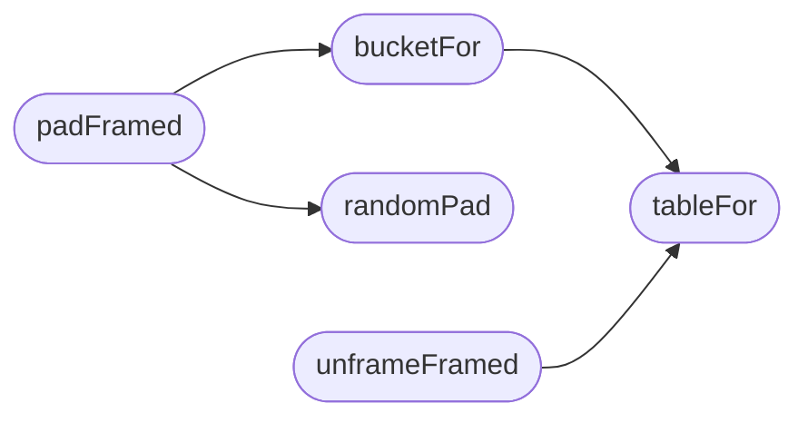

# `static/js/qv-padding.js`

> Source: [static/js/qv-padding.js:1](../../static/js/qv-padding.js#L1) | language `js` | coverage 16.7% | [API index](../index.md)

QuantumVault fixed-bucket padding (QV-PAD-1), browser mirror of utils/padding.py.

Every plaintext is framed as [len(4 BE) | plaintext | fresh random pad] up to its bucket before AES-GCM. Buckets must stay identical to the server table: an envelope whose ciphertext length is not bucket+GCM overhead is rejected by the server. Pad bytes come from crypto.getRandomValues on every call and are never cached or reused; only the immutable bucket tables below are long-lived.

## Contents

- **Functions:** [`tableFor`](#tablefor), [`bucketFor`](#bucketfor), [`randomPad`](#randompad), [`padFramed`](#padframed), [`unframeFramed`](#unframeframed)

## Call Graph

Solid arrows stay in this module, dashed arrows leave it.



## Functions

<a id="tablefor"></a>

### `tableFor`

`function` | [static/js/qv-padding.js:16](../../static/js/qv-padding.js#L16)

```javascript
function tableFor(kind)
```

**Parameters**

| Name | Type | Default | Description |
|---|---|---|---|
| `kind` |  |  |  |

*Called by:* [`bucketFor`](#bucketfor), [`unframeFramed`](#unframeframed)

---

<a id="bucketfor"></a>

### `bucketFor`

`function` | [static/js/qv-padding.js:20](../../static/js/qv-padding.js#L20)

```javascript
export function bucketFor(plaintextLen, kind)
```

**Parameters**

| Name | Type | Default | Description |
|---|---|---|---|
| `plaintextLen` |  |  |  |
| `kind` |  |  |  |

*Calls:* [`tableFor`](#tablefor)

*Called by:* [`padFramed`](#padframed)

---

<a id="randompad"></a>

### `randomPad`

`function` | [static/js/qv-padding.js:34](../../static/js/qv-padding.js#L34)

```javascript
function randomPad(length)
```

**Parameters**

| Name | Type | Default | Description |
|---|---|---|---|
| `length` |  |  |  |

*Called by:* [`padFramed`](#padframed)

---

<a id="padframed"></a>

### `padFramed`

`function` | [static/js/qv-padding.js:42](../../static/js/qv-padding.js#L42)

```javascript
export function padFramed(plaintextBytes, kind)
```

**Parameters**

| Name | Type | Default | Description |
|---|---|---|---|
| `plaintextBytes` |  |  |  |
| `kind` |  |  |  |

*Calls:* [`bucketFor`](#bucketfor), [`randomPad`](#randompad)

*Called by:* [`encryptAndUpload`](static.js.qv-crypto.js.md#encryptandupload), [`sendSecureMessage`](static.js.qv-crypto.js.md#sendsecuremessage)

---

<a id="unframeframed"></a>

### `unframeFramed`

`function` | [static/js/qv-padding.js:54](../../static/js/qv-padding.js#L54)

```javascript
export function unframeFramed(paddedBytes, kind)
```

**Parameters**

| Name | Type | Default | Description |
|---|---|---|---|
| `paddedBytes` |  |  |  |
| `kind` |  |  |  |

*Calls:* [`tableFor`](#tablefor)

*Called by:* [`decryptInbox`](static.js.qv-crypto.js.md#decryptinbox), [`downloadAndDecrypt`](static.js.qv-crypto.js.md#downloadanddecrypt)

---
