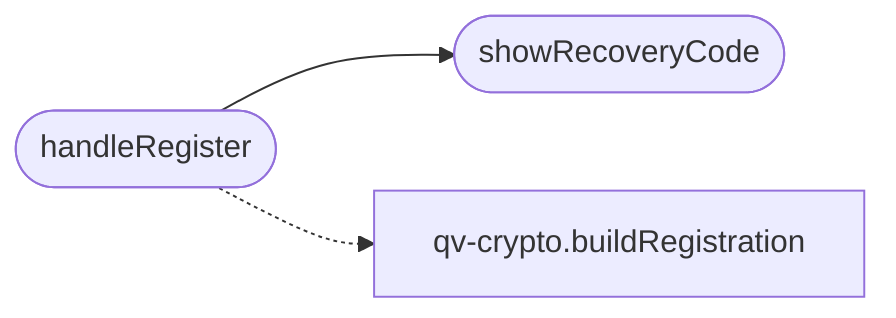

# `static/js/register.js`

> Source: [static/js/register.js:1](../../static/js/register.js#L1) | language `js` | coverage 50.0% | [API index](../index.md)

Registration page controller (zero-knowledge flow).

This module is loaded as an external ES module so it complies with the strict Content-Security-Policy (script-src 'self'), which forbids inline scripts and inline event handlers. It reads the profile from the form, runs the browser-side crypto in qv-crypto.js, and POSTs only opaque zero-knowledge material to the server. The password and the private key never leave the browser.

## Contents

- **Functions:** [`showRecoveryCode`](#showrecoverycode), [`handleRegister`](#handleregister), [`init`](#init)

## Call Graph

Solid arrows stay in this module, dashed arrows leave it.



## Functions

<a id="showrecoverycode"></a>

### `showRecoveryCode`

`function` | [static/js/register.js:17](../../static/js/register.js#L17)

```javascript
function showRecoveryCode(recoveryCode)
```

Display the one-time QV-RECOVERY-1 code in a modal and wait for the user to acknowledge they have saved it before continuing.

The code is shown only once: it is never sent to or stored by the server in plaintext.

**Parameters**

| Name | Type | Default | Description |
|---|---|---|---|
| `recoveryCode` |  |  |  |

*Called by:* [`handleRegister`](#handleregister)

---

<a id="handleregister"></a>

### `handleRegister`

`function` `async` | [static/js/register.js:42](../../static/js/register.js#L42)

```javascript
async function handleRegister(event)
```

**Parameters**

| Name | Type | Default | Description |
|---|---|---|---|
| `event` |  |  |  |

*Calls:* [`buildRegistration`](static.js.qv-crypto.js.md#buildregistration), [`showRecoveryCode`](#showrecoverycode)

---

<a id="init"></a>

### `init`

`function` | [static/js/register.js:110](../../static/js/register.js#L110)

```javascript
function init()
```

---
