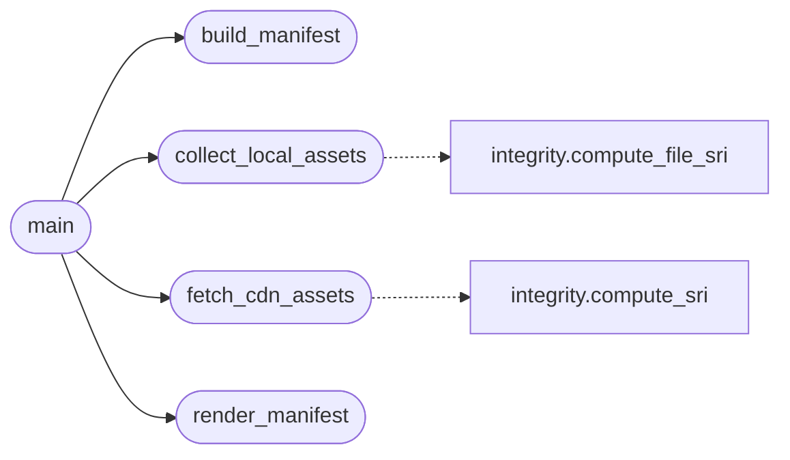

# `tools.generate_sri`

> Source: [tools/generate_sri.py:1](../../tools/generate_sri.py#L1) | language `py` | coverage 100.0% | [API index](../index.md)

Generate the SRI manifest for first-party assets and pinned CDN URLs.

Regenerating the manifest is the audited step that binds served bytes
to served hashes. The output is deterministic: keys are sorted, the
JSON uses a fixed indent, and the file ends with a single newline, so
two runs over identical inputs produce byte-identical output.

Usage:
    ./.venv/bin/python tools/generate_sri.py
    ./.venv/bin/python tools/generate_sri.py --check

## Contents

- **Functions:** [`collect_local_assets`](#collect_local_assets), [`fetch_cdn_assets`](#fetch_cdn_assets), [`build_manifest`](#build_manifest), [`render_manifest`](#render_manifest), [`main`](#main)
- **Constants:** [`PROJECT_ROOT`](#project_root), [`STATIC_DIR`](#static_dir), [`MANIFEST_PATH`](#manifest_path), [`LOCAL_SUFFIXES`](#local_suffixes), [`PINNED_CDN_URLS`](#pinned_cdn_urls)

## Call Graph

Solid arrows stay in this module, dashed arrows leave it.



## Functions

<a id="collect_local_assets"></a>

### `collect_local_assets`

`function` | [tools/generate_sri.py:41](../../tools/generate_sri.py#L41)

```python
def collect_local_assets() -> dict[str, str]
```

Hash every first-party script and stylesheet under ``static/``.

**Returns:** `dict[str, str]`

*Calls:* [`compute_file_sri`](utils.integrity.py.md#compute_file_sri)

*Called by:* [`main`](#main)

---

<a id="fetch_cdn_assets"></a>

### `fetch_cdn_assets`

`function` | [tools/generate_sri.py:56](../../tools/generate_sri.py#L56)

```python
def fetch_cdn_assets() -> dict[str, str]
```

Download every pinned CDN URL and hash its exact bytes.

**Returns:** `dict[str, str]`

*Calls:* [`compute_sri`](utils.integrity.py.md#compute_sri)

*Called by:* [`main`](#main)

---

<a id="build_manifest"></a>

### `build_manifest`

`function` | [tools/generate_sri.py:66](../../tools/generate_sri.py#L66)

```python
def build_manifest(cdn: dict[str, str], local: dict[str, str]) -> dict
```

Assemble the deterministic manifest document.

**Parameters**

| Name | Type | Default | Description |
|---|---|---|---|
| `cdn` | `dict[str, str]` |  |  |
| `local` | `dict[str, str]` |  |  |

**Returns:** `dict`

*Called by:* [`main`](#main)

---

<a id="render_manifest"></a>

### `render_manifest`

`function` | [tools/generate_sri.py:76](../../tools/generate_sri.py#L76)

```python
def render_manifest(manifest: dict) -> str
```

Render the manifest deterministically with a trailing newline.

**Parameters**

| Name | Type | Default | Description |
|---|---|---|---|
| `manifest` | `dict` |  |  |

**Returns:** `str`

*Called by:* [`main`](#main)

---

<a id="main"></a>

### `main`

`function` | [tools/generate_sri.py:81](../../tools/generate_sri.py#L81)

```python
def main(argv: list[str] | None = None) -> int
```

Generate the manifest, or verify it is current with ``--check``.

**Parameters**

| Name | Type | Default | Description |
|---|---|---|---|
| `argv` | `list[str] \| None` | `None` |  |

**Returns:** `int`

**Raises**

- `SystemExit`: (raised in the body, not documented)

*Calls:* [`build_manifest`](#build_manifest), [`collect_local_assets`](#collect_local_assets), [`fetch_cdn_assets`](#fetch_cdn_assets), [`render_manifest`](#render_manifest)

---

## Constants

<a id="project_root"></a>

### `PROJECT_ROOT`

`constant` | [tools/generate_sri.py:25](../../tools/generate_sri.py#L25)

```python
PROJECT_ROOT = Path(__file__).resolve().parent.parent
```

---

<a id="static_dir"></a>

### `STATIC_DIR`

`constant` | [tools/generate_sri.py:26](../../tools/generate_sri.py#L26)

```python
STATIC_DIR = PROJECT_ROOT / 'static'
```

---

<a id="manifest_path"></a>

### `MANIFEST_PATH`

`constant` | [tools/generate_sri.py:27](../../tools/generate_sri.py#L27)

```python
MANIFEST_PATH = PROJECT_ROOT / 'static' / 'sri_manifest.json'
```

---

<a id="local_suffixes"></a>

### `LOCAL_SUFFIXES`

`constant` | [tools/generate_sri.py:28](../../tools/generate_sri.py#L28)

```python
LOCAL_SUFFIXES: tuple[str, ...] = ('.js', '.css')
```

---

<a id="pinned_cdn_urls"></a>

### `PINNED_CDN_URLS`

`constant` | [tools/generate_sri.py:30](../../tools/generate_sri.py#L30)

```python
PINNED_CDN_URLS: tuple[str, ...]
```

---
