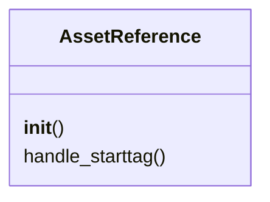
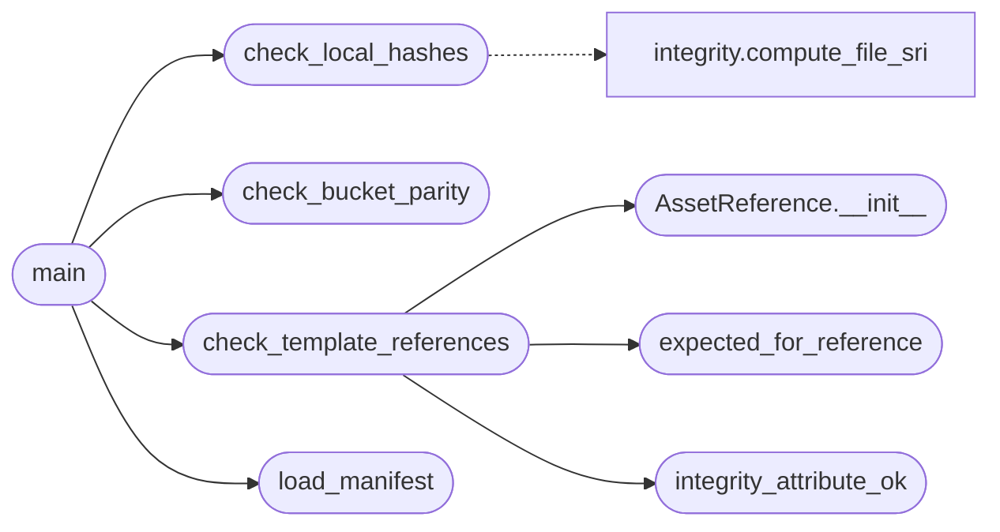

# `tools.verify_build`

> Source: [tools/verify_build.py:1](../../tools/verify_build.py#L1) | language `py` | coverage 100.0% | [API index](../index.md)

Verify reproducible builds and the fixed code contracts (QV-SRI-1).

Checks performed, all offline:

1. Every first-party asset in ``static/sri_manifest.json`` recomputes to
   its pinned hash. A mismatch means the served bytes drifted from the
   audited bytes.
2. Every ``/static/...`` script or stylesheet referenced by any template
   carries an ``integrity`` attribute equal to the manifest value.
3. Every ``https://`` script or stylesheet referenced by any template
   carries an ``integrity`` attribute equal to the manifest CDN pin.
4. The JavaScript bucket tables in ``static/js/qv-padding.js`` equal the
   Python defaults in ``utils/padding.py``, so the two sides of the
   padding contract cannot drift apart silently.

Usage:
    ./.venv/bin/python tools/verify_build.py

## Contents

- **Classes:** [`AssetReference`](#assetreference)
- **Functions:** [`load_manifest`](#load_manifest), [`expected_for_reference`](#expected_for_reference), [`integrity_attribute_ok`](#integrity_attribute_ok), [`check_local_hashes`](#check_local_hashes), [`check_template_references`](#check_template_references), [`check_bucket_parity`](#check_bucket_parity), [`main`](#main)
- **Constants:** [`PROJECT_ROOT`](#project_root), [`STATIC_DIR`](#static_dir), [`TEMPLATES_DIR`](#templates_dir), [`MANIFEST_PATH`](#manifest_path)

## Type Diagram



## Call Graph

Solid arrows stay in this module, dashed arrows leave it.



## Classes

<a id="assetreference"></a>

### `AssetReference`

`class` | [tools/verify_build.py:34](../../tools/verify_build.py#L34)

```python
class AssetReference(HTMLParser)
```

Bases: `HTMLParser`

Collect external script and stylesheet references from one template.

**Members**

| Member | Kind | Summary |
|---|---|---|
| [`__init__`](#assetreference-__init__) | constructor | Initialize the reference collector. |
| [`handle_starttag`](#assetreference-handle_starttag) | method | Record one script or link tag with its integrity attribute. |

<a id="assetreference-__init__"></a>

#### `AssetReference.__init__`

`constructor` | [tools/verify_build.py:37](../../tools/verify_build.py#L37)

```python
def __init__(self) -> None
```

Initialize the reference collector.

*Called by:* [`check_template_references`](#check_template_references)

<a id="assetreference-handle_starttag"></a>

#### `AssetReference.handle_starttag`

`method` | [tools/verify_build.py:42](../../tools/verify_build.py#L42)

```python
def handle_starttag(self, tag: str, attrs: list[tuple[str, str | None]]) -> None
```

Record one script or link tag with its integrity attribute.

**Parameters**

| Name | Type | Default | Description |
|---|---|---|---|
| `tag` | `str` |  |  |
| `attrs` | `list[tuple[str, str \| None]]` |  |  |

---

## Functions

<a id="load_manifest"></a>

### `load_manifest`

`function` | [tools/verify_build.py:71](../../tools/verify_build.py#L71)

```python
def load_manifest() -> dict
```

Load and return the SRI manifest document.

**Returns:** `dict`

*Called by:* [`main`](#main)

---

<a id="expected_for_reference"></a>

### `expected_for_reference`

`function` | [tools/verify_build.py:76](../../tools/verify_build.py#L76)

```python
def expected_for_reference(manifest: dict, ref: str) -> str | None
```

Resolve the pinned integrity value for one template reference.

**Parameters**

| Name | Type | Default | Description |
|---|---|---|---|
| `manifest` | `dict` |  |  |
| `ref` | `str` |  |  |

**Returns:** `str | None`

*Called by:* [`check_template_references`](#check_template_references)

---

<a id="integrity_attribute_ok"></a>

### `integrity_attribute_ok`

`function` | [tools/verify_build.py:85](../../tools/verify_build.py#L85)

```python
def integrity_attribute_ok(integrity: str, ref: str, expected: str) -> bool
```

Accept a literal pin or the ``sri_integrity`` template expression.

**Parameters**

| Name | Type | Default | Description |
|---|---|---|---|
| `integrity` | `str` |  |  |
| `ref` | `str` |  |  |
| `expected` | `str` |  |  |

**Returns:** `bool`

*Called by:* [`check_template_references`](#check_template_references)

---

<a id="check_local_hashes"></a>

### `check_local_hashes`

`function` | [tools/verify_build.py:95](../../tools/verify_build.py#L95)

```python
def check_local_hashes(manifest: dict, failures: list[str]) -> None
```

Recompute every pinned local asset and record mismatches.

**Parameters**

| Name | Type | Default | Description |
|---|---|---|---|
| `manifest` | `dict` |  |  |
| `failures` | `list[str]` |  |  |

*Calls:* [`compute_file_sri`](utils.integrity.py.md#compute_file_sri)

*Called by:* [`main`](#main)

---

<a id="check_template_references"></a>

### `check_template_references`

`function` | [tools/verify_build.py:110](../../tools/verify_build.py#L110)

```python
def check_template_references(manifest: dict, failures: list[str]) -> None
```

Require manifest-backed integrity on every template reference.

**Parameters**

| Name | Type | Default | Description |
|---|---|---|---|
| `manifest` | `dict` |  |  |
| `failures` | `list[str]` |  |  |

*Calls:* [`AssetReference.__init__`](#assetreference-__init__), [`expected_for_reference`](#expected_for_reference), [`integrity_attribute_ok`](#integrity_attribute_ok)

*Called by:* [`main`](#main)

---

<a id="check_bucket_parity"></a>

### `check_bucket_parity`

`function` | [tools/verify_build.py:126](../../tools/verify_build.py#L126)

```python
def check_bucket_parity(failures: list[str]) -> None
```

Require identical bucket tables in Python and JavaScript.

**Parameters**

| Name | Type | Default | Description |
|---|---|---|---|
| `failures` | `list[str]` |  |  |

*Called by:* [`main`](#main)

---

<a id="main"></a>

### `main`

`function` | [tools/verify_build.py:141](../../tools/verify_build.py#L141)

```python
def main() -> int
```

Run every check and report failures.

**Returns:** `int`

*Calls:* [`check_bucket_parity`](#check_bucket_parity), [`check_local_hashes`](#check_local_hashes), [`check_template_references`](#check_template_references), [`load_manifest`](#load_manifest)

---

## Constants

<a id="project_root"></a>

### `PROJECT_ROOT`

`constant` | [tools/verify_build.py:28](../../tools/verify_build.py#L28)

```python
PROJECT_ROOT = Path(__file__).resolve().parent.parent
```

---

<a id="static_dir"></a>

### `STATIC_DIR`

`constant` | [tools/verify_build.py:29](../../tools/verify_build.py#L29)

```python
STATIC_DIR = PROJECT_ROOT / 'static'
```

---

<a id="templates_dir"></a>

### `TEMPLATES_DIR`

`constant` | [tools/verify_build.py:30](../../tools/verify_build.py#L30)

```python
TEMPLATES_DIR = PROJECT_ROOT / 'templates'
```

---

<a id="manifest_path"></a>

### `MANIFEST_PATH`

`constant` | [tools/verify_build.py:31](../../tools/verify_build.py#L31)

```python
MANIFEST_PATH = STATIC_DIR / 'sri_manifest.json'
```

---
