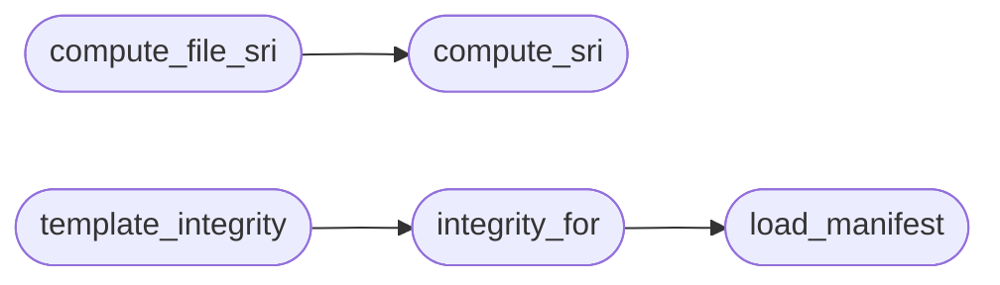

# `utils.integrity`

> Source: [utils/integrity.py:1](../../utils/integrity.py#L1) | language `py` | coverage 100.0% | [API index](../index.md)

Subresource Integrity manifest helpers (QV-SRI-1).

The manifest at ``static/sri_manifest.json`` pins the exact bytes of
every first-party script and stylesheet plus every pinned CDN URL. It
is generated with ``tools/generate_sri.py`` and checked with
``tools/verify_build.py``. Templates read values through
[`integrity_for`](#integrity_for) so the served HTML always carries the hash of the
audited bytes, and a compromised static file or a swapped CDN payload
fails closed in the browser instead of executing.

## Contents

- **Functions:** [`manifest_path`](#manifest_path), [`compute_sri`](#compute_sri), [`compute_file_sri`](#compute_file_sri), [`load_manifest`](#load_manifest), [`integrity_for`](#integrity_for), [`clear_manifest_cache`](#clear_manifest_cache), [`template_integrity`](#template_integrity)
- **Constants:** [`SRI_ALGORITHM`](#sri_algorithm), [`MANIFEST_RELATIVE_PATH`](#manifest_relative_path)

## Call Graph

Solid arrows stay in this module, dashed arrows leave it.



## Functions

<a id="manifest_path"></a>

### `manifest_path`

`function` | [utils/integrity.py:26](../../utils/integrity.py#L26)

```python
def manifest_path() -> Path
```

Return the manifest path resolved from this file, never hardcoded.

The manifest ships inside the `[`quantumvault`](quantumvault.__init__.py.md)` package (installed
wheels keep it next to the templates), so the lookup walks to the
sibling package. Operators can override the location with
``QV_SRI_MANIFEST`` for unusual multi-instance deployments.

**Returns:** `Path`

---

<a id="compute_sri"></a>

### `compute_sri`

`function` | [utils/integrity.py:40](../../utils/integrity.py#L40)

```python
def compute_sri(data: bytes, algorithm: str = SRI_ALGORITHM) -> str
```

Return the SRI string ``<algorithm>-<base64 digest>`` for ``data``.

**Parameters**

| Name | Type | Default | Description |
|---|---|---|---|
| `data` | `bytes` |  |  |
| `algorithm` | `str` | `SRI_ALGORITHM` |  |

**Returns:** `str`

*Called by:* [`fetch_cdn_assets`](tools.generate_sri.py.md#fetch_cdn_assets), [`compute_file_sri`](#compute_file_sri)

---

<a id="compute_file_sri"></a>

### `compute_file_sri`

`function` | [utils/integrity.py:46](../../utils/integrity.py#L46)

```python
def compute_file_sri(path: Path, algorithm: str = SRI_ALGORITHM) -> str
```

Return the SRI string for the bytes stored at ``path``.

**Parameters**

| Name | Type | Default | Description |
|---|---|---|---|
| `path` | `Path` |  |  |
| `algorithm` | `str` | `SRI_ALGORITHM` |  |

**Returns:** `str`

*Calls:* [`compute_sri`](#compute_sri)

*Called by:* [`collect_local_assets`](tools.generate_sri.py.md#collect_local_assets), [`check_local_hashes`](tools.verify_build.py.md#check_local_hashes)

---

<a id="load_manifest"></a>

### `load_manifest`

`function` | [utils/integrity.py:57](../../utils/integrity.py#L57)

```python
def load_manifest() -> dict
```

Return the parsed SRI manifest, or an empty mapping when absent.

**Returns:** `dict`

*Called by:* [`integrity_for`](#integrity_for)

---

<a id="integrity_for"></a>

### `integrity_for`

`function` | [utils/integrity.py:65](../../utils/integrity.py#L65)

```python
def integrity_for(key: str) -> Optional[str]
```

Return the pinned integrity string for one manifest key.

**Parameters**

| Name | Type | Default | Description |
|---|---|---|---|
| `key` | `str` |  | Either a first-party asset path such as ``js/qv-crypto.js`` or a full CDN URL. |

**Returns:** `Optional[str]` - The pinned ``sha384-...`` value, or ``None`` when unpinned.

*Calls:* [`load_manifest`](#load_manifest)

*Called by:* [`template_integrity`](#template_integrity)

---

<a id="clear_manifest_cache"></a>

### `clear_manifest_cache`

`function` | [utils/integrity.py:82](../../utils/integrity.py#L82)

```python
def clear_manifest_cache() -> None
```

Drop the cached manifest text so tests see a regenerated file.

---

<a id="template_integrity"></a>

### `template_integrity`

`function` | [utils/integrity.py:87](../../utils/integrity.py#L87)

```python
def template_integrity(key: str) -> str
```

Return the integrity string for a template asset reference.

Accepts the same reference the template already uses: a ``/static/``
path is normalized to its manifest key, and a full CDN URL resolves
to the CDN pin. Returns an empty string when unpinned so a missing
entry fails closed in ``verify_build`` instead of rendering ``None``.

**Parameters**

| Name | Type | Default | Description |
|---|---|---|---|
| `key` | `str` |  |  |

**Returns:** `str`

*Calls:* [`integrity_for`](#integrity_for)

---

## Constants

<a id="sri_algorithm"></a>

### `SRI_ALGORITHM`

`constant` | [utils/integrity.py:22](../../utils/integrity.py#L22)

```python
SRI_ALGORITHM: str = 'sha384'
```

---

<a id="manifest_relative_path"></a>

### `MANIFEST_RELATIVE_PATH`

`constant` | [utils/integrity.py:23](../../utils/integrity.py#L23)

```python
MANIFEST_RELATIVE_PATH: str = 'static/sri_manifest.json'
```

---
