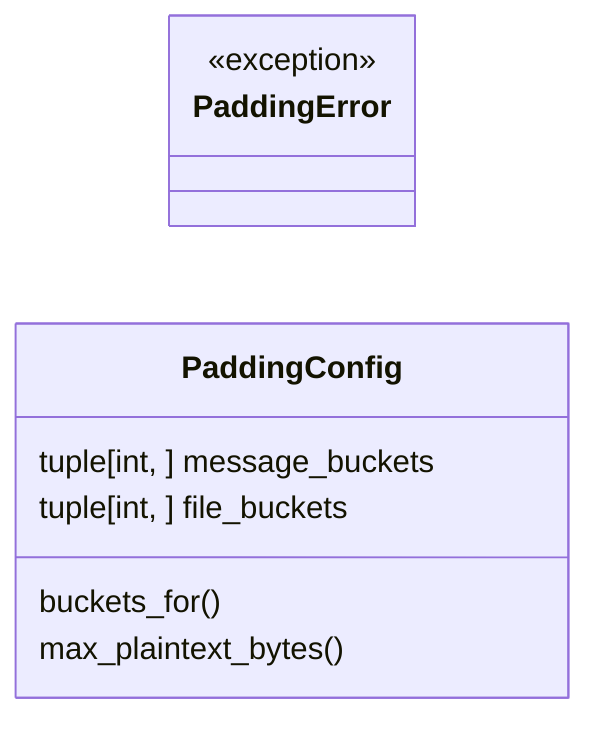
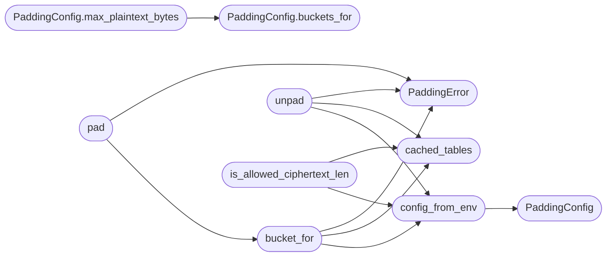

# `utils.padding`

> Source: [utils/padding.py:1](../../utils/padding.py#L1) | language `py` | coverage 100.0% | [API index](../index.md)

Fixed-bucket padding for metadata-size concealment (QV-PAD-1).

An observer who cannot read ciphertext can still read its length. This
module groups every plaintext into fixed buckets so the wire reveals
only a coarse size class instead of an exact byte count.

Wire format for one padded plaintext of bucket ``B``::

    LENGTH_PREFIX || PLAINTEXT || RANDOM_PAD

where ``LENGTH_PREFIX`` is the true plaintext length as a 4-byte
big-endian unsigned integer and ``RANDOM_PAD`` is fresh output from
`secrets` filling the remainder ``B - prefix - len(plaintext)``.
The padded plaintext is then encrypted with AES-256-GCM, so the stored
and transmitted ciphertext length is ``B + GCM_OVERHEAD_BYTES`` for
every plaintext inside the same bucket.

Cache safety contract: the only value ever cached is the immutable
bucket table itself, keyed by configuration version, never by message
content or message length. Padding bytes are drawn fresh from the
operating-system CSPRNG on every call and are never stored, reused, or
placed in any cache. Reusing pad bytes across envelopes would make
equal-length plaintexts produce related padded inputs, so reuse is
forbidden by construction: there is no API that accepts caller-supplied
pad bytes and no cache entry that holds them.

Bucket lookup always scans the full table so the number of iterations
does not depend on which bucket matched.

## Contents

- **Classes:** [`PaddingConfig`](#paddingconfig)
- **Exceptions:** [`PaddingError`](#paddingerror)
- **Functions:** [`config_from_env`](#config_from_env), [`cached_tables`](#cached_tables), [`bucket_for`](#bucket_for), [`pad`](#pad), [`unpad`](#unpad), [`wire_ciphertext_len`](#wire_ciphertext_len), [`is_allowed_ciphertext_len`](#is_allowed_ciphertext_len)
- **Constants:** [`LENGTH_PREFIX_BYTES`](#length_prefix_bytes), [`GCM_IV_BYTES`](#gcm_iv_bytes), [`GCM_TAG_BYTES`](#gcm_tag_bytes), [`GCM_OVERHEAD_BYTES`](#gcm_overhead_bytes), [`DEFAULT_MESSAGE_BUCKETS`](#default_message_buckets), [`DEFAULT_FILE_BUCKETS`](#default_file_buckets), [`MESSAGE_BUCKETS_ENV_VAR`](#message_buckets_env_var), [`FILE_BUCKETS_ENV_VAR`](#file_buckets_env_var)

## Type Diagram



## Call Graph

Solid arrows stay in this module, dashed arrows leave it.



## Classes

<a id="paddingconfig"></a>

### `PaddingConfig`

`class` `dataclass` | [utils/padding.py:78](../../utils/padding.py#L78)

Decorators: `@dataclass(frozen=True, slots=True)`

```python
class PaddingConfig
```

Immutable bucket tables for the two padded payload kinds.

**Attributes**

| Name | Type | Default | Description |
|---|---|---|---|
| [`message_buckets`](#paddingconfig-message_buckets) | `tuple[int, ...]` | `DEFAULT_MESSAGE_BUCKETS` |  |
| [`file_buckets`](#paddingconfig-file_buckets) | `tuple[int, ...]` | `DEFAULT_FILE_BUCKETS` |  |

**Members**

| Member | Kind | Summary |
|---|---|---|
| [`buckets_for`](#paddingconfig-buckets_for) | method | Return the bucket table for ``kind``. |
| [`max_plaintext_bytes`](#paddingconfig-max_plaintext_bytes) | method | Return the largest plaintext that fits ``kind``. |

<a id="paddingconfig-buckets_for"></a>

#### `PaddingConfig.buckets_for`

`method` | [utils/padding.py:84](../../utils/padding.py#L84)

```python
def buckets_for(self, kind: Kind) -> tuple[int, ...]
```

Return the bucket table for ``kind``.

**Parameters**

| Name | Type | Default | Description |
|---|---|---|---|
| `kind` | `Kind` |  |  |

**Returns:** `tuple[int, ...]`

*Called by:* [`PaddingConfig.max_plaintext_bytes`](#paddingconfig-max_plaintext_bytes)

<a id="paddingconfig-max_plaintext_bytes"></a>

#### `PaddingConfig.max_plaintext_bytes`

`method` | [utils/padding.py:90](../../utils/padding.py#L90)

```python
def max_plaintext_bytes(self, kind: Kind) -> int
```

Return the largest plaintext that fits ``kind``.

**Parameters**

| Name | Type | Default | Description |
|---|---|---|---|
| `kind` | `Kind` |  |  |

**Returns:** `int`

*Calls:* [`PaddingConfig.buckets_for`](#paddingconfig-buckets_for)

---

## Exceptions

<a id="paddingerror"></a>

### `PaddingError`

`exception` | [utils/padding.py:73](../../utils/padding.py#L73)

```python
class PaddingError(ValueError)
```

Bases: `ValueError`

Raised when data does not fit any bucket or framing is invalid.

---

## Functions

<a id="config_from_env"></a>

### `config_from_env`

`function` | [utils/padding.py:109](../../utils/padding.py#L109)

```python
def config_from_env() -> PaddingConfig
```

Build a [`PaddingConfig`](#paddingconfig) from the environment.

``QV_PAD_MESSAGE_BUCKETS`` and ``QV_PAD_FILE_BUCKETS`` accept
comma-separated byte sizes. Unset or malformed values resolve to the
compiled defaults so a misconfigured host fails closed to a known
table instead of disabling padding.

**Returns:** `PaddingConfig`

*Calls:* [`PaddingConfig`](#paddingconfig)

*Called by:* [`FileController.upload_encrypted_file`](controllers.file.py.md#filecontroller-upload_encrypted_file), [`MessageController.send_encrypted_message`](controllers.message.py.md#messagecontroller-send_encrypted_message), [`bucket_for`](#bucket_for), [`is_allowed_ciphertext_len`](#is_allowed_ciphertext_len), [`unpad`](#unpad)

---

<a id="cached_tables"></a>

### `cached_tables`

`function` | [utils/padding.py:142](../../utils/padding.py#L142)

```python
def cached_tables(config: PaddingConfig) -> tuple[tuple[int, ...], tuple[int, ...]]
```

Return the process-wide cached bucket tables for ``config``.

**Parameters**

| Name | Type | Default | Description |
|---|---|---|---|
| `config` | `PaddingConfig` |  |  |

**Returns:** `tuple[tuple[int, ...], tuple[int, ...]]`

*Called by:* [`bucket_for`](#bucket_for), [`is_allowed_ciphertext_len`](#is_allowed_ciphertext_len), [`unpad`](#unpad)

---

<a id="bucket_for"></a>

### `bucket_for`

`function` | [utils/padding.py:149](../../utils/padding.py#L149)

```python
def bucket_for(plaintext_len: int, kind: Kind, config: PaddingConfig | None = None) -> int
```

Return the smallest bucket holding ``plaintext_len`` plus prefix.

**Parameters**

| Name | Type | Default | Description |
|---|---|---|---|
| `plaintext_len` | `int` |  |  |
| `kind` | `Kind` |  |  |
| `config` | `PaddingConfig \| None` | `None` |  |

**Returns:** `int`

**Raises**

- [`PaddingError`](#paddingerror): If the payload plus prefix exceeds every bucket.

*Calls:* [`PaddingError`](#paddingerror), [`cached_tables`](#cached_tables), [`config_from_env`](#config_from_env)

*Called by:* [`pad`](#pad)

---

<a id="pad"></a>

### `pad`

`function` | [utils/padding.py:169](../../utils/padding.py#L169)

```python
def pad(plaintext: bytes, kind: Kind, config: PaddingConfig | None = None) -> bytes
```

Pad ``plaintext`` to its bucket with fresh CSPRNG bytes.

**Parameters**

| Name | Type | Default | Description |
|---|---|---|---|
| `plaintext` | `bytes` |  |  |
| `kind` | `Kind` |  |  |
| `config` | `PaddingConfig \| None` | `None` |  |

**Returns:** `bytes`

**Raises**

- [`PaddingError`](#paddingerror): If the payload does not fit any bucket.

*Calls:* [`PaddingError`](#paddingerror), [`bucket_for`](#bucket_for)

---

<a id="unpad"></a>

### `unpad`

`function` | [utils/padding.py:183](../../utils/padding.py#L183)

```python
def unpad(padded: bytes, kind: Kind, config: PaddingConfig | None = None) -> bytes
```

Remove bucket framing and return the original plaintext.

**Parameters**

| Name | Type | Default | Description |
|---|---|---|---|
| `padded` | `bytes` |  |  |
| `kind` | `Kind` |  |  |
| `config` | `PaddingConfig \| None` | `None` |  |

**Returns:** `bytes`

**Raises**

- [`PaddingError`](#paddingerror): If the length is not a bucket or framing is corrupt.

*Calls:* [`PaddingError`](#paddingerror), [`cached_tables`](#cached_tables), [`config_from_env`](#config_from_env)

---

<a id="wire_ciphertext_len"></a>

### `wire_ciphertext_len`

`function` | [utils/padding.py:209](../../utils/padding.py#L209)

```python
def wire_ciphertext_len(bucket: int) -> int
```

Return the AES-256-GCM ciphertext length for one padded bucket.

**Parameters**

| Name | Type | Default | Description |
|---|---|---|---|
| `bucket` | `int` |  |  |

**Returns:** `int`

---

<a id="is_allowed_ciphertext_len"></a>

### `is_allowed_ciphertext_len`

`function` | [utils/padding.py:214](../../utils/padding.py#L214)

```python
def is_allowed_ciphertext_len(ciphertext_len: int, kind: Kind, config: PaddingConfig | None = None) -> bool
```

Return True when ``ciphertext_len`` matches a bucket plus GCM overhead.

**Parameters**

| Name | Type | Default | Description |
|---|---|---|---|
| `ciphertext_len` | `int` |  |  |
| `kind` | `Kind` |  |  |
| `config` | `PaddingConfig \| None` | `None` |  |

**Returns:** `bool`

*Calls:* [`cached_tables`](#cached_tables), [`config_from_env`](#config_from_env)

*Called by:* [`FileController.upload_encrypted_file`](controllers.file.py.md#filecontroller-upload_encrypted_file), [`MessageController.send_encrypted_message`](controllers.message.py.md#messagecontroller-send_encrypted_message)

---

## Constants

<a id="length_prefix_bytes"></a>

### `LENGTH_PREFIX_BYTES`

`constant` | [utils/padding.py:42](../../utils/padding.py#L42)

```python
LENGTH_PREFIX_BYTES: Final[int] = 4
```

---

<a id="gcm_iv_bytes"></a>

### `GCM_IV_BYTES`

`constant` | [utils/padding.py:43](../../utils/padding.py#L43)

```python
GCM_IV_BYTES: Final[int] = 12
```

---

<a id="gcm_tag_bytes"></a>

### `GCM_TAG_BYTES`

`constant` | [utils/padding.py:44](../../utils/padding.py#L44)

```python
GCM_TAG_BYTES: Final[int] = 16
```

---

<a id="gcm_overhead_bytes"></a>

### `GCM_OVERHEAD_BYTES`

`constant` | [utils/padding.py:45](../../utils/padding.py#L45)

```python
GCM_OVERHEAD_BYTES: Final[int] = GCM_IV_BYTES + GCM_TAG_BYTES
```

---

<a id="default_message_buckets"></a>

### `DEFAULT_MESSAGE_BUCKETS`

`constant` | [utils/padding.py:47](../../utils/padding.py#L47)

```python
DEFAULT_MESSAGE_BUCKETS: Final[tuple[int, ...]] = (512, 1024, 2048, 4096, 8192, 16384, 32768, 65536)
```

---

<a id="default_file_buckets"></a>

### `DEFAULT_FILE_BUCKETS`

`constant` | [utils/padding.py:57](../../utils/padding.py#L57)

```python
DEFAULT_FILE_BUCKETS: Final[tuple[int, ...]] = (65536, 131072, 262144, 524288, 1048576, 2097152, 4194304, 8388608, 10485760)
```

---

<a id="message_buckets_env_var"></a>

### `MESSAGE_BUCKETS_ENV_VAR`

`constant` | [utils/padding.py:69](../../utils/padding.py#L69)

```python
MESSAGE_BUCKETS_ENV_VAR: Final[str] = 'QV_PAD_MESSAGE_BUCKETS'
```

---

<a id="file_buckets_env_var"></a>

### `FILE_BUCKETS_ENV_VAR`

`constant` | [utils/padding.py:70](../../utils/padding.py#L70)

```python
FILE_BUCKETS_ENV_VAR: Final[str] = 'QV_PAD_FILE_BUCKETS'
```

---
