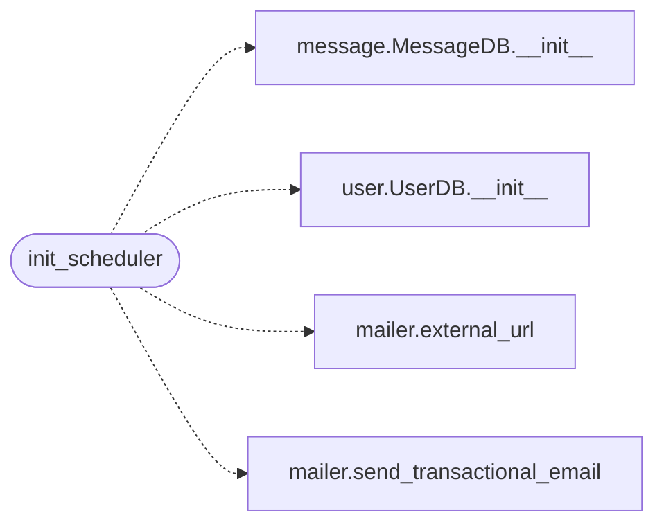

# `utils.scheduler`

> Source: [utils/scheduler.py:1](../../utils/scheduler.py#L1) | language `py` | coverage 100.0% | [API index](../index.md)

Background scheduler for trial expiration and inbox cleanup.

Runs two recurring jobs:

- ``check_trial_expiration`` (every 24h): flips ``subscription_status``
  to ``inactive`` once the free trial has elapsed, and emails the
  user with a renewal link.
- ``cleanup_old_messages`` (every 24h): drops inbox messages older
  than 7 days for inactive free users.

Both jobs run in APScheduler's BackgroundScheduler, so they execute
on a separate thread from the Flask request workers. Any exception
inside a job is logged but does not crash the scheduler process.

## Contents

- **Functions:** [`init_scheduler`](#init_scheduler)

## Call Graph

Solid arrows stay in this module, dashed arrows leave it.



## Functions

<a id="init_scheduler"></a>

### `init_scheduler`

`function` | [utils/scheduler.py:37](../../utils/scheduler.py#L37)

```python
def init_scheduler(app: Flask, mail: Mail) -> None
```

Start the background scheduler with the production job schedule.

The jobs run in a daemon thread, so they do not block the Flask
request loop. They are added idempotently: re-importing the module
does not register duplicates because `BackgroundScheduler`
is local to this call.

**Parameters**

| Name | Type | Default | Description |
|---|---|---|---|
| `app` | `Flask` |  |  |
| `mail` | `Mail` |  |  |

*Calls:* [`MessageDB.__init__`](models.message.py.md#messagedb-__init__), [`UserDB.__init__`](models.user.py.md#userdb-__init__), [`external_url`](utils.mailer.py.md#external_url), [`send_transactional_email`](utils.mailer.py.md#send_transactional_email)

---
