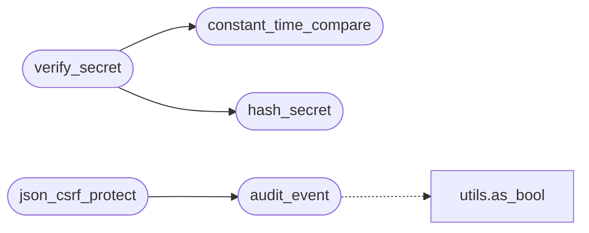

# `utils.security`

> Source: [utils/security.py:1](../../utils/security.py#L1) | language `py` | coverage 100.0% | [API index](../index.md)

Centralized security primitives for QuantumVault.

Single source of truth for:

- The structured audit log used by every security-relevant event
  (registration, login, MFA, lockouts, contact, role changes, etc.).
- A JSON-CSRF decorator that protects ``/api/*`` POST/PUT/DELETE routes
  against cross-origin forgery via the ``X-CSRF-Token`` header (the
  same token already issued by ``/api/csrf-token``).
- Small helpers for constant-time comparison and secret hashing of
  short-lived codes (phone verification, MFA, recovery codes).

Keeping these in one module makes the threat model auditable: if a
new endpoint is added and it touches the audit logger, the call site
becomes trivially visible during a security review.

## Contents

- **Functions:** [`audit_event`](#audit_event), [`constant_time_compare`](#constant_time_compare), [`hash_secret`](#hash_secret), [`verify_secret`](#verify_secret), [`new_one_time_code`](#new_one_time_code), [`json_csrf_protect`](#json_csrf_protect)

## Call Graph

Solid arrows stay in this module, dashed arrows leave it.



## Functions

<a id="audit_event"></a>

### `audit_event`

`function` | [utils/security.py:86](../../utils/security.py#L86)

```python
def audit_event(event: str, **fields: Any) -> None
```

Emit a structured audit record.

The ``ip`` and ``ua`` fields are recorded as ``None`` when
``QV_AUDIT_LOG_IP=0`` or ``QV_AUDIT_LOG_UA=0`` respectively, for
operators running for high-risk users (e.g. behind Tor) who do not
want client IP addresses or User-Agent strings persisted to logs.
Both default to enabled (``"1"``).

**Parameters**

| Name | Type | Default | Description |
|---|---|---|---|
| `event` | `str` |  | A short, snake_case event name, e.g. ``login_success`` or ``mfa_failure``. |
| `**fields` | `Any` |  | Additional structured fields to record. The keys ``ts`` (unix epoch in milliseconds), ``event``, ``cid`` (correlation id), ``ip``, and ``ua`` are added automatically. |

*Calls:* [`as_bool`](utils.utils.py.md#as_bool)

*Called by:* [`AuthController.register`](controllers.auth.py.md#authcontroller-register), [`AuthController.resend_phone_code`](controllers.auth.py.md#authcontroller-resend_phone_code), [`AuthController.send_confirmation_email`](controllers.auth.py.md#authcontroller-send_confirmation_email), [`AuthController.send_mfa_code`](controllers.auth.py.md#authcontroller-send_mfa_code), [`AuthController.send_sms_verification`](controllers.auth.py.md#authcontroller-send_sms_verification), [`AuthController.srp_hello`](controllers.auth.py.md#authcontroller-srp_hello), [`AuthController.srp_verify`](controllers.auth.py.md#authcontroller-srp_verify), [`AuthController.toggle_mfa`](controllers.auth.py.md#authcontroller-toggle_mfa), [`AuthController.verify_mfa_code`](controllers.auth.py.md#authcontroller-verify_mfa_code), [`AuthController.verify_phone_code`](controllers.auth.py.md#authcontroller-verify_phone_code), [`DeniableVaultController.load_or_provision`](controllers.deniable_vault.py.md#deniablevaultcontroller-load_or_provision), [`DeniableVaultController.reset`](controllers.deniable_vault.py.md#deniablevaultcontroller-reset) and 11 more

---

<a id="constant_time_compare"></a>

### `constant_time_compare`

`function` | [utils/security.py:123](../../utils/security.py#L123)

```python
def constant_time_compare(a: Optional[str], b: Optional[str]) -> bool
```

Return True if the two strings match in constant time.

A regular ``==`` leaks length and content-prefix information via
short-circuit evaluation. This wraps `hmac.compare_digest`
which compares the whole input even when lengths differ.

**Parameters**

| Name | Type | Default | Description |
|---|---|---|---|
| `a` | `Optional[str]` |  |  |
| `b` | `Optional[str]` |  |  |

**Returns:** `bool`

*Called by:* [`verify_secret`](#verify_secret)

---

<a id="hash_secret"></a>

### `hash_secret`

`function` | [utils/security.py:135](../../utils/security.py#L135)

```python
def hash_secret(secret: str) -> str
```

Hash a short-lived secret (phone code, MFA, recovery code) for storage.

Uses SHA-256 with a server-side pepper. The pepper is read from the
``QV_SECRET_PEPPER`` environment variable and falls back to a value
derived from ``SECRET_KEY`` so the hash is non-deterministic across
reinstalls but stable for a given deployment.

The goal is to avoid storing plaintext codes in the database: a DB
dump no longer hands an attacker ready-to-use codes. Phone codes
are 6 digits and MFA codes are 6 digits, so a peppered SHA-256 is
more than sufficient: an attacker with the DB but without the
pepper must precompute a 10^6-entry rainbow table per deployment.

**Parameters**

| Name | Type | Default | Description |
|---|---|---|---|
| `secret` | `str` |  |  |

**Returns:** `str`

*Called by:* [`AuthController.register`](controllers.auth.py.md#authcontroller-register), [`AuthController.resend_phone_code`](controllers.auth.py.md#authcontroller-resend_phone_code), [`AuthController.send_mfa_code`](controllers.auth.py.md#authcontroller-send_mfa_code), [`verify_secret`](#verify_secret)

---

<a id="verify_secret"></a>

### `verify_secret`

`function` | [utils/security.py:156](../../utils/security.py#L156)

```python
def verify_secret(secret: str, expected_hash: str) -> bool
```

Verify a short-lived secret against its stored hash.

**Parameters**

| Name | Type | Default | Description |
|---|---|---|---|
| `secret` | `str` |  |  |
| `expected_hash` | `str` |  |  |

**Returns:** `bool`

*Calls:* [`constant_time_compare`](#constant_time_compare), [`hash_secret`](#hash_secret)

*Called by:* [`AuthController.verify_mfa_code`](controllers.auth.py.md#authcontroller-verify_mfa_code), [`AuthController.verify_phone_code`](controllers.auth.py.md#authcontroller-verify_phone_code)

---

<a id="new_one_time_code"></a>

### `new_one_time_code`

`function` | [utils/security.py:163](../../utils/security.py#L163)

```python
def new_one_time_code(length: int = 6) -> str
```

Return a cryptographically random numeric verification code.

**Parameters**

| Name | Type | Default | Description |
|---|---|---|---|
| `length` | `int` | `6` |  |

**Returns:** `str`

*Called by:* [`AuthController.register`](controllers.auth.py.md#authcontroller-register), [`AuthController.resend_phone_code`](controllers.auth.py.md#authcontroller-resend_phone_code), [`AuthController.send_mfa_code`](controllers.auth.py.md#authcontroller-send_mfa_code)

---

<a id="json_csrf_protect"></a>

### `json_csrf_protect`

`function` | [utils/security.py:193](../../utils/security.py#L193)

```python
def json_csrf_protect(view: Callable) -> Callable
```

Decorator: require a valid CSRF token on JSON state-changing requests.

The token is the one Flask-WTF issues through ``form.hidden_tag()`` or
``/api/csrf-token``. It is a *signed* value, so it is validated with
`flask_wtf.csrf.validate_csrf`, which unsigns it and compares it to
the raw token held in the session; a direct string comparison against the
session value never matches and must not be used. A missing or invalid
token is rejected with HTTP 403 and recorded in the audit log.

GET, HEAD and OPTIONS pass through unchanged because they are not
state-changing. Use this on every ``/api/`` route that mutates state.

**Parameters**

| Name | Type | Default | Description |
|---|---|---|---|
| `view` | `Callable` |  |  |

**Returns:** `Callable`

*Calls:* [`audit_event`](#audit_event)

---
