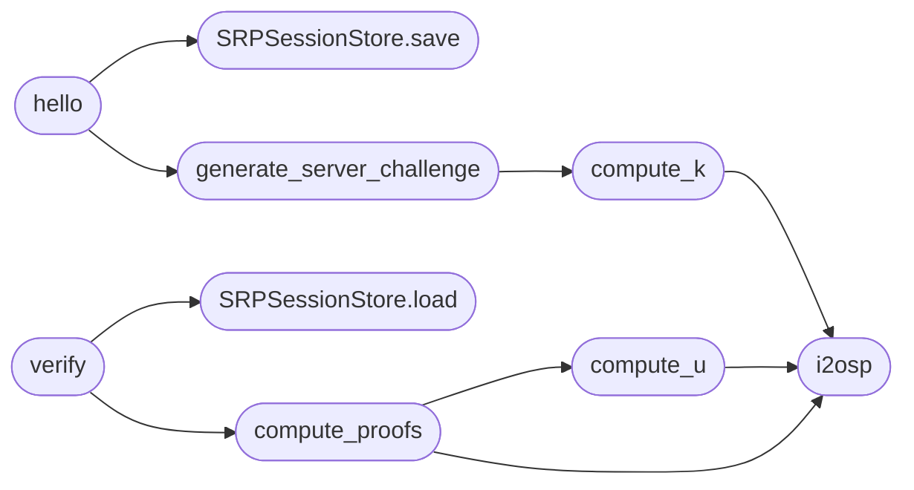

# `utils.srp6a`

> Source: [utils/srp6a.py:1](../../utils/srp6a.py#L1) | language `py` | coverage 100.0% | [API index](../index.md)

Zero-knowledge SRP-6a authentication primitives for QuantumVault.

This module implements the server side of a Secure Remote Password (SRP-6a)
handshake using the RFC 5054 2048-bit group with SHA-256. The user's password
never reaches the server: registration stores only ``salt`` and the password
verifier ``v = g**x mod N``; authentication is a challenge/response that proves
knowledge of the password without transmitting it.

The serialization scheme ("QV-SRP-1") is implemented identically in the browser
module ``static/js/qv-crypto.js`` so both ends agree byte-for-byte:

    - Every group element hashed (N, g, A, B, S) is encoded as a big-endian
      integer left-padded to the byte length of N (256 bytes) via [`i2osp`](#i2osp).
    - `[`H`](static.js.qv-crypto.js.md#h)` is SHA-256 over the concatenation of byte strings.
    - ``salt`` travels as a hex string; its raw bytes are used inside hashes.

Public functions perform the SRP math; [`SRPSessionStore`](#srpsessionstore) persists the
ephemeral per-login server state in Redis with a short time-to-live.

## Contents

- **Classes:** [`SRPSessionStore`](#srpsessionstore)
- **Functions:** [`i2osp`](#i2osp), [`compute_k`](#compute_k), [`compute_u`](#compute_u), [`generate_server_challenge`](#generate_server_challenge), [`compute_proofs`](#compute_proofs), [`hello`](#hello), [`verify`](#verify)
- **Constants:** [`N_HEX`](#n_hex), [`N`](#n), [`N_BYTE_LENGTH`](#n_byte_length), [`SESSION_TTL_SECONDS`](#session_ttl_seconds), [`EPHEMERAL_PRIVATE_BITS`](#ephemeral_private_bits)

## Call Graph

Solid arrows stay in this module, dashed arrows leave it.



## Classes

<a id="srpsessionstore"></a>

### `SRPSessionStore`

`class` | [utils/srp6a.py:150](../../utils/srp6a.py#L150)

```python
class SRPSessionStore
```

Redis-backed store for the ephemeral state of an in-flight SRP login.

Each `[`hello`](#hello)` step persists the values needed to verify the subsequent
`[`verify`](#verify)` step. Entries expire after [`SESSION_TTL_SECONDS`](#session_ttl_seconds) so an
abandoned handshake cannot be resumed later.

**Members**

| Member | Kind | Summary |
|---|---|---|
| [`__init__`](#srpsessionstore-__init__) | constructor | Initialize the store from a Redis connection URI. |
| [`save`](#srpsessionstore-save) | method | Persist the ephemeral SRP challenge state for a username. |
| [`load`](#srpsessionstore-load) | method | Load and consume the ephemeral SRP state for a username. |

<a id="srpsessionstore-__init__"></a>

#### `SRPSessionStore.__init__`

`constructor` | [utils/srp6a.py:158](../../utils/srp6a.py#L158)

```python
def __init__(self, storage_uri: str)
```

Initialize the store from a Redis connection URI.

**Parameters**

| Name | Type | Default | Description |
|---|---|---|---|
| `storage_uri` | `str` |  | A ``redis://`` connection string (the same one used by the rate limiter). |

*Called by:* [`AuthController.__init__`](controllers.auth.py.md#authcontroller-__init__)

<a id="srpsessionstore-save"></a>

#### `SRPSessionStore.save`

`method` | [utils/srp6a.py:172](../../utils/srp6a.py#L172)

```python
def save(self, username: str, salt_hex: str, verifier_hex: str, server_a_hex: str, server_b_hex: str, server_b_secret_hex: str) -> None
```

Persist the ephemeral SRP challenge state for a username.

**Parameters**

| Name | Type | Default | Description |
|---|---|---|---|
| `username` | `str` |  | The user identity. |
| `salt_hex` | `str` |  | The user salt as a hex string. |
| `verifier_hex` | `str` |  | The stored verifier as a hex string. |
| `server_a_hex` | `str` |  | The client public ephemeral A as a hex string. |
| `server_b_hex` | `str` |  | The server public ephemeral B as a hex string. |
| `server_b_secret_hex` | `str` |  | The server secret ephemeral b as a hex string. |

*Called by:* [`hello`](#hello)

<a id="srpsessionstore-load"></a>

#### `SRPSessionStore.load`

`method` | [utils/srp6a.py:202](../../utils/srp6a.py#L202)

```python
def load(self, username: str) -> Optional[dict]
```

Load and consume the ephemeral SRP state for a username.

The entry is deleted on read so each challenge is single-use.

**Parameters**

| Name | Type | Default | Description |
|---|---|---|---|
| `username` | `str` |  | The user identity. |

**Returns:** `Optional[dict]` - The stored session dictionary, or ``None`` if no valid session
exists (expired, missing, or already consumed).

*Called by:* [`verify`](#verify)

---

## Functions

<a id="i2osp"></a>

### `i2osp`

`function` | [utils/srp6a.py:47](../../utils/srp6a.py#L47)

```python
def i2osp(value: int) -> bytes
```

Encode an integer as a big-endian byte string padded to the length of N.

**Parameters**

| Name | Type | Default | Description |
|---|---|---|---|
| `value` | `int` |  | Non-negative integer to encode (a group element). |

**Returns:** `bytes` - The big-endian representation left-padded with zero bytes to
`[`N_BYTE_LENGTH`](#n_byte_length)`.

*Called by:* [`compute_k`](#compute_k), [`compute_proofs`](#compute_proofs), [`compute_u`](#compute_u)

---

<a id="compute_k"></a>

### `compute_k`

`function` | [utils/srp6a.py:73](../../utils/srp6a.py#L73)

```python
def compute_k() -> int
```

Compute the SRP-6a multiplier parameter ``k = H(N | PAD(g))``.

**Returns:** `int`

*Calls:* [`i2osp`](#i2osp)

*Called by:* [`generate_server_challenge`](#generate_server_challenge)

---

<a id="compute_u"></a>

### `compute_u`

`function` | [utils/srp6a.py:78](../../utils/srp6a.py#L78)

```python
def compute_u(server_a: int, server_b: int) -> int
```

Compute the random scrambling parameter ``u = H(PAD(A) | PAD(B))``.

**Parameters**

| Name | Type | Default | Description |
|---|---|---|---|
| `server_a` | `int` |  | The client public ephemeral value A. |
| `server_b` | `int` |  | The server public ephemeral value B. |

**Returns:** `int` - The scrambling parameter u as an integer.

*Calls:* [`i2osp`](#i2osp)

*Called by:* [`compute_proofs`](#compute_proofs)

---

<a id="generate_server_challenge"></a>

### `generate_server_challenge`

`function` | [utils/srp6a.py:91](../../utils/srp6a.py#L91)

```python
def generate_server_challenge(verifier: int) -> Tuple[int, int]
```

Generate the server ephemeral key pair (b, B) for a login challenge.

**Parameters**

| Name | Type | Default | Description |
|---|---|---|---|
| `verifier` | `int` |  | The stored password verifier ``v`` for the user. |

**Returns:** `Tuple[int, int]` - A tuple ``(b, B)`` where ``b`` is the secret ephemeral and
``B = (k * v + g**b) mod N`` is the public value sent to the client.

*Calls:* [`compute_k`](#compute_k)

*Called by:* [`hello`](#hello)

---

<a id="compute_proofs"></a>

### `compute_proofs`

`function` | [utils/srp6a.py:107](../../utils/srp6a.py#L107)

```python
def compute_proofs(username: str, salt_hex: str, verifier: int, server_a: int, server_b: int, server_b_secret: int) -> Tuple[bytes, bytes]
```

Compute the expected client proof M1 and the server proof M2.

**Parameters**

| Name | Type | Default | Description |
|---|---|---|---|
| `username` | `str` |  | The user identity I. |
| `salt_hex` | `str` |  | The user salt as a hex string. |
| `verifier` | `int` |  | The stored password verifier v. |
| `server_a` | `int` |  | The client public ephemeral A. |
| `server_b` | `int` |  | The server public ephemeral B. |
| `server_b_secret` | `int` |  | The server secret ephemeral b. |

**Returns:** `Tuple[bytes, bytes]` - A tuple ``(expected_m1, m2)`` of raw digest bytes.

*Calls:* [`compute_u`](#compute_u), [`i2osp`](#i2osp)

*Called by:* [`verify`](#verify)

---

<a id="hello"></a>

### `hello`

`function` | [utils/srp6a.py:224](../../utils/srp6a.py#L224)

```python
def hello(store: SRPSessionStore, username: str, client_a_hex: str, salt_hex: str, verifier_hex: str) -> Optional[str]
```

Process the SRP `[`hello`](#hello)` step and return the server challenge B.

**Parameters**

| Name | Type | Default | Description |
|---|---|---|---|
| `store` | `SRPSessionStore` |  | The ephemeral session store. |
| `username` | `str` |  | The user identity. |
| `client_a_hex` | `str` |  | The client public ephemeral A as a hex string. |
| `salt_hex` | `str` |  | The stored user salt as a hex string. |
| `verifier_hex` | `str` |  | The stored verifier as a hex string. |

**Returns:** `Optional[str]` - The server public ephemeral B as a hex string, or ``None`` if the
client value A is invalid (``A mod N == 0``).

*Calls:* [`SRPSessionStore.save`](#srpsessionstore-save), [`generate_server_challenge`](#generate_server_challenge)

*Called by:* [`AuthController.srp_hello`](controllers.auth.py.md#authcontroller-srp_hello)

---

<a id="verify"></a>

### `verify`

`function` | [utils/srp6a.py:260](../../utils/srp6a.py#L260)

```python
def verify(store: SRPSessionStore, username: str, client_m1_hex: str) -> Optional[str]
```

Process the SRP `[`verify`](#verify)` step and return the server proof M2.

**Parameters**

| Name | Type | Default | Description |
|---|---|---|---|
| `store` | `SRPSessionStore` |  | The ephemeral session store. |
| `username` | `str` |  | The user identity. |
| `client_m1_hex` | `str` |  | The client proof M1 as a hex string. |

**Returns:** `Optional[str]` - The server proof M2 as a hex string on success, or ``None`` if no
pending session exists or the client proof is invalid.

*Calls:* [`SRPSessionStore.load`](#srpsessionstore-load), [`compute_proofs`](#compute_proofs)

---

## Constants

<a id="n_hex"></a>

### `N_HEX`

`constant` | [utils/srp6a.py:29](../../utils/srp6a.py#L29)

```python
N_HEX
```

---

<a id="n"></a>

### `N`

`constant` | [utils/srp6a.py:39](../../utils/srp6a.py#L39)

```python
N = int(N_HEX, 16)
```

---

<a id="n_byte_length"></a>

### `N_BYTE_LENGTH`

`constant` | [utils/srp6a.py:41](../../utils/srp6a.py#L41)

```python
N_BYTE_LENGTH = (N.bit_length() + 7) // 8
```

---

<a id="session_ttl_seconds"></a>

### `SESSION_TTL_SECONDS`

`constant` | [utils/srp6a.py:43](../../utils/srp6a.py#L43)

```python
SESSION_TTL_SECONDS = 60
```

---

<a id="ephemeral_private_bits"></a>

### `EPHEMERAL_PRIVATE_BITS`

`constant` | [utils/srp6a.py:44](../../utils/srp6a.py#L44)

```python
EPHEMERAL_PRIVATE_BITS = 256
```

---
