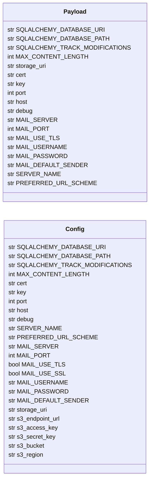

# `utils.utils`

> Source: [utils/utils.py:1](../../utils/utils.py#L1) | language `py` | coverage 87.5% | [API index](../index.md)

utils/utils.py

## Contents

- **Classes:** [`Payload`](#payload), [`Config`](#config)
- **Functions:** [`database_path`](#database_path), [`as_bool`](#as_bool), [`sanitize_path`](#sanitize_path), [`load_payload`](#load_payload)

## Type Diagram



## Call Graph

Solid arrows stay in this module, dashed arrows leave it.


## Classes

<a id="payload"></a>

### `Payload`

`class` | [utils/utils.py:80](../../utils/utils.py#L80)

```python
class Payload(TypedDict, total=False)
```

Bases: `TypedDict`

Non-secret application configuration loaded from ``payload.json``.

**Attributes**

| Name | Type | Default | Description |
|---|---|---|---|
| [`SQLALCHEMY_DATABASE_URI`](#payload-sqlalchemy_database_uri) | `str` |  |  |
| [`SQLALCHEMY_DATABASE_PATH`](#payload-sqlalchemy_database_path) | `str` |  |  |
| [`SQLALCHEMY_TRACK_MODIFICATIONS`](#payload-sqlalchemy_track_modifications) | `str` |  |  |
| [`MAX_CONTENT_LENGTH`](#payload-max_content_length) | `int` |  |  |
| [`storage_uri`](#payload-storage_uri) | `str` |  |  |
| [`cert`](#payload-cert) | `str` |  |  |
| [`key`](#payload-key) | `str` |  |  |
| [`port`](#payload-port) | `int` |  |  |
| [`host`](#payload-host) | `str` |  |  |
| [`debug`](#payload-debug) | `str` |  |  |
| [`MAIL_SERVER`](#payload-mail_server) | `str` |  |  |
| [`MAIL_PORT`](#payload-mail_port) | `int` |  |  |
| [`MAIL_USE_TLS`](#payload-mail_use_tls) | `str` |  |  |
| [`MAIL_USERNAME`](#payload-mail_username) | `str` |  |  |
| [`MAIL_PASSWORD`](#payload-mail_password) | `str` |  |  |
| [`MAIL_DEFAULT_SENDER`](#payload-mail_default_sender) | `str` |  |  |
| [`SERVER_NAME`](#payload-server_name) | `str` |  |  |
| [`PREFERRED_URL_SCHEME`](#payload-preferred_url_scheme) | `str` |  |  |

---

<a id="config"></a>

### `Config`

`class` | [utils/utils.py:103](../../utils/utils.py#L103)

```python
class Config
```

Application configuration sourced from ``payload.json`` and the environment.

Non-secret defaults come from ``payload.json``; secrets and infrastructure
endpoints (mail credentials, object storage, Redis) are overlaid from
environment variables so that no credential is committed to the repository.

Every attribute is declared on the class so static analyzers see the
full shape; [`__init__`](init__.py.md) populates them from the loaded payload.

**Attributes**

| Name | Type | Default | Description |
|---|---|---|---|
| [`SQLALCHEMY_DATABASE_URI`](#config-sqlalchemy_database_uri) | `str` |  |  |
| [`SQLALCHEMY_DATABASE_PATH`](#config-sqlalchemy_database_path) | `str` |  |  |
| [`SQLALCHEMY_TRACK_MODIFICATIONS`](#config-sqlalchemy_track_modifications) | `str` |  |  |
| [`MAX_CONTENT_LENGTH`](#config-max_content_length) | `int` |  |  |
| [`cert`](#config-cert) | `str` |  |  |
| [`key`](#config-key) | `str` |  |  |
| [`port`](#config-port) | `int` |  |  |
| [`host`](#config-host) | `str` |  |  |
| [`debug`](#config-debug) | `str` |  |  |
| [`SERVER_NAME`](#config-server_name) | `str` |  |  |
| [`PREFERRED_URL_SCHEME`](#config-preferred_url_scheme) | `str` |  |  |
| [`MAIL_SERVER`](#config-mail_server) | `str` |  |  |
| [`MAIL_PORT`](#config-mail_port) | `int` |  |  |
| [`MAIL_USE_TLS`](#config-mail_use_tls) | `bool` |  |  |
| [`MAIL_USE_SSL`](#config-mail_use_ssl) | `bool` |  |  |
| [`MAIL_USERNAME`](#config-mail_username) | `str` |  |  |
| [`MAIL_PASSWORD`](#config-mail_password) | `str` |  |  |
| [`MAIL_DEFAULT_SENDER`](#config-mail_default_sender) | `str` |  |  |
| [`storage_uri`](#config-storage_uri) | `str` |  |  |
| [`s3_endpoint_url`](#config-s3_endpoint_url) | `str` |  |  |
| [`s3_access_key`](#config-s3_access_key) | `str` |  |  |
| [`s3_secret_key`](#config-s3_secret_key) | `str` |  |  |
| [`s3_bucket`](#config-s3_bucket) | `str` |  |  |
| [`s3_region`](#config-s3_region) | `str` |  |  |

**Members**

| Member | Kind | Summary |
|---|---|---|
| [`__init__`](#config-__init__) | constructor |  |

<a id="config-__init__"></a>

#### `Config.__init__`

`constructor` | [utils/utils.py:145](../../utils/utils.py#L145)

```python
def __init__(self, config_dict: Payload)
```

**Parameters**

| Name | Type | Default | Description |
|---|---|---|---|
| `config_dict` | `Payload` |  |  |

*Calls:* [`as_bool`](#as_bool)

*Called by:* [`main`](app.py.md#main), [`create_app`](app_factory.py.md#create_app), [`cmd_link`](scripts.email_tool.py.md#cmd_link), [`cmd_test_smtp`](scripts.email_tool.py.md#cmd_test_smtp)

---

## Functions

<a id="database_path"></a>

### `database_path`

`function` | [utils/utils.py:12](../../utils/utils.py#L12)

```python
def database_path() -> str
```

Return the SQLite database path from config, with a legacy fallback.

Request-path code must never hard-code a database location: in tests and
in multi-instance deployments the configured path is the only correct
one, and a hard-coded path silently writes to (or reads from) the wrong
file. Outside an application context, for standalone scripts, the
``QV_USERS_DB`` environment variable or the historical default is used.

**Returns:** `str`

*Called by:* [`AuthController.register`](controllers.auth.py.md#authcontroller-register), [`MessageController.__init__`](controllers.message.py.md#messagecontroller-__init__), [`admin_contacts`](views.admin.py.md#admin_contacts), [`contact`](views.auth.py.md#contact), [`get_auth_controller`](views.auth.py.md#get_auth_controller), [`landing`](views.faq.py.md#landing), [`SubscriptionForm.__init__`](views.subscription.py.md#subscriptionform-__init__), [`payment_success`](views.subscription.py.md#payment_success), [`subscribe`](views.subscription.py.md#subscribe), [`home`](views.views.py.md#home)

---

<a id="as_bool"></a>

### `as_bool`

`function` | [utils/utils.py:29](../../utils/utils.py#L29)

```python
def as_bool(value: Union[str, bool, int, None], default: bool = False) -> bool
```

Coerce an environment or payload value into a real boolean.

Strings such as ``"True"`` and ``"False"`` are both truthy when passed
straight to Flask, which silently enables flags that were meant to be
disabled. This normalizes them so ``MAIL_USE_TLS="False"`` disables TLS.

**Parameters**

| Name | Type | Default | Description |
|---|---|---|---|
| `value` | `Union[str, bool, int, None]` |  | The raw value from ``os.environ`` or ``payload.json``. |
| `default` | `bool` | `False` | The value to return when ``value`` is ``None``. |

**Returns:** `bool` - The coerced boolean.

*Called by:* [`audit_event`](utils.security.py.md#audit_event), [`Config.__init__`](#config-__init__)

---

<a id="sanitize_path"></a>

### `sanitize_path`

`function` | [utils/utils.py:49](../../utils/utils.py#L49)

```python
def sanitize_path(path: str) -> str
```

Sanitiza una ruta de archivo para prevenir LFI y path traversal. - Elimina caracteres peligrosos - Normaliza la ruta - Asegura que no contenga '..' o rutas absolutas

**Parameters**

| Name | Type | Default | Description |
|---|---|---|---|
| `path` | `str` |  |  |

**Returns:** `str`

---

<a id="load_payload"></a>

### `load_payload`

`function` | [utils/utils.py:168](../../utils/utils.py#L168)

```python
def load_payload() -> Payload
```

Load non-secret application configuration from ``payload.json``.

A local ``.env`` file is loaded first (when ``python-dotenv`` is available)
so environment-based secrets are populated before [`Config`](#config) reads them.

**Returns:** `Payload` - The parsed configuration dictionary.

*Called by:* [`main`](app.py.md#main), [`create_app`](app_factory.py.md#create_app), [`cmd_link`](scripts.email_tool.py.md#cmd_link), [`cmd_test_smtp`](scripts.email_tool.py.md#cmd_test_smtp)

---
