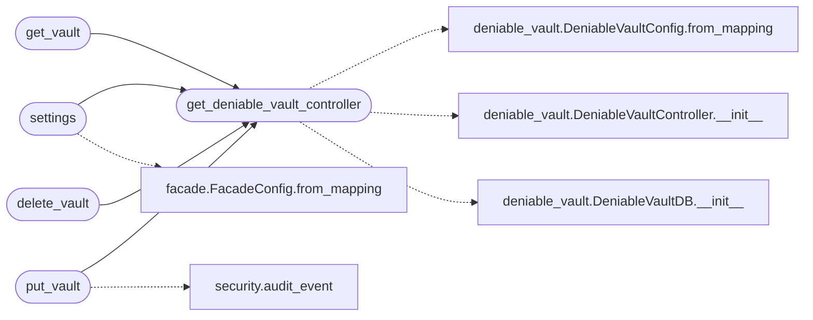

# `views.account`

> Source: [views/account.py:1](../../views/account.py#L1) | language `py` | coverage 100.0% | [API index](../index.md)

Account settings page and the deniable vault JSON API (QV-DENIABLE-1).

The settings page is a normal, universal part of every authenticated
account, regardless of role. It deliberately does not advertise the
deniable vault as a special feature: the page looks the same for everyone,
and the API never tells the caller whether a hidden vault is configured.
That is by design. A deniable vault only protects the user if its presence
leaves no evidence; an obvious "you have a hidden vault" indicator would
make coercion more effective, not less.

Routes:

- ``GET    /account``            : render the account settings page
- ``GET    /api/account/vault``  : return the user's opaque container,
                                   minting an indistinguishable random one
                                   if the account has none yet
- ``PUT    /api/account/vault``  : validate and store a container
- ``DELETE /api/account/vault``  : reset the container to a fresh random one

The server validates container *structure* only; it never decrypts a slot
or sees a passphrase (see [`controllers.deniable_vault`](controllers.deniable_vault.py.md)).

## Contents

- **Functions:** [`get_deniable_vault_controller`](#get_deniable_vault_controller), [`settings`](#settings), [`get_vault`](#get_vault), [`put_vault`](#put_vault), [`delete_vault`](#delete_vault)

## Call Graph

Solid arrows stay in this module, dashed arrows leave it.



## Functions

<a id="get_deniable_vault_controller"></a>

### `get_deniable_vault_controller`

`function` | [views/account.py:51](../../views/account.py#L51)

```python
def get_deniable_vault_controller() -> DeniableVaultController
```

Build a controller bound to the active app's database and config.

The database path and structural parameters are read from
``current_app.config`` so tests (which point the app at a temporary
database and may override limits) and production share one code path.

**Returns:** `DeniableVaultController`

*Calls:* [`DeniableVaultConfig.from_mapping`](controllers.deniable_vault.py.md#deniablevaultconfig-from_mapping), [`DeniableVaultController.__init__`](controllers.deniable_vault.py.md#deniablevaultcontroller-__init__), [`DeniableVaultDB.__init__`](models.deniable_vault.py.md#deniablevaultdb-__init__)

*Called by:* [`delete_vault`](#delete_vault), [`get_vault`](#get_vault), [`put_vault`](#put_vault), [`settings`](#settings)

---

<a id="settings"></a>

### `settings`

`function` | [views/account.py:65](../../views/account.py#L65)

Decorators: `@account_bp.route('/account', methods=['GET'])`, `@login_required`

```python
def settings()
```

Render the account settings page.

When the cover facade is enabled the decoy feature requires a deniable
passphrase, so the page asks for one. The server never learns whether a
passphrase has been set: it only exposes the instance-level facade flag.

*Calls:* [`FacadeConfig.from_mapping`](controllers.facade.py.md#facadeconfig-from_mapping), [`get_deniable_vault_controller`](#get_deniable_vault_controller)

---

<a id="get_vault"></a>

### `get_vault`

`function` | [views/account.py:85](../../views/account.py#L85)

Decorators: `@account_bp.route('/api/account/vault', methods=['GET'])`, `@login_required`, `@limiter.limit('30 per minute')`

```python
def get_vault()
```

Return the user's container and the build parameters.

The response always includes an ``envelope`` (a random one is minted on
first access) and the structural ``parameters``. It never includes a
"configured" flag: whether the container holds real data is exactly
what must stay hidden.

*Calls:* [`get_deniable_vault_controller`](#get_deniable_vault_controller)

---

<a id="put_vault"></a>

### `put_vault`

`function` | [views/account.py:107](../../views/account.py#L107)

Decorators: `@account_bp.route('/api/account/vault', methods=['PUT'])`, `@login_required`, `@limiter.limit('10 per minute')`, `@json_csrf_protect`

```python
def put_vault()
```

Validate and store a container for the user.

*Calls:* [`audit_event`](utils.security.py.md#audit_event), [`get_deniable_vault_controller`](#get_deniable_vault_controller)

---

<a id="delete_vault"></a>

### `delete_vault`

`function` | [views/account.py:130](../../views/account.py#L130)

Decorators: `@account_bp.route('/api/account/vault', methods=['DELETE'])`, `@login_required`, `@limiter.limit('10 per minute')`, `@json_csrf_protect`

```python
def delete_vault()
```

Reset the user's container to a fresh random one.

Reset, not delete: removing the row would distinguish an account that
deactivated from one that never activated. A random container keeps the
"every account has one" invariant intact.

*Calls:* [`get_deniable_vault_controller`](#get_deniable_vault_controller)

---
