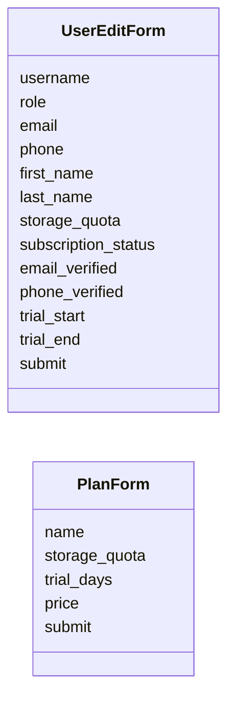
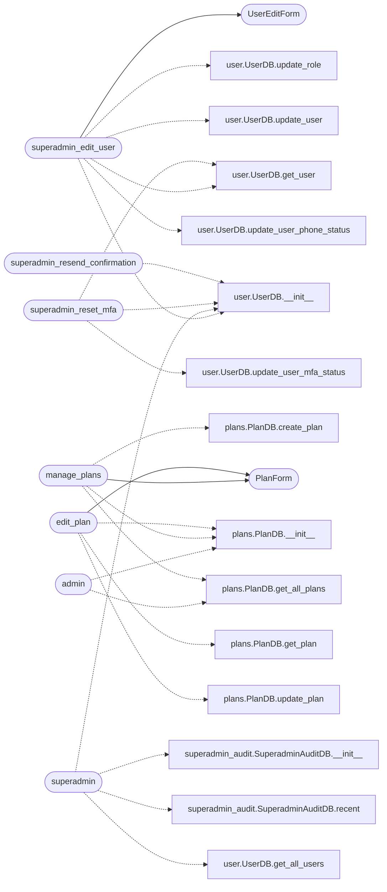

# `views.admin`

> Source: [views/admin.py:1](../../views/admin.py#L1) | language `py` | coverage 86.7% | [API index](../index.md)

## Contents

- **Classes:** [`UserEditForm`](#usereditform), [`PlanForm`](#planform)
- **Functions:** [`admin`](#admin), [`superadmin_edit_user`](#superadmin_edit_user), [`manage_plans`](#manage_plans), [`edit_plan`](#edit_plan), [`superadmin`](#superadmin), [`superadmin_reset_mfa`](#superadmin_reset_mfa), [`superadmin_resend_confirmation`](#superadmin_resend_confirmation), [`superadmin_toggle_suspend`](#superadmin_toggle_suspend), [`superadmin_channel_start`](#superadmin_channel_start), [`superadmin_channel_stop`](#superadmin_channel_stop), [`superadmin_channel_rotate`](#superadmin_channel_rotate), [`admin_contacts`](#admin_contacts)

## Type Diagram



## Call Graph

Solid arrows stay in this module, dashed arrows leave it.



## Classes

<a id="usereditform"></a>

### `UserEditForm`

`class` | [views/admin.py:141](../../views/admin.py#L141)

```python
class UserEditForm(FlaskForm)
```

Bases: `FlaskForm`

Form for editing user details.

Intentionally does NOT carry these fields:

* `[`confirmation_token`](models.user.py.md#usermodel-confirmation_token)` — rotated by the resend-confirmation
  endpoint, never hand-edited. A static token cannot expire and
  would either lock the user out or be reused forever.
* ``phone_verification_code`` — same reason; the column stores
  a hash, not the cleartext code, so a superadmin UI input is
  meaningless.
* KEM/SRP blob columns (srp_salt, srp_verifier, public_key,
  encrypted_private_key, kdf_salt) — the server has no UI to
  rewrite them. Modifying any of them would silently brick the
  user's login.

``password`` is also absent: the server is zero-knowledge, so a
"change password" UI lives in the user's own profile, not here.

**Attributes**

| Name | Type | Default | Description |
|---|---|---|---|
| [`username`](#usereditform-username) |  | `StringField('Username', validators=[DataRequired()])` |  |
| [`role`](#usereditform-role) |  | `SelectField('Role', choices=[('free', 'Free'), ('bronze', 'Bronze'), ('silver', 'Silver'), ('gold', 'Gold'), ('admin', 'Admin'), ('superadmin', 'Superadmin')], validators=[DataRequired()])` |  |
| [`email`](#usereditform-email) |  | `StringField('Email', validators=[Optional(), Email()])` |  |
| [`phone`](#usereditform-phone) |  | `StringField('Phone', validators=[Optional()])` |  |
| [`first_name`](#usereditform-first_name) |  | `StringField('First Name', validators=[Optional()])` |  |
| [`last_name`](#usereditform-last_name) |  | `StringField('Last Name', validators=[Optional()])` |  |
| [`storage_quota`](#usereditform-storage_quota) |  | `IntegerField('Storage Quota (MB)', validators=[DataRequired(), NumberRange(min=0)])` |  |
| [`subscription_status`](#usereditform-subscription_status) |  | `SelectField('Subscription Status', choices=[('active', 'Active'), ('inactive', 'Inactive')], validators=[DataRequired()])` |  |
| [`email_verified`](#usereditform-email_verified) |  | `BooleanField('Email Verified')` |  |
| [`phone_verified`](#usereditform-phone_verified) |  | `BooleanField('Phone Verified')` |  |
| [`trial_start`](#usereditform-trial_start) |  | `StringField('Trial Start (YYYY-MM-DD)', validators=[Optional()])` |  |
| [`trial_end`](#usereditform-trial_end) |  | `StringField('Trial End (YYYY-MM-DD)', validators=[Optional()])` |  |
| [`submit`](#usereditform-submit) |  | `SubmitField('Update User')` |  |

---

<a id="planform"></a>

### `PlanForm`

`class` | [views/admin.py:174](../../views/admin.py#L174)

```python
class PlanForm(FlaskForm)
```

Bases: `FlaskForm`

Form for creating or editing a subscription plan.

**Attributes**

| Name | Type | Default | Description |
|---|---|---|---|
| [`name`](#planform-name) |  | `StringField('Plan Name', validators=[DataRequired()])` |  |
| [`storage_quota`](#planform-storage_quota) |  | `IntegerField('Storage Quota (MB)', validators=[DataRequired(), NumberRange(min=0)])` |  |
| [`trial_days`](#planform-trial_days) |  | `IntegerField('Trial Days', validators=[DataRequired(), NumberRange(min=0)])` |  |
| [`price`](#planform-price) |  | `FloatField('Price ($)', validators=[DataRequired(), NumberRange(min=0.0)])` |  |
| [`submit`](#planform-submit) |  | `SubmitField('Save Plan')` |  |

---

## Functions

<a id="admin"></a>

### `admin`

`function` | [views/admin.py:186](../../views/admin.py#L186)

Decorators: `@admin_bp.route(f'/admin{token}', methods=['GET'])`, `@login_required`, `@role_required('admin', 'superadmin')`, `@limiter.limit('10 per minute')`

```python
def admin()
```

Plan catalog read view.

Plan CRUD lives at ``/admin<token>/plans`` and
``/admin<token>/plans/edit/<name>`` so a single page is not also
a destructive form. This view is now strictly a list of
available plans, with a per-row edit link.

User identity (list, edit, suspend, MFA reset, confirmation
rotation) is the superadmin panel's job and lives at
``/superadmin<token>``.

*Calls:* [`PlanDB.__init__`](models.plans.py.md#plandb-__init__), [`PlanDB.get_all_plans`](models.plans.py.md#plandb-get_all_plans)

---

<a id="superadmin_edit_user"></a>

### `superadmin_edit_user`

`function` | [views/admin.py:208](../../views/admin.py#L208)

Decorators: `@admin_bp.route(f'/superadmin{token}/edit/<username>', methods=['GET', 'POST'])`, `@login_required`, `@role_required('superadmin')`, `@limiter.limit('10 per minute')`

```python
def superadmin_edit_user(username)
```

Full profile edit for a single user.

Lives under ``/superadmin<token>`` because every field here touches
identity directly (role, verifications, quota, subscription). Admin
role no longer has access: the superadmin panel is the only place
that can rewrite those columns.

Fields intentionally NOT editable through this form:

* `[`confirmation_token`](models.user.py.md#usermodel-confirmation_token)` — rotated by the resend-confirmation
  endpoint, never hand-edited (a static token cannot expire).
* ``phone_verification_code`` — same reason, lives in a hashed
  column anyway so even a superadmin should not see it.
* KEM/SRP blob columns (srp_salt, srp_verifier, public_key,
  encrypted_private_key, kdf_salt) — modifying any of these would
  silently brick the user's login. The server has no UI to rewrite
  them and never should.

**Parameters**

| Name | Type | Default | Description |
|---|---|---|---|
| `username` |  |  |  |

*Calls:* [`UserDB.__init__`](models.user.py.md#userdb-__init__), [`UserDB.get_user`](models.user.py.md#userdb-get_user), [`UserDB.update_role`](models.user.py.md#userdb-update_role), [`UserDB.update_user`](models.user.py.md#userdb-update_user), [`UserDB.update_user_phone_status`](models.user.py.md#userdb-update_user_phone_status), [`UserEditForm`](#usereditform)

---

<a id="manage_plans"></a>

### `manage_plans`

`function` | [views/admin.py:313](../../views/admin.py#L313)

Decorators: `@admin_bp.route(f'/admin{token}/plans', methods=['GET', 'POST'])`, `@login_required`, `@role_required('admin', 'superadmin')`, `@limiter.limit('10 per minute')`

```python
def manage_plans()
```

Handle plan management.

*Calls:* [`PlanDB.__init__`](models.plans.py.md#plandb-__init__), [`PlanDB.create_plan`](models.plans.py.md#plandb-create_plan), [`PlanDB.get_all_plans`](models.plans.py.md#plandb-get_all_plans), [`PlanForm`](#planform)

---

<a id="edit_plan"></a>

### `edit_plan`

`function` | [views/admin.py:337](../../views/admin.py#L337)

Decorators: `@admin_bp.route(f'/admin{token}/plans/edit/<plan_name>', methods=['GET', 'POST'])`, `@login_required`, `@role_required('admin', 'superadmin')`, `@limiter.limit('10 per minute')`

```python
def edit_plan(plan_name)
```

Handle editing of plan details.

**Parameters**

| Name | Type | Default | Description |
|---|---|---|---|
| `plan_name` |  |  |  |

*Calls:* [`PlanDB.__init__`](models.plans.py.md#plandb-__init__), [`PlanDB.get_plan`](models.plans.py.md#plandb-get_plan), [`PlanDB.update_plan`](models.plans.py.md#plandb-update_plan), [`PlanForm`](#planform)

---

<a id="superadmin"></a>

### `superadmin`

`function` | [views/admin.py:373](../../views/admin.py#L373)

Decorators: `@admin_bp.route(f'/superadmin{token}', methods=['GET'])`, `@login_required`, `@role_required('superadmin')`, `@limiter.limit('5 per minute')`

```python
def superadmin()
```

Superadmin identity-recovery and inventory panel.

Read-only by design. The server is zero-knowledge, so it can never
decrypt user content; instead this view surfaces the actions a
superadmin actually has to perform during incident response:

* inventory of encrypted file names per user (metadata only)
* last 50 audit log entries (who did what to which account)
* the user table with per-row privileged action buttons

Mutating actions live in the three POST handlers below. The GET
handler must never accept a side-effect query string, otherwise an
attacker could trigger a reset by luring a superadmin to follow a
crafted link.

*Calls:* [`SuperadminAuditDB.__init__`](models.superadmin_audit.py.md#superadminauditdb-__init__), [`SuperadminAuditDB.recent`](models.superadmin_audit.py.md#superadminauditdb-recent), [`UserDB.__init__`](models.user.py.md#userdb-__init__), [`UserDB.get_all_users`](models.user.py.md#userdb-get_all_users)

---

<a id="superadmin_reset_mfa"></a>

### `superadmin_reset_mfa`

`function` | [views/admin.py:476](../../views/admin.py#L476)

Decorators: `@admin_bp.route(f'/superadmin{token}/reset-mfa/<username>', methods=['POST'])`, `@login_required`, `@role_required('superadmin')`, `@limiter.limit('5 per minute')`

```python
def superadmin_reset_mfa(username: str)
```

Disable MFA and clear the pending code for `[`username`](#usereditform-username)`.

Used when a user loses their authenticator device. We do NOT
touch the password, the email, or the KEM material — losing a
second factor should not invalidate the rest of the identity.

**Parameters**

| Name | Type | Default | Description |
|---|---|---|---|
| `username` | `str` |  |  |

*Calls:* [`UserDB.__init__`](models.user.py.md#userdb-__init__), [`UserDB.get_user`](models.user.py.md#userdb-get_user), [`UserDB.update_user_mfa_status`](models.user.py.md#userdb-update_user_mfa_status)

---

<a id="superadmin_resend_confirmation"></a>

### `superadmin_resend_confirmation`

`function` | [views/admin.py:523](../../views/admin.py#L523)

Decorators: `@admin_bp.route(f'/superadmin{token}/resend-confirmation/<username>', methods=['POST'])`, `@login_required`, `@role_required('superadmin')`, `@limiter.limit('5 per minute')`

```python
def superadmin_resend_confirmation(username: str)
```

Issue a fresh `[`confirmation_token`](models.user.py.md#usermodel-confirmation_token)` for `[`username`](#usereditform-username)`.

The token's 24h expiry is recomputed by `[`update_user`](models.user.py.md#userdb-update_user)` (see
models/user.py:337). If the user already verified, we still issue
a new token so the link can be reused as a magic-link login path
— useful when a user has lost access to their primary device.

**Parameters**

| Name | Type | Default | Description |
|---|---|---|---|
| `username` | `str` |  |  |

*Calls:* [`UserDB.__init__`](models.user.py.md#userdb-__init__), [`UserDB.get_user`](models.user.py.md#userdb-get_user), [`UserDB.update_user`](models.user.py.md#userdb-update_user)

---

<a id="superadmin_toggle_suspend"></a>

### `superadmin_toggle_suspend`

`function` | [views/admin.py:570](../../views/admin.py#L570)

Decorators: `@admin_bp.route(f'/superadmin{token}/toggle-suspend/<username>', methods=['POST'])`, `@login_required`, `@role_required('superadmin')`, `@limiter.limit('5 per minute')`

```python
def superadmin_toggle_suspend(username: str)
```

Flip `[`subscription_status`](#usereditform-subscription_status)` between active and inactive.

Suspension is a billing/operational lever (refuse new uploads,
block new devices) that does not require touching the KEM
material. Reactivation brings the user back into the same
position they were in before suspension.

**Parameters**

| Name | Type | Default | Description |
|---|---|---|---|
| `username` | `str` |  |  |

*Calls:* [`UserDB.__init__`](models.user.py.md#userdb-__init__), [`UserDB.get_user`](models.user.py.md#userdb-get_user), [`UserDB.update_role`](models.user.py.md#userdb-update_role)

---

<a id="superadmin_channel_start"></a>

### `superadmin_channel_start`

`function` | [views/admin.py:620](../../views/admin.py#L620)

Decorators: `@admin_bp.route(f'/superadmin{token}/channel-start', methods=['POST'])`, `@login_required`, `@role_required('superadmin')`, `@limiter.limit('5 per minute')`

```python
def superadmin_channel_start()
```

Start a disposable secure channel in the requested mode.

Accepts ``cloudflared``, ``tor``, or ``hybrid`` from the panel form.
Any other value is rejected so a crafted POST cannot smuggle a mode
the supervisor does not know. Audit details carry only the mode
plus address fingerprints, never the addresses themselves.

*Calls:* [`ChannelMode.parse`](controllers.secure_channel.py.md#channelmode-parse)

---

<a id="superadmin_channel_stop"></a>

### `superadmin_channel_stop`

`function` | [views/admin.py:659](../../views/admin.py#L659)

Decorators: `@admin_bp.route(f'/superadmin{token}/channel-stop', methods=['POST'])`, `@login_required`, `@role_required('superadmin')`, `@limiter.limit('5 per minute')`

```python
def superadmin_channel_stop()
```

Dispose the running channel and remove its addresses.

---

<a id="superadmin_channel_rotate"></a>

### `superadmin_channel_rotate`

`function` | [views/admin.py:682](../../views/admin.py#L682)

Decorators: `@admin_bp.route(f'/superadmin{token}/channel-rotate', methods=['POST'])`, `@login_required`, `@role_required('superadmin')`, `@limiter.limit('5 per minute')`

```python
def superadmin_channel_rotate()
```

Dispose current addresses and publish fresh ones in the same mode.

---

<a id="admin_contacts"></a>

### `admin_contacts`

`function` | [views/admin.py:705](../../views/admin.py#L705)

Decorators: `@admin_bp.route(f'/admin_contacts{token}', methods=['GET'])`, `@login_required`, `@role_required('admin', 'superadmin')`, `@limiter.limit('5 per minute')`

```python
def admin_contacts()
```

*Calls:* [`ContactController.__init__`](controllers.contact.py.md#contactcontroller-__init__), [`ContactDB.get_all_contacts`](models.contact.py.md#contactdb-get_all_contacts), [`database_path`](utils.utils.py.md#database_path)

---
