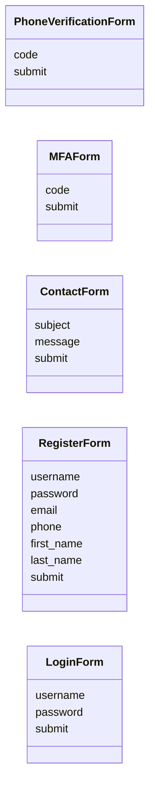
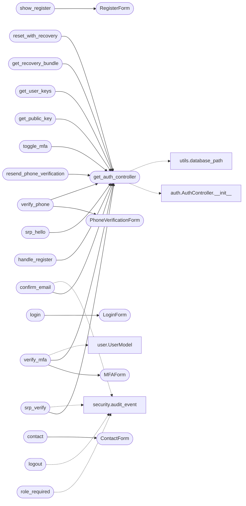

# `views.auth`

> Source: [views/auth.py:1](../../views/auth.py#L1) | language `py` | coverage 46.2% | [API index](../index.md)

Authentication and account-management views.

Routes:

- ``GET  /register``            : render the registration form
- ``POST /register``            : create a new account from a zero-knowledge payload
- ``GET  /login``               : render the login form
- ``POST /api/srp/hello``       : SRP-6a step 1, returns salt and server challenge B
- ``POST /api/srp/verify``      : SRP-6a step 2, returns server proof M2 and starts a session
- ``GET  /logout``              : clear the session
- ``GET  /confirm/<token>``     : mark an email as verified
- ``GET/POST /verify_phone``    : enter the phone verification code
- ``GET/POST /verify_mfa``      : enter the MFA code
- ``POST /toggle_mfa``          : enable or disable MFA for the current user
- ``GET  /contact``             : render and accept the contact form
- ``GET  /api/auth/pubkey``     : return a user's hybrid public key
- ``GET  /api/auth/user-keys``  : return the current user's keying material
- ``GET  /api/csrf-token``      : issue the CSRF token for SPA use

Every state-changing JSON route is decorated with
[`utils.security.json_csrf_protect`](utils.security.py.md#json_csrf_protect) so a cross-origin request
without the matching CSRF token is rejected with HTTP 403 and audited.

## Contents

- **Classes:** [`PhoneVerificationForm`](#phoneverificationform), [`MFAForm`](#mfaform), [`ContactForm`](#contactform), [`RegisterForm`](#registerform), [`LoginForm`](#loginform)
- **Functions:** [`role_required`](#role_required), [`get_auth_controller`](#get_auth_controller), [`show_register`](#show_register), [`handle_register`](#handle_register), [`login`](#login), [`recover`](#recover), [`srp_hello`](#srp_hello), [`srp_verify`](#srp_verify), [`logout`](#logout), [`confirm_email`](#confirm_email), [`verify_phone`](#verify_phone), [`resend_phone_verification`](#resend_phone_verification), [`verify_mfa`](#verify_mfa), [`toggle_mfa`](#toggle_mfa), [`contact`](#contact), [`get_public_key`](#get_public_key), [`get_user_keys`](#get_user_keys), [`get_recovery_bundle`](#get_recovery_bundle), [`reset_with_recovery`](#reset_with_recovery), [`get_csrf_token`](#get_csrf_token)
- **Constants:** [`USER_KEYS_BASE_DIR`](#user_keys_base_dir), [`USER_KEYS_BASE_DIR`](#user_keys_base_dir), [`VALID_ROLES`](#valid_roles)

## Type Diagram



## Call Graph

Solid arrows stay in this module, dashed arrows leave it.



## Classes

<a id="phoneverificationform"></a>

### `PhoneVerificationForm`

`class` | [views/auth.py:98](../../views/auth.py#L98)

```python
class PhoneVerificationForm(FlaskForm)
```

Bases: `FlaskForm`

**Attributes**

| Name | Type | Default | Description |
|---|---|---|---|
| [`code`](#phoneverificationform-code) |  | `StringField('Verification Code', validators=[DataRequired()])` |  |
| [`submit`](#phoneverificationform-submit) |  | `SubmitField('Verify')` |  |

---

<a id="mfaform"></a>

### `MFAForm`

`class` | [views/auth.py:103](../../views/auth.py#L103)

```python
class MFAForm(FlaskForm)
```

Bases: `FlaskForm`

**Attributes**

| Name | Type | Default | Description |
|---|---|---|---|
| [`code`](#mfaform-code) |  | `StringField('MFA Code', validators=[DataRequired()])` |  |
| [`submit`](#mfaform-submit) |  | `SubmitField('Verify')` |  |

---

<a id="contactform"></a>

### `ContactForm`

`class` | [views/auth.py:108](../../views/auth.py#L108)

```python
class ContactForm(FlaskForm)
```

Bases: `FlaskForm`

**Attributes**

| Name | Type | Default | Description |
|---|---|---|---|
| [`subject`](#contactform-subject) |  | `StringField('Subject', validators=[DataRequired()])` |  |
| [`message`](#contactform-message) |  | `TextAreaField('Message', validators=[DataRequired()])` |  |
| [`submit`](#contactform-submit) |  | `SubmitField('Send')` |  |

---

<a id="registerform"></a>

### `RegisterForm`

`class` | [views/auth.py:114](../../views/auth.py#L114)

```python
class RegisterForm(FlaskForm)
```

Bases: `FlaskForm`

**Attributes**

| Name | Type | Default | Description |
|---|---|---|---|
| [`username`](#registerform-username) |  | `StringField('Username', validators=[DataRequired()])` |  |
| [`password`](#registerform-password) |  | `PasswordField('Password', validators=[DataRequired()])` |  |
| [`email`](#registerform-email) |  | `StringField('Email', validators=[DataRequired()])` |  |
| [`phone`](#registerform-phone) |  | `StringField('Telephone', validators=[DataRequired()])` |  |
| [`first_name`](#registerform-first_name) |  | `StringField('Name', validators=[DataRequired()])` |  |
| [`last_name`](#registerform-last_name) |  | `StringField('Last name', validators=[DataRequired()])` |  |
| [`submit`](#registerform-submit) |  | `SubmitField('Sign up')` |  |

---

<a id="loginform"></a>

### `LoginForm`

`class` | [views/auth.py:124](../../views/auth.py#L124)

```python
class LoginForm(FlaskForm)
```

Bases: `FlaskForm`

**Attributes**

| Name | Type | Default | Description |
|---|---|---|---|
| [`username`](#loginform-username) |  | `StringField('Username', validators=[DataRequired()])` |  |
| [`password`](#loginform-password) |  | `PasswordField('Password', validators=[DataRequired()])` |  |
| [`submit`](#loginform-submit) |  | `SubmitField('Sign in')` |  |

---

## Functions

<a id="role_required"></a>

### `role_required`

`function` | [views/auth.py:71](../../views/auth.py#L71)

```python
def role_required(*roles: str)
```

Restrict a route to authenticated users holding one of the given roles.

The check is an intersection of `[`VALID_ROLES`](#valid_roles)` and the caller-
supplied roles so a typo in a future route (e.g. ``role_required("user")``)
cannot accidentally grant access because the role never existed.

**Parameters**

| Name | Type | Default | Description |
|---|---|---|---|
| `*roles` | `str` |  |  |

**Raises**

- `ValueError`: (raised in the body, not documented)

*Calls:* [`audit_event`](utils.security.py.md#audit_event)

---

<a id="get_auth_controller"></a>

### `get_auth_controller`

`function` | [views/auth.py:132](../../views/auth.py#L132)

```python
def get_auth_controller() -> AuthController
```

**Returns:** `AuthController`

*Calls:* [`AuthController.__init__`](controllers.auth.py.md#authcontroller-__init__), [`database_path`](utils.utils.py.md#database_path)

*Called by:* [`confirm_email`](#confirm_email), [`get_public_key`](#get_public_key), [`get_recovery_bundle`](#get_recovery_bundle), [`get_user_keys`](#get_user_keys), [`handle_register`](#handle_register), [`resend_phone_verification`](#resend_phone_verification), [`reset_with_recovery`](#reset_with_recovery), [`srp_hello`](#srp_hello), [`srp_verify`](#srp_verify), [`toggle_mfa`](#toggle_mfa), [`verify_mfa`](#verify_mfa), [`verify_phone`](#verify_phone)

---

<a id="show_register"></a>

### `show_register`

`function` | [views/auth.py:143](../../views/auth.py#L143)

Decorators: `@auth_bp.route('/register', methods=['GET'])`

```python
def show_register()
```

*Calls:* [`RegisterForm`](#registerform)

---

<a id="handle_register"></a>

### `handle_register`

`function` | [views/auth.py:150](../../views/auth.py#L150)

Decorators: `@auth_bp.route('/register', methods=['POST'])`, `@limiter.limit('5 per minute')`

```python
def handle_register()
```

*Calls:* [`get_auth_controller`](#get_auth_controller)

---

<a id="login"></a>

### `login`

`function` | [views/auth.py:234](../../views/auth.py#L234)

Decorators: `@auth_bp.route('/login', methods=['GET'])`

```python
def login()
```

*Calls:* [`LoginForm`](#loginform)

---

<a id="recover"></a>

### `recover`

`function` | [views/auth.py:242](../../views/auth.py#L242)

Decorators: `@auth_bp.route('/recover', methods=['GET'])`

```python
def recover()
```

Render the QV-RECOVERY-1 account-recovery page.

Available to anonymous visitors: a forgotten password means the
visitor cannot authenticate, by definition.

---

<a id="srp_hello"></a>

### `srp_hello`

`function` | [views/auth.py:278](../../views/auth.py#L278)

Decorators: `@auth_bp.route('/api/srp/hello', methods=['POST'])`, `@limiter.limit('10 per minute;20 per hour', key_func=_srp_key)`, `@json_csrf_protect`

```python
def srp_hello()
```

First SRP-6a step: receive the client public value A, return salt and B.

*Calls:* [`get_auth_controller`](#get_auth_controller)

---

<a id="srp_verify"></a>

### `srp_verify`

`function` | [views/auth.py:299](../../views/auth.py#L299)

Decorators: `@auth_bp.route('/api/srp/verify', methods=['POST'])`, `@limiter.limit('10 per minute;20 per hour', key_func=_srp_key)`, `@json_csrf_protect`

```python
def srp_verify()
```

Second SRP-6a step: verify the client proof M1 and return server proof M2.

*Calls:* [`audit_event`](utils.security.py.md#audit_event), [`get_auth_controller`](#get_auth_controller)

---

<a id="logout"></a>

### `logout`

`function` | [views/auth.py:337](../../views/auth.py#L337)

Decorators: `@auth_bp.route('/logout')`, `@login_required`

```python
def logout()
```

*Calls:* [`audit_event`](utils.security.py.md#audit_event)

---

<a id="confirm_email"></a>

### `confirm_email`

`function` | [views/auth.py:344](../../views/auth.py#L344)

Decorators: `@auth_bp.route('/confirm/<token>', methods=['GET'])`

```python
def confirm_email(token)
```

**Parameters**

| Name | Type | Default | Description |
|---|---|---|---|
| `token` |  |  |  |

*Calls:* [`audit_event`](utils.security.py.md#audit_event), [`get_auth_controller`](#get_auth_controller)

---

<a id="verify_phone"></a>

### `verify_phone`

`function` | [views/auth.py:367](../../views/auth.py#L367)

Decorators: `@auth_bp.route('/verify_phone', methods=['GET', 'POST'])`, `@limiter.limit('5 per minute')`

```python
def verify_phone()
```

*Calls:* [`PhoneVerificationForm`](#phoneverificationform), [`get_auth_controller`](#get_auth_controller)

---

<a id="resend_phone_verification"></a>

### `resend_phone_verification`

`function` | [views/auth.py:384](../../views/auth.py#L384)

Decorators: `@auth_bp.route('/resend_phone_verification', methods=['POST'])`, `@limiter.limit('3 per minute')`

```python
def resend_phone_verification()
```

Re-send the phone verification code for an account.

The username is supplied as a query parameter by the verify-phone
template's resend form. The form carries the CSRF token, so the
app-wide CSRFProtect guard applies. The handler never reveals whether
the account exists: it always redirects back with a neutral message.

*Calls:* [`get_auth_controller`](#get_auth_controller)

---

<a id="verify_mfa"></a>

### `verify_mfa`

`function` | [views/auth.py:407](../../views/auth.py#L407)

Decorators: `@auth_bp.route('/verify_mfa', methods=['GET', 'POST'])`, `@limiter.limit('5 per minute')`

```python
def verify_mfa()
```

*Calls:* [`UserModel`](models.user.py.md#usermodel), [`MFAForm`](#mfaform), [`get_auth_controller`](#get_auth_controller)

---

<a id="toggle_mfa"></a>

### `toggle_mfa`

`function` | [views/auth.py:429](../../views/auth.py#L429)

Decorators: `@auth_bp.route('/toggle_mfa', methods=['POST'])`, `@login_required`, `@limiter.limit('5 per minute')`

```python
def toggle_mfa()
```

*Calls:* [`get_auth_controller`](#get_auth_controller)

---

<a id="contact"></a>

### `contact`

`function` | [views/auth.py:454](../../views/auth.py#L454)

Decorators: `@auth_bp.route('/contact', methods=['GET', 'POST'])`, `@limiter.limit('10 per minute')`

```python
def contact()
```

Render the contact form and persist a message from the current user.

The page is only meaningful for authenticated users: messages are tied to
a `[`user_id`](models.contact.py.md#contactmodel-user_id)` foreign key in ``contacts``. Anonymous visitors are sent
to the login page so they can sign in (or register) before contacting.

*Calls:* [`ContactController.__init__`](controllers.contact.py.md#contactcontroller-__init__), [`ContactController.create_contact`](controllers.contact.py.md#contactcontroller-create_contact), [`audit_event`](utils.security.py.md#audit_event), [`database_path`](utils.utils.py.md#database_path), [`ContactForm`](#contactform)

---

<a id="get_public_key"></a>

### `get_public_key`

`function` | [views/auth.py:485](../../views/auth.py#L485)

Decorators: `@auth_bp.route('/api/auth/pubkey', methods=['GET'])`, `@limiter.limit('10 per minute')`

```python
def get_public_key()
```

Return a user's hybrid public key so the browser can wrap data to them.

*Calls:* [`get_auth_controller`](#get_auth_controller)

---

<a id="get_user_keys"></a>

### `get_user_keys`

`function` | [views/auth.py:503](../../views/auth.py#L503)

Decorators: `@auth_bp.route('/api/auth/user-keys', methods=['GET'])`, `@login_required`, `@limiter.limit('10 per minute')`

```python
def get_user_keys()
```

Provide the keys a user needs to decrypt their data client-side.

The caller must already be authenticated and asking for their own
material; the route refuses to return anyone else's keying data.

*Calls:* [`audit_event`](utils.security.py.md#audit_event), [`get_auth_controller`](#get_auth_controller)

---

<a id="get_recovery_bundle"></a>

### `get_recovery_bundle`

`function` | [views/auth.py:534](../../views/auth.py#L534)

Decorators: `@auth_bp.route('/api/auth/recovery-bundle', methods=['GET'])`, `@limiter.limit('10 per minute', key_func=_recovery_key)`

```python
def get_recovery_bundle()
```

Return the QV-RECOVERY-1 bundle for a username, if one was generated.

No authentication is required: a forgotten password by definition
means the caller cannot log in. The returned values are opaque to
anyone without the recovery code: ``encrypted_private_key_recovery``
is AES-256-GCM ciphertext keyed by a PBKDF2 derivation of the
recovery code, so exposing it to an unauthenticated caller does not
weaken the zero-knowledge guarantees.

*Calls:* [`get_auth_controller`](#get_auth_controller)

---

<a id="reset_with_recovery"></a>

### `reset_with_recovery`

`function` | [views/auth.py:559](../../views/auth.py#L559)

Decorators: `@auth_bp.route('/api/auth/reset-with-recovery', methods=['POST'])`, `@limiter.limit('5 per hour', key_func=_recovery_key)`, `@json_csrf_protect`

```python
def reset_with_recovery()
```

Reset SRP credentials and the password-wrapped private key via QV-RECOVERY-1.

The browser has already decrypted ``encrypted_private_key_recovery``
using a key derived from the recovery code and reconstructed the
account's public key from the recovered private key blob (see
`[`derivePublicKeyFromPrivateBlob`](quantumvault.static.js.qv-crypto.js.md#derivepublickeyfromprivateblob)` in ``static/js/qv-crypto.js``).
That reconstruction is supplied as ``public_key_proof``: AES-GCM
authentication means a wrong recovery code fails to decrypt at all,
so only a caller who supplied the correct code can produce a
``public_key_proof`` that matches the stored ``public_key``
byte-for-byte. The underlying keypair and ``public_key`` are not
changed; only the SRP verifier and the password-wrapping of the
existing private key blob are replaced.

*Calls:* [`mail_is_configured`](utils.mailer.py.md#mail_is_configured), [`send_transactional_email`](utils.mailer.py.md#send_transactional_email), [`audit_event`](utils.security.py.md#audit_event), [`get_auth_controller`](#get_auth_controller)

---

<a id="get_csrf_token"></a>

### `get_csrf_token`

`function` | [views/auth.py:619](../../views/auth.py#L619)

Decorators: `@auth_bp.route('/api/csrf-token', methods=['GET', 'OPTIONS'])`

```python
def get_csrf_token()
```

Issue the CSRF token used by the SPA for state-changing JSON calls.

---

## Constants

<a id="user_keys_base_dir"></a>

### `USER_KEYS_BASE_DIR`

`constant` | [views/auth.py:63](../../views/auth.py#L63)

```python
USER_KEYS_BASE_DIR = os.path.abspath(USER_KEYS_BASE_DIR)
```

---

<a id="user_keys_base_dir"></a>

### `USER_KEYS_BASE_DIR`

`constant` | [views/auth.py:63](../../views/auth.py#L63)

```python
USER_KEYS_BASE_DIR = os.path.abspath(USER_KEYS_BASE_DIR)
```

---

<a id="valid_roles"></a>

### `VALID_ROLES`

`constant` | [views/auth.py:68](../../views/auth.py#L68)

```python
VALID_ROLES = ('free', 'bronze', 'silver', 'gold', 'admin', 'superadmin')
```

---
