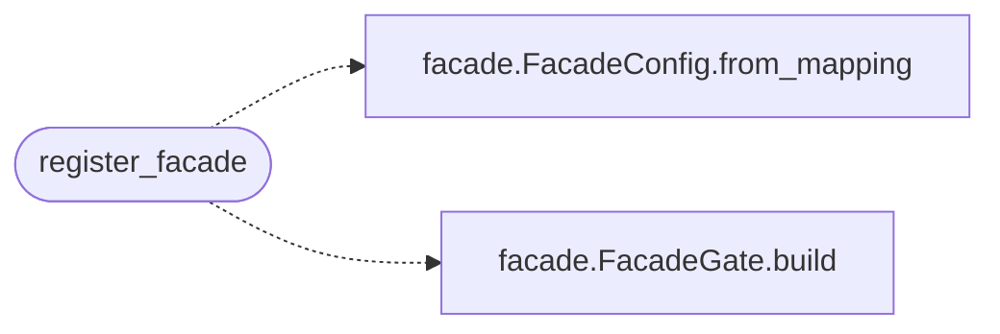

# `views.facade`

> Source: [views/facade.py:1](../../views/facade.py#L1) | language `py` | coverage 100.0% | [API index](../index.md)

Cover facade HTTP integration: before-request cover and the gate endpoint.

When the facade is configured, anonymous visitors to the protected pages
see a configurable cover instead of the application, and ``POST /gate``
accepts the secret phrase. A correct phrase stores the signed ticket in
the session and redirects to the ordinary login page; a miss keeps the
cover. Nothing in the response distinguishes a miss from a hit to an
unauthenticated observer.

## Contents

- **Functions:** [`register_facade`](#register_facade)
- **Constants:** [`GATE_TICKET_KEY`](#gate_ticket_key), [`GATE_MODE_KEY`](#gate_mode_key), [`GATE_ENDPOINT`](#gate_endpoint)

## Call Graph

Solid arrows stay in this module, dashed arrows leave it.



## Functions

<a id="register_facade"></a>

### `register_facade`

`function` | [views/facade.py:33](../../views/facade.py#L33)

```python
def register_facade(app: Flask) -> Optional[FacadeGate]
```

Install the facade on `[`app`](app.py.md)` when it is enabled and configured.

**Parameters**

| Name | Type | Default | Description |
|---|---|---|---|
| `app` | `Flask` |  |  |

**Returns:** `Optional[FacadeGate]`

*Calls:* [`FacadeConfig.from_mapping`](controllers.facade.py.md#facadeconfig-from_mapping), [`FacadeGate.build`](controllers.facade.py.md#facadegate-build)

*Called by:* [`create_app`](app_factory.py.md#create_app)

---

## Constants

<a id="gate_ticket_key"></a>

### `GATE_TICKET_KEY`

`constant` | [views/facade.py:28](../../views/facade.py#L28)

```python
GATE_TICKET_KEY = 'qv_gate_ticket'
```

---

<a id="gate_mode_key"></a>

### `GATE_MODE_KEY`

`constant` | [views/facade.py:29](../../views/facade.py#L29)

```python
GATE_MODE_KEY = 'qv_gate_mode'
```

---

<a id="gate_endpoint"></a>

### `GATE_ENDPOINT`

`constant` | [views/facade.py:30](../../views/facade.py#L30)

```python
GATE_ENDPOINT = '/gate'
```

---
