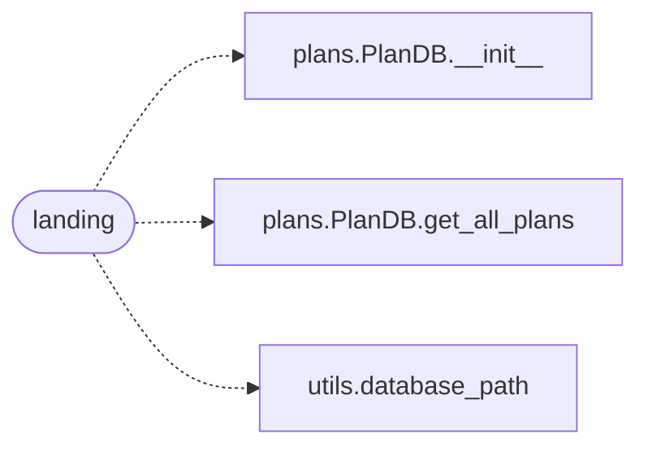

# `views.faq`

> Source: [views/faq.py:1](../../views/faq.py#L1) | language `py` | coverage 66.7% | [API index](../index.md)

## Contents

- **Functions:** [`faq`](#faq), [`landing`](#landing)

## Call Graph

Solid arrows stay in this module, dashed arrows leave it.



## Functions

<a id="faq"></a>

### `faq`

`function` | [views/faq.py:7](../../views/faq.py#L7)

Decorators: `@faq_bp.route('/faq')`

```python
def faq()
```

Render the About page.

---

<a id="landing"></a>

### `landing`

`function` | [views/faq.py:12](../../views/faq.py#L12)

Decorators: `@faq_bp.route('/landing')`

```python
def landing()
```

Render the About page.

*Calls:* [`PlanDB.__init__`](models.plans.py.md#plandb-__init__), [`PlanDB.get_all_plans`](models.plans.py.md#plandb-get_all_plans), [`database_path`](utils.utils.py.md#database_path)

---
