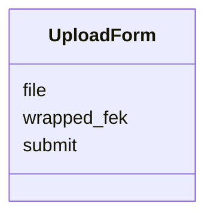
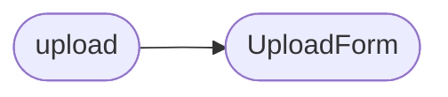

# `views.file`

> Source: [views/file.py:1](../../views/file.py#L1) | language `py` | coverage 75.0% | [API index](../index.md)

## Contents

- **Classes:** [`UploadForm`](#uploadform)
- **Functions:** [`upload`](#upload), [`download`](#download)

## Type Diagram



## Call Graph

Solid arrows stay in this module, dashed arrows leave it.



## Classes

<a id="uploadform"></a>

### `UploadForm`

`class` | [views/file.py:15](../../views/file.py#L15)

```python
class UploadForm(FlaskForm)
```

Bases: `FlaskForm`

Formulario para la subida de archivos cifrados.

**Attributes**

| Name | Type | Default | Description |
|---|---|---|---|
| [`file`](#uploadform-file) |  | `FileField('Archivo Cifrado', validators=[DataRequired()])` |  |
| [`wrapped_fek`](#uploadform-wrapped_fek) |  | `HiddenField('Clave de Archivo Envuelta', validators=[DataRequired()])` |  |
| [`submit`](#uploadform-submit) |  | `SubmitField('Subir Archivo Seguro')` |  |

---

## Functions

<a id="upload"></a>

### `upload`

`function` | [views/file.py:25](../../views/file.py#L25)

Decorators: `@file_bp.route('/upload', methods=['GET', 'POST'])`, `@login_required`, `@role_required('free', 'bronze', 'silver', 'gold', 'admin', 'superadmin')`, `@limiter.limit('20 per minute')`

```python
def upload()
```

Maneja la subida de archivos cifrados desde el cliente.

*Calls:* [`UploadForm`](#uploadform)

---

<a id="download"></a>

### `download`

`function` | [views/file.py:56](../../views/file.py#L56)

Decorators: `@file_bp.route('/download/<path:filename>')`, `@login_required`, `@role_required('free', 'bronze', 'silver', 'gold', 'admin', 'superadmin')`, `@limiter.limit('20 per minute')`

```python
def download(filename: str)
```

Provide the encrypted file and its key for client-side decryption.

The filename comes from the URL and is used to look up a key under
the authenticated user's S3 prefix. The server never lets the
filename escape that prefix: any ``/``, ``\``, ``..`` or control
character is rejected before the S3 key is constructed, so a
crafted ``filename`` like ``../admin/files/x`` cannot exfiltrate
another user's ciphertext.

**Parameters**

| Name | Type | Default | Description |
|---|---|---|---|
| `filename` | `str` |  |  |

---
