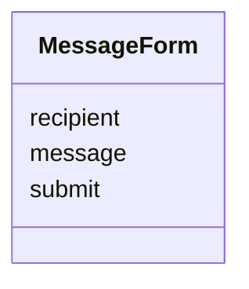
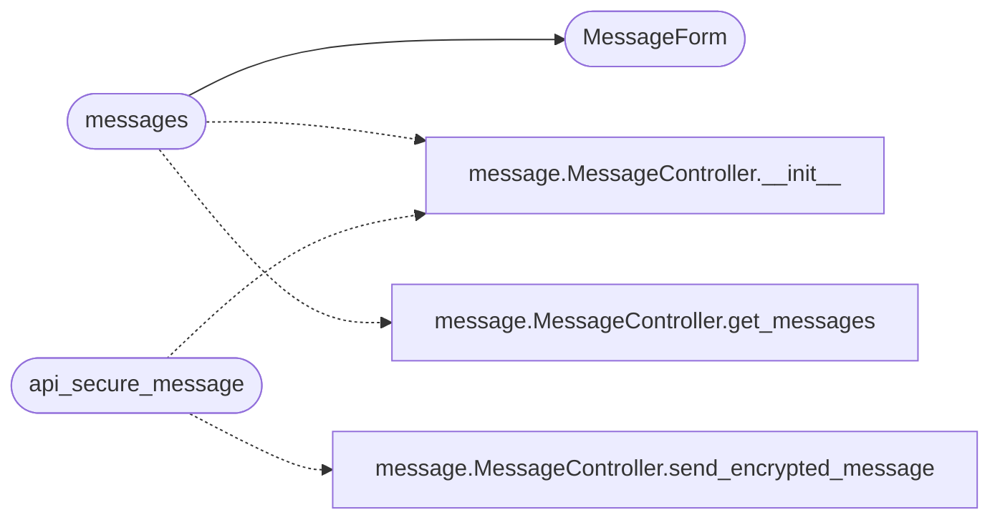

# `views.message`

> Source: [views/message.py:1](../../views/message.py#L1) | language `py` | coverage 75.0% | [API index](../index.md)

## Contents

- **Classes:** [`MessageForm`](#messageform)
- **Functions:** [`messages`](#messages), [`api_secure_message`](#api_secure_message)
- **Constants:** [`USER_KEYS_BASE_DIR`](#user_keys_base_dir)

## Type Diagram



## Call Graph

Solid arrows stay in this module, dashed arrows leave it.



## Classes

<a id="messageform"></a>

### `MessageForm`

`class` | [views/message.py:19](../../views/message.py#L19)

```python
class MessageForm(FlaskForm)
```

Bases: `FlaskForm`

Form for sending messages.

**Attributes**

| Name | Type | Default | Description |
|---|---|---|---|
| [`recipient`](#messageform-recipient) |  | `StringField('Recipient', validators=[DataRequired()])` |  |
| [`message`](#messageform-message) |  | `TextAreaField('Message', validators=[DataRequired()])` |  |
| [`submit`](#messageform-submit) |  | `SubmitField('Send')` |  |

---

## Functions

<a id="messages"></a>

### `messages`

`function` | [views/message.py:29](../../views/message.py#L29)

Decorators: `@message_bp.route('/messages', methods=['GET', 'POST'])`, `@login_required`, `@role_required('free', 'bronze', 'silver', 'gold', 'admin', 'superadmin')`, `@limiter.limit('50 per minute')`

```python
def messages()
```

Render the messages page; the browser handles all crypto.

Sending happens via the JSON API in /api/secure_message below.

*Calls:* [`MessageController.__init__`](controllers.message.py.md#messagecontroller-__init__), [`MessageController.get_messages`](controllers.message.py.md#messagecontroller-get_messages), [`MessageForm`](#messageform)

---

<a id="api_secure_message"></a>

### `api_secure_message`

`function` | [views/message.py:49](../../views/message.py#L49)

Decorators: `@message_bp.route('/api/secure_message', methods=['POST'])`, `@login_required`, `@role_required('free', 'bronze', 'silver', 'gold', 'admin', 'superadmin')`, `@limiter.limit('50 per minute')`

```python
def api_secure_message()
```

Accept an opaque end-to-end encrypted message envelope.

The browser already generated the CEK, encrypted the message body with
AES-256-GCM, and wrapped the CEK to the recipient's and sender's
hybrid public keys. The server stores only the opaque material.

*Calls:* [`MessageController.__init__`](controllers.message.py.md#messagecontroller-__init__), [`MessageController.send_encrypted_message`](controllers.message.py.md#messagecontroller-send_encrypted_message)

---

## Constants

<a id="user_keys_base_dir"></a>

### `USER_KEYS_BASE_DIR`

`constant` | [views/message.py:15](../../views/message.py#L15)

```python
USER_KEYS_BASE_DIR = os.path.abspath('users')
```

---
