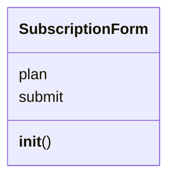
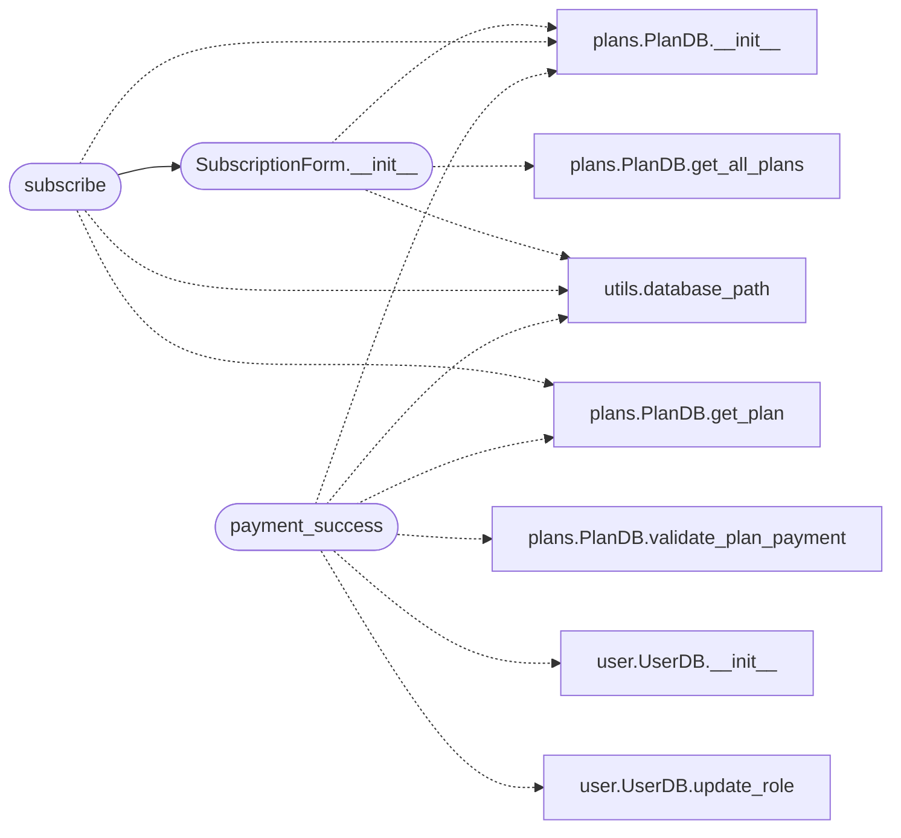

# `views.subscription`

> Source: [views/subscription.py:1](../../views/subscription.py#L1) | language `py` | coverage 60.0% | [API index](../index.md)

## Contents

- **Classes:** [`SubscriptionForm`](#subscriptionform)
- **Functions:** [`subscribe`](#subscribe), [`payment_success`](#payment_success)

## Type Diagram



## Call Graph

Solid arrows stay in this module, dashed arrows leave it.



## Classes

<a id="subscriptionform"></a>

### `SubscriptionForm`

`class` | [views/subscription.py:24](../../views/subscription.py#L24)

```python
class SubscriptionForm(FlaskForm)
```

Bases: `FlaskForm`

Formulario para seleccionar un plan de suscripción.

**Attributes**

| Name | Type | Default | Description |
|---|---|---|---|
| [`plan`](#subscriptionform-plan) |  | `SelectField('Subscription Plan', validators=[DataRequired()])` |  |
| [`submit`](#subscriptionform-submit) |  | `SubmitField('Subscribe')` |  |

**Members**

| Member | Kind | Summary |
|---|---|---|
| [`__init__`](#subscriptionform-__init__) | constructor |  |

<a id="subscriptionform-__init__"></a>

#### `SubscriptionForm.__init__`

`constructor` | [views/subscription.py:26](../../views/subscription.py#L26)

```python
def __init__(self, *args, **kwargs)
```

**Parameters**

| Name | Type | Default | Description |
|---|---|---|---|
| `*args` |  |  |  |
| `**kwargs` |  |  |  |

*Calls:* [`PlanDB.__init__`](models.plans.py.md#plandb-__init__), [`PlanDB.get_all_plans`](models.plans.py.md#plandb-get_all_plans), [`database_path`](utils.utils.py.md#database_path)

*Called by:* [`subscribe`](#subscribe)

---

## Functions

<a id="subscribe"></a>

### `subscribe`

`function` | [views/subscription.py:37](../../views/subscription.py#L37)

Decorators: `@subscription_bp.route('/subscribe', methods=['GET', 'POST'])`, `@limiter.limit('10 per minute')`

```python
def subscribe()
```

Maneja la selección de planes y el proceso de pago.

*Calls:* [`PlanDB.__init__`](models.plans.py.md#plandb-__init__), [`PlanDB.get_plan`](models.plans.py.md#plandb-get_plan), [`database_path`](utils.utils.py.md#database_path), [`SubscriptionForm.__init__`](#subscriptionform-__init__)

---

<a id="payment_success"></a>

### `payment_success`

`function` | [views/subscription.py:86](../../views/subscription.py#L86)

Decorators: `@subscription_bp.route('/payment/success')`, `@login_required`, `@limiter.limit('10 per minute')`

```python
def payment_success()
```

Maneja el éxito del pago y actualiza el plan del usuario.

*Calls:* [`PlanDB.__init__`](models.plans.py.md#plandb-__init__), [`PlanDB.get_plan`](models.plans.py.md#plandb-get_plan), [`PlanDB.validate_plan_payment`](models.plans.py.md#plandb-validate_plan_payment), [`UserDB.__init__`](models.user.py.md#userdb-__init__), [`UserDB.update_role`](models.user.py.md#userdb-update_role), [`database_path`](utils.utils.py.md#database_path)

---
