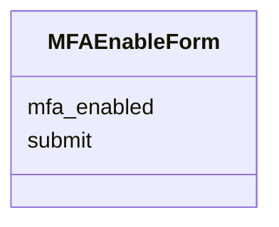
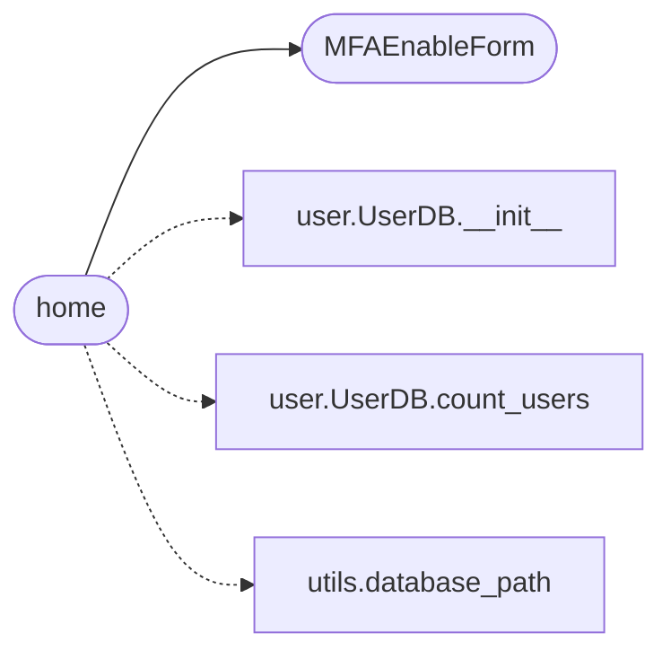

# `views.views`

> Source: [views/views.py:1](../../views/views.py#L1) | language `py` | coverage 66.7% | [API index](../index.md)

Top-level non-API views: home page, account preferences, etc.

## Contents

- **Classes:** [`MFAEnableForm`](#mfaenableform)
- **Functions:** [`home`](#home)

## Type Diagram



## Call Graph

Solid arrows stay in this module, dashed arrows leave it.



## Classes

<a id="mfaenableform"></a>

### `MFAEnableForm`

`class` | [views/views.py:15](../../views/views.py#L15)

```python
class MFAEnableForm(FlaskForm)
```

Bases: `FlaskForm`

**Attributes**

| Name | Type | Default | Description |
|---|---|---|---|
| [`mfa_enabled`](#mfaenableform-mfa_enabled) |  | `BooleanField('Enable Two-Factor Authentication (2FA)')` |  |
| [`submit`](#mfaenableform-submit) |  | `SubmitField('Save')` |  |

---

## Functions

<a id="home"></a>

### `home`

`function` | [views/views.py:21](../../views/views.py#L21)

Decorators: `@views_bp.route('/')`

```python
def home()
```

Render the landing/home page.

The total user count is fetched with ``SELECT COUNT(*)`` directly
rather than loading every row into memory, so the cost is O(1)
regardless of the user table size.

*Calls:* [`UserDB.__init__`](models.user.py.md#userdb-__init__), [`UserDB.count_users`](models.user.py.md#userdb-count_users), [`database_path`](utils.utils.py.md#database_path), [`MFAEnableForm`](#mfaenableform)

---
