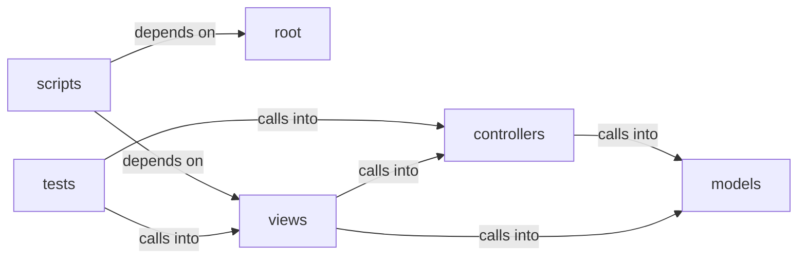

# controllers

controllers groups 8 files (py) around ContactModel, ContactDB, __init__, _init_db, create_contact. Local development entry point.

## controllers (4.1)

controllers groups 2 files (py) around ContactController, __init__, create_contact, get_user_contacts, ChannelMode. ContactController: Handles logic related to contact messages.

## models (4.2)

models groups 2 files (py) around ContactModel, ContactDB, __init__, _init_db, create_contact. ContactModel: Pydantic model for a contact message.

## root (4.3)

root groups 1 files (py) around main, _is_production_like. Local development entry point.

## scripts (4.4)

scripts groups 1 files (py) around _FakeUser, __init__, is_authenticated, is_active, is_anonymous. Bloque 1 test: superadmin_edit_user endpoint.

## tests (4.5)

tests groups 1 files (py) around test_config_defaults_to_disabled_without_binaries, test_config_reads_mode_and_port_from_env, test_config_rejects_out_of_range_port, test_url_validators_accept_only_expected_shapes, test_manager_starts_hybrid_with_injected_launcher. Behaviour contracts for QV-TUNNEL disposable secure channels.

## views (4.6)

views groups 1 files (py) around _audit_action, _channel_manager, _s3_reachable, _read_log_tail, _channel_diagnostics. UserEditForm: Form for editing user details.

**Files**:

- app.py
- controllers/contact.py
- controllers/secure_channel.py
- models/contact.py
- models/superadmin_audit.py
- scripts/test_bloque1.py
- tests/test_secure_channel.py
- views/admin.py
