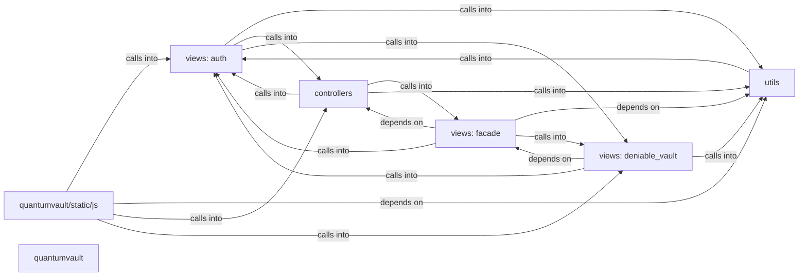

## Details

Static architecture map of 90 files (go, js, py, sh) in 7 components: views: auth, views: facade, utils, quantumvault/static/js, controllers, views: deniable_vault, quantumvault. Structure is extracted statically without LLM calls; component prose may be enriched locally.

### views: auth (1)

views: auth groups 16 files (py) around database_path, as_bool, sanitize_path, Payload, Config. Zero-knowledge authentication controller for QuantumVault.

**Related Classes/Methods**:

- <a href="../utils/utils.py#L12-L28">utils/utils.py::database_path</a>
- <a href="../utils/utils.py#L29-L48">utils/utils.py::as_bool</a>
- <a href="../utils/utils.py#L49-L79">utils/utils.py::sanitize_path</a>
- <a href="../utils/utils.py#L80-L102">utils/utils.py::Payload</a>
- <a href="../utils/utils.py#L103-L144">utils/utils.py::Config</a>
- <a href="../utils/utils.py#L145-L164">utils/utils.py::__init__</a>
- <a href="../utils/utils.py#L165-L167">utils/utils.py::__getitem__</a>
- <a href="../utils/utils.py#L168-L185">utils/utils.py::load_payload</a>

### views: facade (2)

views: facade groups 11 files (py) around _is_production, _build_csp, _build_talisman_kwargs, _configure_secret_key, _configure_session. QV-FACADE-1 cover facade: configuration, gate hashing, tickets, gate control.

**Related Classes/Methods**:

- <a href="../quantumvault/app_factory.py#L71-L81">quantumvault/app_factory.py::_is_production</a>
- <a href="../quantumvault/app_factory.py#L82-L118">quantumvault/app_factory.py::_build_csp</a>
- <a href="../quantumvault/app_factory.py#L119-L159">quantumvault/app_factory.py::_build_talisman_kwargs</a>
- <a href="../quantumvault/app_factory.py#L160-L202">quantumvault/app_factory.py::_configure_secret_key</a>
- <a href="../quantumvault/app_factory.py#L203-L219">quantumvault/app_factory.py::_configure_session</a>
- <a href="../quantumvault/app_factory.py#L220-L236">quantumvault/app_factory.py::_configure_logging</a>
- <a href="../quantumvault/app_factory.py#L237-L415">quantumvault/app_factory.py::create_app</a>
- <a href="../quantumvault/app_factory.py#L416-L444">quantumvault/app_factory.py::load_user</a>

### utils (3)

utils groups 10 files (py) around PaddingError, PaddingConfig, buckets_for, max_plaintext_bytes, _parse_buckets. Encrypted file persistence layer.

**Related Classes/Methods**:

- <a href="../utils/padding.py#L73-L77">utils/padding.py::PaddingError</a>
- <a href="../utils/padding.py#L78-L83">utils/padding.py::PaddingConfig</a>
- <a href="../utils/padding.py#L84-L89">utils/padding.py::buckets_for</a>
- <a href="../utils/padding.py#L90-L94">utils/padding.py::max_plaintext_bytes</a>
- <a href="../utils/padding.py#L95-L108">utils/padding.py::_parse_buckets</a>
- <a href="../utils/padding.py#L109-L127">utils/padding.py::config_from_env</a>
- <a href="../utils/padding.py#L128-L141">utils/padding.py::_cached_bucket_table</a>
- <a href="../utils/padding.py#L142-L148">utils/padding.py::cached_tables</a>

### quantumvault/static/js (4)

quantumvault/static/js groups 9 files (js) around concatBytes, hexToBytes, bytesToHex, bytesToBase64, bytesToBase32. Account settings controller: secure notes (QV-DENIABLE-1).

**Related Classes/Methods**:

- <a href="../quantumvault/static/js/qv-crypto.js#L59-L69">quantumvault/static/js/qv-crypto.js::concatBytes</a>
- <a href="../quantumvault/static/js/qv-crypto.js#L70-L78">quantumvault/static/js/qv-crypto.js::hexToBytes</a>
- <a href="../quantumvault/static/js/qv-crypto.js#L79-L84">quantumvault/static/js/qv-crypto.js::bytesToHex</a>
- <a href="../quantumvault/static/js/qv-crypto.js#L85-L95">quantumvault/static/js/qv-crypto.js::bytesToBase64</a>
- <a href="../quantumvault/static/js/qv-crypto.js#L96-L113">quantumvault/static/js/qv-crypto.js::bytesToBase32</a>
- <a href="../quantumvault/static/js/qv-crypto.js#L114-L120">quantumvault/static/js/qv-crypto.js::base64ToBytes</a>
- <a href="../quantumvault/static/js/qv-crypto.js#L121-L127">quantumvault/static/js/qv-crypto.js::bytesToBigInt</a>
- <a href="../quantumvault/static/js/qv-crypto.js#L128-L137">quantumvault/static/js/qv-crypto.js::i2osp</a>

### controllers (5)

controllers groups 8 files (py) around ContactModel, ContactDB, __init__, _init_db, create_contact. Local development entry point.

**Related Classes/Methods**:

- <a href="../models/contact.py#L8-L25">models/contact.py::ContactModel</a>
- <a href="../models/contact.py#L26-L28">models/contact.py::ContactDB</a>
- <a href="../models/contact.py#L29-L37">models/contact.py::__init__</a>
- <a href="../models/contact.py#L38-L51">models/contact.py::_init_db</a>
- <a href="../models/contact.py#L52-L88">models/contact.py::create_contact</a>
- <a href="../models/contact.py#L89-L114">models/contact.py::get_user_contacts</a>
- <a href="../models/contact.py#L115-L138">models/contact.py::_convert_row_to_dict</a>
- <a href="../models/contact.py#L139-L167">models/contact.py::get_all_contacts</a>

### views: deniable_vault (6)

views: deniable_vault groups 8 files (py) around _get_audit_logger, _correlation_id, audit_event, constant_time_compare, hash_secret. QV-DENIABLE-1 deniable vault: configuration, validation, orchestration.

**Related Classes/Methods**:

- <a href="../utils/security.py#L46-L71">utils/security.py::_get_audit_logger</a>
- <a href="../utils/security.py#L72-L85">utils/security.py::_correlation_id</a>
- <a href="../utils/security.py#L86-L122">utils/security.py::audit_event</a>
- <a href="../utils/security.py#L123-L134">utils/security.py::constant_time_compare</a>
- <a href="../utils/security.py#L135-L155">utils/security.py::hash_secret</a>
- <a href="../utils/security.py#L156-L162">utils/security.py::verify_secret</a>
- <a href="../utils/security.py#L163-L171">utils/security.py::new_one_time_code</a>
- <a href="../utils/security.py#L172-L192">utils/security.py::_extract_csrf_token</a>

### quantumvault (7)

quantumvault groups 2 files (py). QuantumVault application package.
