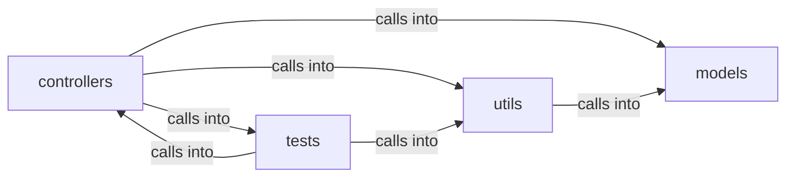

# utils

utils groups 8 files (py) around PaddingError, PaddingConfig, buckets_for, max_plaintext_bytes, _parse_buckets. Encrypted file persistence layer.

## controllers (6.1)

controllers groups 2 files (py) around MessageController, __init__, send_encrypted_message, get_messages, _log_s3_error. Encrypted file persistence layer.

## models (6.2)

models groups 1 files (py) around MessageModel, MessageDB, __init__, save_message, get_messages. Persistence layer for end-to-end encrypted messages.

## tests (6.3)

tests groups 2 files (py) around test_pad_roundtrip_message_sizes, test_pad_roundtrip_file_kind, test_bucket_boundaries, test_pad_output_length_is_bucketed, test_pad_uses_fresh_randomness. Contract tests for fixed-bucket padding (QV-PAD-1) and its enforcement.

## utils (6.4)

utils groups 3 files (py) around PaddingError, PaddingConfig, buckets_for, max_plaintext_bytes, _parse_buckets. Fixed-bucket padding for metadata-size concealment (QV-PAD-1).

**Files**:

- controllers/file.py
- controllers/message.py
- models/message.py
- tests/test_padding.py
- tests/test_srp.py
- utils/__init__.py
- utils/padding.py
- utils/scheduler.py
