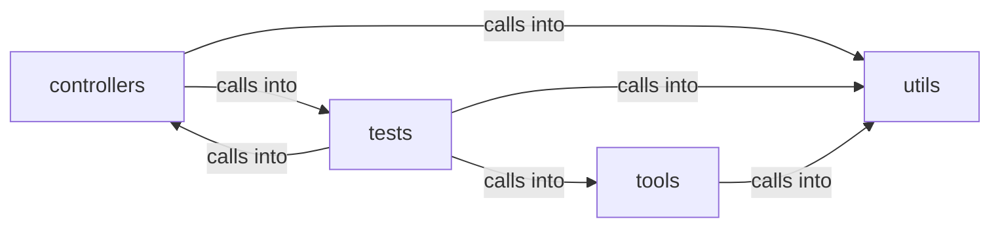

# utils

utils groups 10 files (py) around PaddingError, PaddingConfig, buckets_for, max_plaintext_bytes, _parse_buckets. Encrypted file persistence layer.

## controllers (3.1)

controllers groups 2 files (py) around MessageController, __init__, send_encrypted_message, get_messages, _log_s3_error. Encrypted file persistence layer.

## tests (3.2)

tests groups 3 files (py) around test_compute_sri_format, test_manifest_exists_and_pins_crypto, test_manifest_hashes_match_files, test_template_integrity_resolves_both_forms, test_jinja_global_registered. Contract tests for SRI pins and reproducible builds (QV-SRI-1).

## tools (3.3)

tools groups 2 files (py) around AssetReference, __init__, handle_starttag, _normalize_reference, load_manifest. Generate the SRI manifest for first-party assets and pinned CDN URLs.

## utils (3.4)

utils groups 3 files (py) around PaddingError, PaddingConfig, buckets_for, max_plaintext_bytes, _parse_buckets. Subresource Integrity manifest helpers (QV-SRI-1).

**Files**:

- controllers/file.py
- controllers/message.py
- tests/test_integrity.py
- tests/test_padding.py
- tests/test_srp.py
- tools/generate_sri.py
- tools/verify_build.py
- utils/__init__.py
- utils/integrity.py
- utils/padding.py
