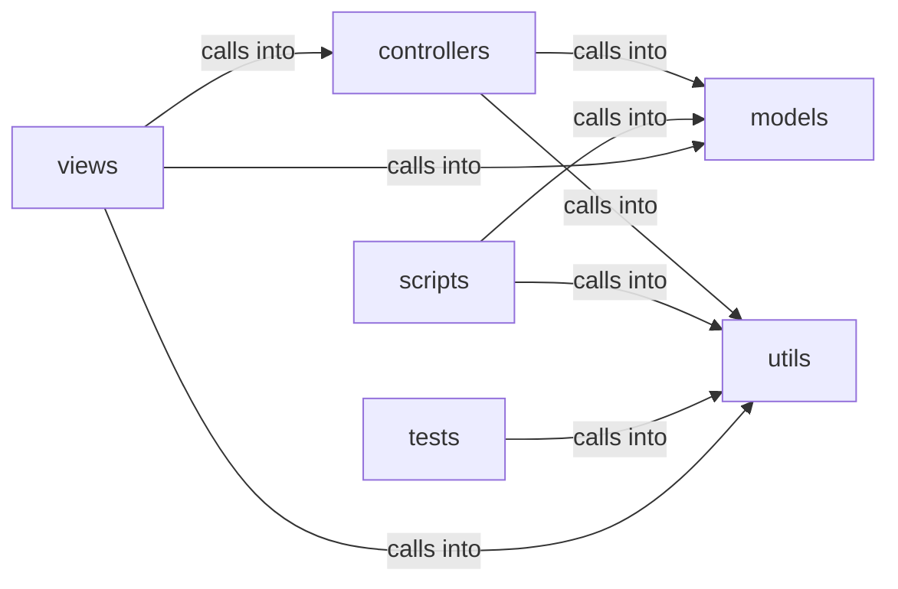

# views: auth

views: auth groups 14 files (py) around database_path, as_bool, sanitize_path, Payload, Config. Zero-knowledge authentication controller for QuantumVault.

## controllers (1.1)

controllers groups 1 files (py) around _now_utc, AuthController, __init__, register, send_confirmation_email. Zero-knowledge authentication controller for QuantumVault.

## models (1.2)

models groups 2 files (py) around UserModel, get_id, is_active, UserDB, __init__. PlanDB: Database operations for subscription plans.

## scripts (1.3)

scripts groups 2 files (py) around _build_mail_app, cmd_test_smtp, cmd_link, cmd_confirm, build_parser. Operator email tooling for QuantumVault.

## tests (1.4)

tests groups 1 files (py) around test_database_path_prefers_the_configured_path, test_database_path_honors_env_outside_a_context, test_database_path_default_outside_a_context. Contract tests for shared utility helpers.

## utils (1.5)

utils groups 2 files (py) around database_path, as_bool, sanitize_path, Payload, Config. Transactional email helpers for QuantumVault.

## views (1.6)

views groups 6 files (py) around role_required, decorator, decorated_function, PhoneVerificationForm, MFAForm. Authentication and account-management views.

**Files**:

- controllers/auth.py
- models/plans.py
- models/user.py
- scripts/email_tool.py
- scripts/makeadmin.py
- tests/test_utils.py
- utils/mailer.py
- utils/utils.py
- views/auth.py
- views/faq.py
- views/file.py
- views/message.py
- views/subscription.py
- views/views.py
